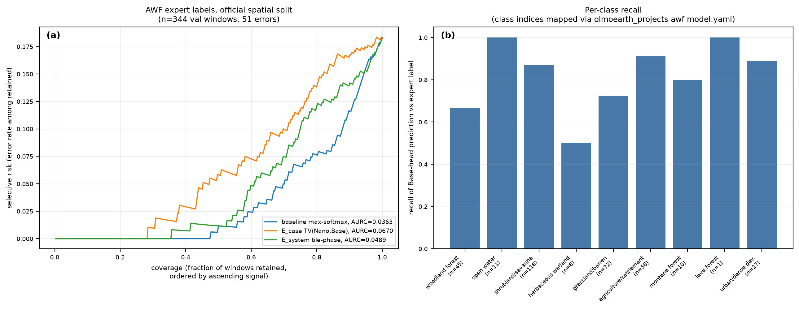
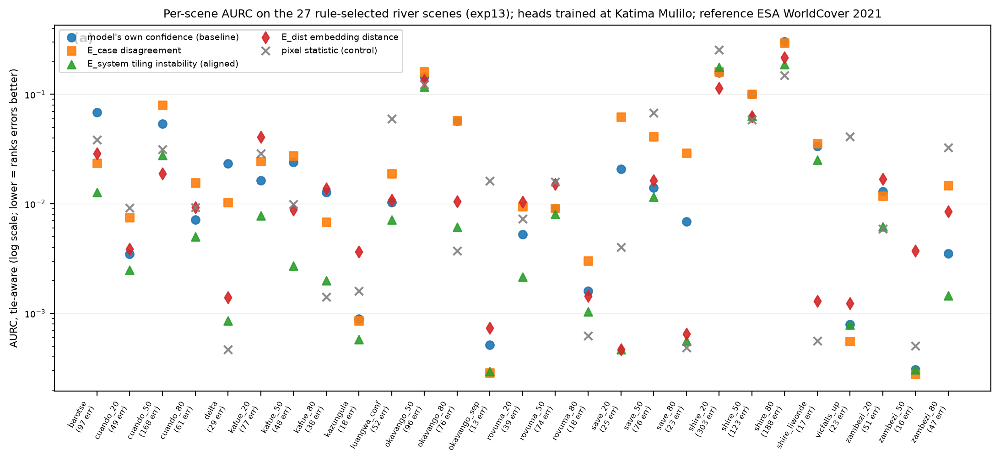

# Cross-signal comparisons

One section per experiment, grouped by what the section is evidence for.
All signals within a section are scored on identical errors with the same
harness. Scoring rules, evidence tiers and status terms are defined in
[../method/protocol.md](../method/protocol.md); per-signal summaries are in
[signals.md](signals.md). Index at [../TECHNIQUES.md](../TECHNIQUES.md).

Superseded runs (exp05, exp09, exp11's statistics) are not reproduced here.
They are in the lab log, [../../exp/NOTES.md](../../exp/NOTES.md).

**Archived experiments.** On 10 October 2026, fourteen experiments were
moved out of the repository's current tree: exp06, exp09, exp10, exp12,
exp22, exp26, exp27, exp39, exp40, exp44, exp53, exp61, exp86 and exp87. No
remaining claim's check, no claim tag of the white paper, no kept script and
no package test reads them (exp11 names exp09's cache only as a fallback).
The white paper reports exp86's and exp87's results and links their archived
files, and two remaining claims list exp10 or exp12 among their experiments
as provenance. Their scripts and outputs are in the [v1.9.0
tree](https://github.com/2imi9/olmoearth_inferenceX/tree/v1.9.0), and the
sections this page gave them are in its [v1.9.0
copy](https://github.com/2imi9/olmoearth_inferenceX/blob/v1.9.0/docs/results/comparisons.md).

---

# 1. Expert labels (authoritative)

These four experiments score signals against human-labelled truth. Where
they conflict with the WorldCover-referenced results in section 2, these
stand.

## Dense flood masks: Sen1Floods11 (exp18)

**Setup.** Sen1Floods11 hand-labelled flood-water masks (public mirror),
64x64 tiles. Head trained on 600 tiles of
the valid split; scored on Bolivia (441 tiles, a geographically held-out
region; 351 with enough errors to score) and on the test split (800 tiles,
482 scored). All signals
computed on one 60x60 crop per tile, tie-aware excess AURC per tile, exact
sign tests. Values in `exp/out/exp18_sen1floods.csv`.

**Result: confidence is the best signal**, on both splits. <!-- claim:exp18-confidence-best-both-splits -->

| Signal vs confidence | Bolivia (better/worse) | p | Test split |
|---|---|---|---|
| Aligned tile-phase | 163 / 187 | 0.22 | 173 / 305 (p=2e-9) |
| Band-set disagreement | 111 / 239 | 7e-12 | 148 / 334 |
| Boundary indicator | 134 / 217 | 1e-5 | 154 / 327 |
| Cross-model (E_case) | 84 / 265 | 6e-23 | 141 / 340 |
| Embedding distance (E_dist) | 22 / 329 | - | - |
| Pixel control | 79 / 271 | - | - |

Pooled E-AURC over all patches: confidence 0.0105 (Bolivia), 0.0096 (test)
— lowest of all signals on both.

**Errors still concentrate on boundaries** (75% of error patches vs 21% of
correct on Bolivia; 73% vs 18% on test). The phenomenon is real; confidence <!-- claim:errors-sit-on-boundaries -->
simply ranks those errors better than boundary proximity or instability do.

**Reading.** The WorldCover-referenced advantages of tile-phase (26/27) and
band-set disagreement (21/27) do not transfer to expert truth. Until a
signal beats confidence on expert-labelled dense maps, this repository's
positive claims are claims about detecting disagreement with a weak
reference, not about detecting model error. Why they do not transfer is
open — see section 3.

**Caveats.** Level-1C inputs through an L2A path (documented mismatch; head
accuracy 0.912 Bolivia, 0.953 test); flood water rather than permanent
water; one crop per tile; the head trains on tiles from the same eleven
regions as the test split, so Bolivia is the clean spatial hold-out. None
of these plausibly favour confidence over the other signals.

## The fine-tuned AWF model, end to end (exp21)

**Setup.** `allenai/OlmoEarth-v1-FT-AWF-Base` is a fully fine-tuned v1-Base
encoder (203 of 231 tensors changed) with a 1x1 convolution head, trained by
rslearn from the AWF `model.yaml`. Replicated without rslearn: encoder
weights loaded strictly into olmoearth_pretrain's v1-Base, tokens mean-pooled
over timesteps and band sets, legacy month-index timestamps, bilinear x4
upsampling before the 1x1 convolution. Run on the 344 expert-labelled
validation points of the official spatial split.

**Accuracy.** 0.881 on 16-px crops (the training regime), 0.878 on 32-px,
against the reported 0.895; 0.898 when the containing patch's logits are
read directly instead of the interpolated pixel. The frozen-encoder probe of
exp16 reaches 0.817 on the same points; 28 of the fine-tuned model's 41
errors are also probe errors. <!-- claim:fine-tuned-vs-probe-errors -->

**Signal comparison** (16-px crops, 41 errors, tie-aware AURC, cluster
bootstrap over the 30 annotation tasks):

| Signal | AURC | Verdict |
|---|---|---|
| Aligned tiling instability | 0.0235 | indistinguishable from confidence (CI [-0.0068, +0.0010], P(better) 0.93) |
| **Confidence** | **0.0262** | best supported, tied with aligned tiling instability | <!-- claim:fine-tuned-model-audit -->
| Boundary indicator | 0.0765 | significantly worse |
| Disagreement with the frozen probe | 0.0852 | worse |
| NDVI temporal-variability control | 0.0937 | worse |
| *oracle / random* | *0.0076 / 0.119* | *bounds* |

On 32-px crops: confidence 0.0276 against tiling instability 0.0286 (CI
[-0.0022, +0.0035]). Error capture at a 20% review budget: confidence 0.63,
tiling instability 0.71 (16 px); 0.69 against 0.64 (32 px).

**How good, stated for a user.** Keeping the 80% most confident points
raises accuracy from 0.881 to 0.945; the 90% most confident to 0.919.
Expected calibration error 0.080 (10 bins): the 299 points above 0.9
top-1 probability are 0.93 accurate at a mean confidence of 0.99, and the 21
points in the 0.8-0.9 bin are 0.52 accurate. **The model is overconfident,
so a stated accuracy needs a coverage.** <!-- claim:accuracy-needs-coverage -->

Per-class recall: shrubland/savanna 0.96 (n 116), agriculture/settlement
0.91 (56), grassland/barren 0.82 (72), woodland forest 0.73 (45), open water
0.91 (11), montane forest 0.80 (10), herbaceous wetland 0.50 (6), urban 1.00
(27). Boundary share among errors 0.63 against 0.34 among correct points; a
sub-patch shift flips the argmax at 5% of error points against 1% of correct
ones. Values in `exp/out/exp21_finetuned_awf.csv`, `exp21_summary.json`.

## Boundary proximity on the AWF point task (exp16)

**Setup.** The Base head applied densely to all 64 patches of each
validation crop, with the exp14 boundary indicator computed at the labelled
patch; errors reproduce exp04 exactly (63/344). Adversarially reviewed
before recording (`exp/out/review_exp16_wf_5d95d304.json`); the score
derives from the head's own prediction map, not
ground-truth boundaries, and uncertainty uses a cluster bootstrap over the
30 annotation tasks.

- **Ranking.** Confidence (negative logit margin) ranks errors better than
  the boundary score (AURC 0.0363 vs 0.0636; cluster-bootstrap 95% interval
  on the difference [+0.0023, +0.0562], P(boundary better) = 0.016) and than
  per-window tile-phase (0.0489, interval [+0.0023, +0.0221]). <!-- claim:awf-confidence-lowest-aurc -->
- **Are labelled patches interior?** No. The labelled patch's score is zero
  on 47% of windows against 43% for other patches of the same maps; its
  within-window quantile averages 0.46. Labelled patches are, if anything,
  slightly *less* boundary-like than an arbitrary patch.
- **Does the score carry error information?** Marginally, strongly: 90% of
  errors have a nonzero score against 44% of correct windows (Fisher p=2e-12).
  Conditionally, little: it correlates with the margin (Spearman 0.60), and
  in a logistic model of error on both, the margin dominates (standardized
  coefficients 3.53 vs 0.52).

**Reading.** On a nine-class task the argmax flips between neighbouring
patches wherever margins are small, so the boundary score is largely a
coarse proxy for low confidence, which the margin already carries at finer
resolution. *Caveat: the AWF split is by point, not by task, so every
validation task also contributes training windows.* Values in
`exp/out/exp16_awf_boundary.csv`, `exp16_summary.json`.

## AWF expert-label validation (exp04, exp12)

Source: the
[olmoearth_projects_awf dataset](https://huggingface.co/datasets/allenai/olmoearth_projects_awf),
classes and split from its
[task config](https://github.com/allenai/olmoearth_projects/blob/main/olmoearth_run_data/awf/model.yaml).

1459 expert-labeled points, 12-month Sentinel-2 stacks, the project's own
1115/344 spatial split. A linear head on frozen Base embeddings reaches
81.7% validation accuracy (the fully fine-tuned model: 89.5%), giving 63
errors for signal evaluation.

On this in-domain multiclass task **confidence achieves the lowest AURC**
(0.0363), against tile-phase 0.0489, Nano-Base total variation 0.0670, and —
completing the comparison on the same 63 errors (exp12, archived;
[v1.9.0 copy](https://github.com/2imi9/olmoearth_inferenceX/blob/v1.9.0/exp/exp12_awf_missing_cells.py)) — E_dist
0.1338 and a no-model spectral-variability control 0.1658. In-domain AWF errors are <!-- claim:awf-confidence-lowest-aurc -->
neither out-of-distribution nor pixel-trivial.

Lowest per-class recall: herbaceous wetland (0.50, n=6, indicative only).

---

# 2. The WorldCover reference: the 27-scene study

The largest study in the repository, and the source of every result that
section 1 fails to confirm. **Read these as claims about disagreement with a
weak reference.**

## The scene rule (exp11)

Committed to git before any new scene was fetched: candidates sampled at
fixed fractions along OSM geometries of eight named rivers, 0.2-degree
separation, included iff the deterministic Base head commits >= 8 errors
against WorldCover. 20 rule-selected scenes joined the 7 exp09 scenes; two
unsuffixed AOIs (kafue, luangwa) that entered through a cache import rather
than the rule are excluded from exp13 onward, leaving **27 scenes**. <!-- claim:rule-selected-27-scenes -->

Head-seed variance is structurally zero: heads initialize at zeros with
deterministic full-batch training, so the planned seed-robustness test is
vacuous rather than passed. Robustness to head initialization is untested by
design choice.

*The exp11 statistics used raw AURC and the unaligned tile-phase; exp13
corrects both and supersedes them.* <!-- claim:exp11-unaligned-tile-phase-stats -->

## Corrected statistics (exp13)

Same errors and heads as exp11, recomputed under the scoring rules in
[../method/protocol.md](../method/protocol.md). Per-scene values in
`exp/out/exp13_corrected_stats.csv`; the win/loss counts, sign and
permutation p-values and best-signal tally below are in
`exp/out/exp13_summary.json`.

**Aligned tile-phase beats confidence on 26/27 scenes** (1 worse, 0 tied;
exact sign test p=4e-07; sign-flip permutation p=1e-04). Its block-bootstrap
interval excludes zero in its favour on 18 scenes and against on 0. It beats
the pixel control on 18/27, E_case on 23/27, E_dist on 22/27, and is the best
of the five signals on 12/27 (best or second on 24/27). <!-- claim:tile-phase-26-of-27-worldcover -->

Everything else against the baseline:

| Signal | Wins | Sign p | Note |
|---|---|---|---|
| Aligned tile-phase | 26/27 | 4e-07 | best signal on 12/27 |
| Control (pixel statistic) | 14/27 | - | best on 9/27, the reference-omission scenes |
| E_dist | 13/27 | 1.00 | mean-based permutation p=0.007 is carried by high-error scenes |
| E_case | 10/27 | 0.25 | intervals favour it on 3 scenes, against on 9 |
| Confidence (baseline) | - | - | best on 0/27 |

Per-scene tie-aware AURC (bold = lowest unrounded value per scene):

| scene | errors | baseline | E_case | tile-phase | E_dist | control |
|---|---|---|---|---|---|---|
| barotse | 97 | 0.0684 | 0.0235 | **0.0127** | 0.0289 | 0.0384 |
| cuando_20 | 49 | 0.0035 | 0.0075 | **0.0025** | 0.0039 | 0.0092 |
| cuando_50 | 168 | 0.0536 | 0.0794 | 0.0277 | **0.0189** | 0.0316 |
| cuando_80 | 61 | 0.0072 | 0.0155 | **0.0050** | 0.0092 | 0.0093 |
| delta | 29 | 0.0234 | 0.0103 | 0.0009 | 0.0014 | **0.0005** |
| kafue_20 | 77 | 0.0164 | 0.0244 | **0.0078** | 0.0407 | 0.0287 |
| kafue_50 | 48 | 0.0241 | 0.0275 | **0.0027** | 0.0089 | 0.0099 |
| kafue_80 | 38 | 0.0128 | 0.0068 | 0.0020 | 0.0138 | **0.0014** |
| kazungula | 18 | 0.0009 | 0.0009 | **0.0006** | 0.0037 | 0.0016 |
| luangwa_conf | 52 | 0.0103 | 0.0189 | **0.0072** | 0.0108 | 0.0597 |
| okavango_50 | 96 | 0.1452 | 0.1612 | **0.1175** | 0.1339 | 0.1229 |
| okavango_80 | 76 | 0.0572 | 0.0578 | 0.0061 | 0.0105 | **0.0037** |
| okavango_sep | 13 | 0.0005 | **0.0003** | 0.0003 | 0.0007 | 0.0163 |
| rovuma_20 | 39 | 0.0053 | 0.0095 | **0.0021** | 0.0104 | 0.0073 |
| rovuma_50 | 74 | 0.0091 | 0.0091 | **0.0080** | 0.0152 | 0.0160 |
| rovuma_80 | 18 | 0.0016 | 0.0030 | 0.0010 | 0.0014 | **0.0006** |
| save_20 | 25 | 0.0208 | 0.0619 | 0.0005 | **0.0005** | 0.0040 |
| save_50 | 76 | 0.0140 | 0.0409 | **0.0116** | 0.0163 | 0.0676 |
| save_80 | 23 | 0.0069 | 0.0292 | 0.0006 | 0.0006 | **0.0005** |
| shire_20 | 303 | 0.1572 | 0.1605 | 0.1778 | **0.1134** | 0.2558 |
| shire_50 | 123 | 0.1008 | 0.1000 | 0.0636 | 0.0629 | **0.0584** |
| shire_80 | 188 | 0.3017 | 0.2947 | 0.1881 | 0.2172 | **0.1487** |
| shire_liwonde | 17 | 0.0335 | 0.0357 | 0.0252 | 0.0013 | **0.0006** |
| vicfalls_up | 23 | 0.0008 | **0.0006** | 0.0008 | 0.0012 | 0.0412 |
| zambezi_20 | 51 | 0.0130 | 0.0118 | 0.0062 | 0.0168 | **0.0059** |
| zambezi_50 | 16 | 0.0003 | **0.0003** | 0.0003 | 0.0037 | 0.0005 |
| zambezi_80 | 47 | 0.0035 | 0.0148 | **0.0014** | 0.0085 | 0.0326 |

## What tile-phase actually measures (exp14)

**Question.** Is aligned tile-phase a perturbation signal, or a detector of
boundaries in the model's own prediction map?

Two zero-cost proxies computed from the shift-0 map alone: gradient
magnitude of the probability map, and the fraction of a patch's 8 neighbours
whose hard label differs.

**The discrete boundary fraction is statistically indistinguishable from
tile-phase**: boundary better on 12 scenes, tile-phase on 15, tied on 0
(sign p=0.70; median E-AURC gap 0.00012 in tile-phase's favour). Per-scene <!-- claim:boundary-fraction-equals-tile-phase -->
values differ in
both directions, so this is a null result, not an equivalence. Boundary
fraction alone beats the baseline on 19/27 (p=0.052) and the pixel control
on 22/27 (p=0.002); the continuous gradient is weaker (tile-phase better on
25/27). Best-signal tally: pred-boundary 10, tile-phase 10, control 5,
baseline 2.

**Conclusion.** No advantage of the perturbation beyond boundary proximity
is detectable. Errors concentrate at prediction boundaries and aligned
tile-phase ranks them better than confidence *against this reference*; the
zero-inference boundary shortcut is suggestive but its own margin over
confidence is marginal (p=0.05). Values in
`exp/out/exp14_boundary_ablation.csv`.

---

# 3. Why the WorldCover advantage does not transfer

Tiling instability wins 26/27 against WorldCover (exp13) and loses against
hand labels (exp18). The first explanation offered — that the counted
"errors" were largely *reference* errors, which boundary-type signals detect
— was tested three times against the measurable components of
reference-versus-image mismatch. **All three tests are negative.**

Each experiment uses the same three-part design: T1 asks whether the
suspect patches are enriched among disagreements, T2 whether the signal's
flagged errors sit there preferentially, T3 whether the advantage survives
removing them.

## Reference instability: WorldCover 2020 vs 2021 (exp23)

24 of the 27 rule scenes (three Kafue scenes dropped: the re-read image no
longer matches the cache).

- **T1.** Version-unstable patches are a median 10.8% of the head's
  disagreements against 0.8% of its agreements (17/3/4 scenes, sign p=0.003).
  Pooled, 10% of disagreements sit on unstable patches. **Real but small.**
- **T2.** Among disagreements, the top-k set ranked by tiling instability is
  no more often reference-unstable than the top-k ranked by confidence
  (median difference +0.00; 8/8/8; p=1.000).
- **T3.** With unstable patches removed (23 scenes with >= 8 remaining
  disagreements), **tiling instability still beats confidence on 21/23**
  (p=7e-05, median E-AURC gain +0.0026) against 22/23 on all patches of the
  same scenes. Boundary indicator 18/23 against 15/23. <!-- claim:reference-instability-does-not-explain -->

Values in `exp/out/exp23_reference_instability.csv`.

## The year gap: 2021 map vs 2024 imagery (exp24)

The rule scenes re-fetched with May-September 2021 imagery (least cloudy
item under 5% cloud), WorldCover 2021 warped to each 2021 window's own grid,
features computed exactly as in exp11, and the head retrained within the year
on Katima 2021. 26 scenes have >= 8 disagreements in both years; 2021 has
more disagreements than 2024 on 20 of 27 scenes (2337 against 1845),
consistent with single dates in the 2021 wet-to-dry transition against an
annual map.

**Within the year the advantage persists:** tiling instability 23/3/0 (sign
p=9e-05, median gain +0.0172) against 25/1/0 with 2024 imagery on the same
scenes (gain +0.0047); boundary 20/6/0 against 18/8/0; E_case 11/15/0 against
10/16/0; E_dist 12/14/0 either way; control 12/14/0 against 13/13/0. The
per-scene gain is **not** larger in 2024 (10/16/0, p=0.327). <!-- claim:year-gap-does-not-explain -->

*Caveat: 2021 Level-2A products predate the 2022 radiometric offset change;
the 2021 head is trained and scored within that radiometry.* Values in
`exp/out/exp24_year2021.csv`.

## Seasonal water (exp25)

JRC Global Surface Water (v1.3, 30 m; seasonality = months with water in
2020) warped onto every scene grid; a 4-px patch is seasonal if any pixel
holds water 1 to 11 months. Median seasonal share per scene 9% (2024 grids).
Tested on the 27 scenes of 2024 and the 26 of exp24.

- **T1.** Seasonal patches are a median 39% of disagreements against 8% of
  agreements in 2024 (21/3/3, p=3e-04); 41% against 9% in 2021 (22/3/1,
  p=2e-04). **The hypothesis's premise holds.**
- **T3.** With seasonal patches removed, **tiling instability still beats
  confidence 22/2/0 in 2024** (p=4e-05; all patches 23/1/0) and 22/1/0 in
  2021 (p=6e-06; all patches 20/3/0). Boundary 19/5/0 against 18/6/0 (2024),
  20/3/0 against 18/5/0 (2021). T3 restricted *to* seasonal patches: tiling
  instability 12/6/0 (2024), 13/8/0 (2021). <!-- claim:seasonal-water-does-not-explain -->

Values in `exp/out/exp25_seasonal_water.csv`.

## Where this leaves it

Three measurable components of reference-versus-image mismatch have been
removed one at a time and the advantage survives each. **What remains is
either reference error shared by both WorldCover versions and unrelated to
seasonality, or a genuine property of the WorldCover-defined task that
date-matched hand labels do not share.** The next step is a human
adjudication of individual disagreements; exp26 prepared the kit (archived;
[v1.9.0 copy](https://github.com/2imi9/olmoearth_inferenceX/blob/v1.9.0/exp/exp26_handcheck_kit.py)).

---

# 4. Deployed products

## Operating points at fixed review budgets (exp35)

The question of roadmap item 3: does a signal help confidence at a fixed
review budget where it does not on AURC? Metric: expected error capture
inside the 5, 10 or 20% most suspect windows under random tie-breaking.
Preregistered test: tiling instability against confidence at 20% on
Sen1Floods11 Bolivia hand labels, per-tile one-sided sign test.

| Testbed | Result |
|---|---|
| Bolivia hand labels, 351 tiles | Preregistered test null: tiling instability 116/112/123 (p = 0.42), pooled 0.707 vs 0.749. Boundary indicator beats confidence at 5% (0.286 vs 0.259, CI [+0.009, +0.046]; 181/147/23, p = 0.068), loses at 20%. The NDWI-level control beats confidence pooled at 20% (0.795 vs 0.749), a caution on single operating points | <!-- claim:operating-points-null -->
| Fine-tuned AWF model, 30 tasks | 16-px crops: tiling instability +0.073 at 20% (CI [+0.000, +0.190], P 0.93), the exp21 hint; 32-px crops: reversed (0.643 vs 0.690). Every other signal behind at every budget |
| WorldCover, 27 scenes | Tiling instability 8/0 rivers at 10% and 20%; boundary 7/1 at every budget where its AURC vote is 5/3: coarse scores fare better at fixed budgets than under AURC |

**Reading.** The ranking metric and the reviewer's workflow differ in
detail, not in verdict: on expert labels no signal beats confidence at a
fixed budget with preregistered support. Details in
`exp/out/exp35_summary.json`.

## Boundary first, then confidence, at fixed budgets (exp36)

The review order that exp35 suggested, tested where exp35 stopped. Capture
of the errors inside the most suspect fraction of the windows, the
boundary-first order against confidence:

| Testbed | 5% | 10% | 20% |
|---|---|---|---|
| Sen1Floods11 Bolivia, pooled over 351 tiles | 0.274 vs 0.259, CI [+0.009, +0.021] | 0.494 vs 0.465, CI [+0.015, +0.039] | 0.732 vs 0.749, CI [-0.054, +0.013] | <!-- claim:boundary-first-review-order -->
| Bolivia per tile, better/worse/tied | 85/31/235, one-sided p = 2.7e-7 | 112/48/191, p = 2.3e-7 | 121/77/153, two-sided p = 0.002 |
| AWF fine-tuned, 16-px crop, 30-task bootstrap | 0.220 vs 0.220 | 0.390 vs 0.390 | 0.634 vs 0.634 | <!-- claim:fine-tuned-capture-at-budgets -->
| AWF fine-tuned, 32-px crop | 0.214 vs 0.214 | 0.381 vs 0.429 | 0.571 vs 0.690 |
| WorldCover scenes, rivers better/worse | 8/0 | 8/0 | 8/0 |

The 5% and 10% Bolivia rows were preregistered (one-sided per-tile sign
tests, tile bootstrap of the pooled gain); the rest is descriptive. On the
AWF model the two orders pick the same 5% review set on both crops, so the
bootstrap interval's lower bound is exactly zero. Source
`exp/out/exp36_summary.json`.

## Spectral ambiguity first, then boundary, then confidence (exp38)

The order exp37's enrichment suggested, tested at fixed budgets on exp37's
per-window tables (CPU; the tables reproduce exp36's counts exactly).
Capture of the errors, NDWI-first order against the boundary-first order of
exp36 and against confidence:

| Comparison | 5% | 10% | 20% |
|---|---|---|---|
| vs boundary-first, Bolivia per tile (better/worse/tied) | 151/100/100, one-sided p = 7.7e-4 | 146/86/119, p = 4.9e-5 | 119/54/178 |
| vs boundary-first, Bolivia pooled | 0.292 vs 0.274, CI [-0.002, +0.037] | 0.481 vs 0.494, CI [-0.053, +0.033] | 0.831 vs 0.732, CI [+0.071, +0.130] |
| vs confidence, Bolivia pooled | 0.292 vs 0.259, CI [+0.014, +0.052] | 0.481 vs 0.465, CI [-0.021, +0.057] | 0.831 vs 0.749, CI [+0.055, +0.107] |
| vs boundary-first, WorldCover rivers (better/worse) | 2/6 | 3/5 | 3/4 |
| vs confidence, WorldCover rivers | 4/4 | 4/4 | 6/1 |

The 5% and 10% rows against the boundary-first order were preregistered
(per-tile one-sided tests and the tile bootstrap of the pooled gain); the
per-tile tests pass, the pooled bootstrap does not, so the result is mixed. <!-- claim:ndwi-first-order-mixed -->
The two statistics are two operating modes: a budget per tile against one
budget over the area, where the ambiguous windows of NDWI-heavy tiles fill
the set. Source `exp/out/exp38_summary.json`.

## Window design at pixel level (exp42)

Four alternatives to the fixed 4-px grid window, all from the cached
features at four crop offsets and the same head, judged on pixel-level hand
labels over the region every tiling covers:

| Design | Bolivia pixel accuracy | Test split pixel accuracy | Per tile vs the grid |
|---|---|---|---|
| W0 grid window | 0.8969 | 0.9411 | |
| W1 shift-averaged (preregistered) | 0.9071 | 0.9503 | 321/66/53, p = 1e-41; 583/78/139, p = 9e-97 | <!-- claim:w1-accuracy-gain -->
| W3 spectral split inside the window | 0.9084 | 0.9483 | vs W1: 217/158 better on Bolivia, 226/404 worse on test | <!-- claim:window-design-alternatives-mixed -->
| W2 scale-adaptive (window accuracy) | 0.9045 vs 0.9020 | 0.9515 vs 0.9518 | 175/121; 253/241 |
| segment majority of W1 over a spectral partition (exp43, preregistered) | 0.9042 | 0.9478 | vs W1: 168/209 (C 15,093, B 16,273); 244/387 (C 24,525, B 30,951) | <!-- claim:segment-majority-rejected -->

Mixed-label windows are 10% of the windows and carry 45% and 58% of the
grid window's errors (error rate 0.39 and 0.28 against 0.054 and 0.022 on
pure windows); that is error concentration, not a bound. The
block-constant oracle limit, the pixels any one-class-per-block decision
must get wrong, is 3.0% and 2.9% pooled, against grid error rates of 10.3%
and 5.9% averaged over tiles, so the block forces at most 29% and 49% of
those errors, and the shift-averaged map decides per pixel and still puts
43% and 56% of its own errors on those windows (exp43). <!-- claim:mixed-label-windows-not-a-ceiling -->
Tile-phase abstention equals confidence abstention at matched coverage.
Source `exp/out/exp42_summary.json`.

## OlmoEarth v1.2 Base, the encoder the served product uses (exp45)

The four supported findings repeated on v1.2 with the same tiles, head
protocol and offsets. Accuracy is unchanged (0.9062 against v1's 0.9116 on
Bolivia; 0.9534 against 0.9528 on the test split); the ranking quality of the
model's own confidence is not.

| Pooled E-AURC on Bolivia | v1 | v1.2 |
|---|---|---|
| confidence | 0.0105 | 0.0146 |
| tiling instability | 0.0115 | 0.0138 |
| NDWI level (no model) | 0.0119 | 0.0119 |

Under v1.2 confidence is third on this testbed, behind a model signal and a
pixel control; on the test split it still leads everything (0.0059). The cue
enrichments replicate on both testbeds, and the shift-averaged window
replicates with a slightly larger gain than under v1 (+0.0110 and +0.0096
against +0.0102 and +0.0091), consistent with v1.2's larger tiling
instability. The boundary-first review order replicates on Bolivia (pooled
0.4611 against 0.4234 at the 10% budget) and does not extend to the test
split. Source `exp/out/exp45_summary.json`. <!-- claim:v12-replication-mixed -->

## SHRUG-FM's reliability signals under the window protocol (exp49)

SHRUG-FM (Gonzalez-Calabuig et al. 2026, accepted for proceedings at the CVPR 2026
EarthVision workshop) ranks images for abstention by three signal families,
ensemble mutual information and entropy, k-means distance and NCDD in
embedding space, and input percentile extremity, fused by a label-fitted
decision tree; it never compares a single model's own confidence. exp49 ports
the three families and the fusion step into exp47's protocol: every ranker
graded on the shift-averaged decision's own errors, both backbones, both
testbeds, with the substitutions stated in the script (the head's training
split stands in for pretraining data, an ensemble of eight tile-bootstrap
linear heads for their CNN ensemble, a logistic combiner for the tree).

| Pooled E-AURC, lower is better | v1 Bolivia | v1 test | v1.2 Bolivia | v1.2 test |
|---|---|---|---|---|
| averaged confidence (reference) | 0.0094 | 0.0109 | 0.0116 | 0.0064 |
| ensemble predictive entropy | 0.0076 | 0.0107 | 0.0115 | 0.0066 |
| ensemble average entropy | 0.0079 | 0.0108 | 0.0117 | 0.0066 |
| ensemble mutual information | 0.0120 | 0.0107 | 0.0176 | 0.0086 |
| NDWI level (no model) | 0.0113 | 0.0106 | 0.0097 | 0.0106 |
| embedding normalized distance | 0.0657 | 0.0347 | 0.0768 | 0.0343 |
| embedding NCDD (eq. 5, cluster-normalized) | 0.0859 | 0.0407 | 0.0888 | 0.0413 |
| embedding NCDD raw | 0.0700 | 0.0295 | 0.0655 | 0.0339 |
| input extremity max / mean | 0.0484 / 0.0364 | 0.0349 / 0.0328 | 0.0538 / 0.0418 | 0.0339 / 0.0319 |
| fusion linear, label-fitted | 0.0067 | 0.0068 | 0.0089 | 0.0060 |
| fusion poly2, label-fitted | 0.0082 | 0.0102 | 0.0101 | 0.0084 |

Preregistered and supported: under v1.2 confidence beats mutual information
(leads +0.0060 and +0.0022, per tile 263/61 and 352/76, p = 2.5e-31 and
7.9e-44) and beats -NCDD (+0.077 and +0.035) on both testbeds. Three things <!-- claim:shrug-signals-rejected -->
beside the preregistration. Bagging the head appeared to help under v1: the
predictive entropy of the eight members' averaged maps beat confidence on
Bolivia (210/103 tiles, p = 1.5e-9) and marginally on the test split
(240/174, pooled -0.0002), and tied or lost under v1.2; exp50 below shows
this does not replicate with a fresh draw. <!-- claim:bag-beats-confidence-v1-bolivia -->
The label-fitted linear fusion beats confidence on three arms by
0.0027-0.0041 (223/94, 265/155, 223/97; p <= 9e-8) and by 0.0004 on the v1.2
test split, the first fusion to beat confidence in this repository, where
exp47's label-free midrank fusions all lost; it is fitted on the head's own
training split against in-sample errors, so it needs no labels beyond the <!-- claim:label-fitted-fusion-three-of-four -->
head's. And the paper's NCDD, computed over cluster-normalized distances as
its eq. 5 states, is worse than the raw deficit on all four arms, as the
normalization predicts when cluster spreads differ.

Their granularity. Averaging each window signal over the tile's
predicted-water windows and calling a tile a failure when its water F1 is
below 0.6 (their definition) gives failure rates of 0.331 on Bolivia and
0.220 / 0.242 on the test split, close to the paper's 0.33 and 0.21:

| Tile-level AURC (Risk@0.5) | v1 Bolivia | v1 test | v1.2 Bolivia | v1.2 test |
|---|---|---|---|---|
| averaged confidence | 0.167 (0.110) | 0.120 (0.105) | 0.140 (0.087) | 0.134 (0.130) |
| ensemble predictive entropy | 0.163 (0.105) | 0.118 (0.105) | 0.137 (0.073) | 0.135 (0.130) |
| ensemble mutual information | 0.226 (0.201) | 0.117 (0.105) | 0.172 (0.155) | 0.142 (0.130) |
| embedding NCDD | 0.281 (0.338) | 0.209 (0.205) | 0.463 (0.489) | 0.284 (0.252) |
| fusion linear, label-fitted | 0.175 (0.105) | 0.138 (0.100) | 0.146 (0.078) | 0.163 (0.127) |

At the tile level the single model's confidence, the baseline the paper never
runs, is at or near the best signal on every arm, mutual information is the
weakest task signal on three of four arms (it edges confidence on the v1 test
split, 0.117 against 0.120), and the window-level gain of the linear fusion does not
carry over (it was fitted on window errors, not tile failures). The numbers
are not comparable to the paper's (different data, model and failure rates);
the point is which baseline was missing. Source `exp/out/exp49_summary.json`,
job 731703.

### What carries the fusion, and does the bag replicate (exp50)

exp50 refits exp49's linear fusion with the same seeds (its numbers reproduce
to the digit), saves the weights, refits it ten times leaving one signal out,
replicates the bag with sixteen fresh members, grades shift-label entropy
(issue 5), and fits a second fusion on tile failures.

| Standardized weight of the linear fusion (positive = more suspect) | v1 | v1.2 |
|---|---|---|
| control NDWI level | +0.87 | +0.87 |
| ensemble average entropy | +0.64 | +0.68 |
| ensemble predictive entropy | +0.62 | +0.66 |
| averaged confidence | +0.38 | +0.31 |
| embedding normalized distance | +0.36 | +0.35 |
| input extremity mean | -0.33 | -0.32 |
| input extremity max | +0.33 | +0.35 |
| tile-phase | -0.25 | -0.24 |
| embedding NCDD | -0.24 | -0.27 |
| ensemble mutual information | +0.22 | +0.24 |

| Pooled E-AURC | v1 Bolivia | v1 test | v1.2 Bolivia | v1.2 test |
|---|---|---|---|---|
| averaged confidence | 0.0094 | 0.0109 | 0.0116 | 0.0064 |
| linear fusion, all ten | 0.0067 | 0.0068 | 0.0089 | 0.0060 |
| without control NDWI level | 0.0076 | 0.0071 | 0.0116 | 0.0050 |
| without averaged confidence | 0.0065 | 0.0068 | 0.0089 | 0.0060 |
| without ensemble average entropy | 0.0067 | 0.0068 | 0.0088 | 0.0060 |
| without ensemble predictive entropy | 0.0067 | 0.0068 | 0.0088 | 0.0060 |
| without embedding normalized distance | 0.0067 | 0.0067 | 0.0088 | 0.0064 |
| without input extremity max | 0.0066 | 0.0069 | 0.0086 | 0.0059 |
| without tile-phase | 0.0067 | 0.0068 | 0.0087 | 0.0060 |

The weight sits on the no-model NDWI-level control, with the two ensemble
entropies and confidence behind it; dropping NDWI level costs the most on
three of four arms, and on Bolivia under v1.2 it returns the fusion to
confidence's level. Label-free midrank fusion of the same two signals lost
everywhere in exp47; what the labels buy is the weighting. <!-- claim:fusion-weight-on-ndwi -->

The bag does not replicate. Sixteen members with a fresh seed lose to
confidence on Bolivia under v1 (0.0100 vs 0.0094,
140/166 tiles), where exp49's eight members had won, and win on the
v1.2 test split (0.0059 vs 0.0064, 248/160), where they had lost.
The preregistered P1 fails; the bag is confidence plus seed noise at the
0.002 level, and its ledger row reads not supported. Shift-label entropy <!-- claim:bag-not-replicated -->
loses to tile-phase on Bolivia under both backbones (0.0161 vs
0.0113; 0.0150 vs 0.0133) and never beats it. <!-- claim:shift-label-entropy-rejected -->

| Tile level | v1 Bolivia | v1 test | v1.2 Bolivia | v1.2 test |
|---|---|---|---|---|
| confidence, ROI-averaged: AURC (Risk@0.5) | 0.167 (0.110) | 0.120 (0.105) | 0.140 (0.087) | 0.134 (0.130) |
| fusion fitted on tile failures: AURC (Risk@0.5) | 0.134 (0.082) | 0.078 (0.057) | 0.138 (0.096) | 0.086 (0.068) |
| AURC difference, 95% tile bootstrap | -0.033 [-0.078, +0.008] | | -0.042 [-0.066, -0.019] | | -0.002 [-0.037, +0.030] | | -0.048 [-0.073, -0.025] |

Fitted on tile failures, the fusion beats confidence at the tile level on the
multi-region split under both backbones, with intervals that exclude zero,
and not on Bolivia, the preregistered arm; P2 fails as stated and the
tile-level gain stands as a secondary result on the split that has many
events. Source `exp/out/exp50_summary.json` and `exp50_fusion_ablation.csv`,
job 736320. <!-- claim:tile-fitted-fusion-split-only -->

## Ai2's own Sen1Floods11 probe under the window protocol (exp51)

Everything above about v1.2's ranking rests on our head and our sensor. Ai2's
Sen1Floods11 evaluation is a Sentinel-1 linear probe with sixteen pixel logits
per token (`olmoearth_pretrain/evals`, `sen1floods11 -> [SENTINEL1]`), and Ai2
publishes the embeddings behind their Table 2. exp51 runs that probe recipe in
fp32 on their embeddings (arm A, plus seven other encoders they publish) and on
our own S1 encodes of v1 and v1.2 (arms B and C), all graded on 4-px windows.

| Their probe on our S1 encode | window acc | pixel mIoU | E-AURC probe confidence | NDWI level (tiles conf/NDWI better, two-sided p) | S1 level |
|---|---|---|---|---|---|
| v1 Base, Bolivia | 0.8801 | 0.739 | 0.0214 | 0.0272 (181/148, p = 0.078) | 0.1221 |
| v1 Base, test split | 0.9097 | 0.779 | 0.0221 | 0.0144 (700/813, p = 0.004) | 0.0905 |
| v1.2 Base, Bolivia | 0.8619 | 0.700 | 0.0241 | 0.0363 (181/157, p = 0.21) | 0.1565 |
| v1.2 Base, test split | 0.9163 | 0.795 | 0.0195 | 0.0141 (685/826, p = 0.00031) | 0.0767 |

| Encoder, their embeddings, their probe | pixel mIoU | window acc | E-AURC confidence | phi of window errors vs OlmoEarth Base | P(OlmoEarth wrong given model wrong) |
|---|---|---|---|---|---|
| olmoearth_base | 0.789 | 0.9155 | 0.0202 | 1 | 1 |
| galileo_base | 0.792 | 0.9168 | 0.0202 | 0.805 | 0.82 |
| croma_base | 0.787 | 0.9152 | 0.0230 | 0.803 | 0.81 |
| terramind_base | 0.782 | 0.9135 | 0.0227 | 0.818 | 0.82 |
| clay_large | 0.784 | 0.9135 | 0.0249 | 0.801 | 0.80 |
| anysat | 0.777 | 0.9121 | 0.0199 | 0.779 | 0.77 |
| panopticon | 0.777 | 0.9113 | 0.0229 | 0.784 | 0.78 |
| satlas_base | 0.727 | 0.8871 | 0.0394 | 0.620 | 0.56 |

On their own embeddings OlmoEarth Base reaches mIoU 0.789 against the
paper's 79.2, and our S1 encode of the same model with the same probe agrees
with it window for window (phi 0.937 on the 2,419 matched test tiles,
accuracy 0.9151 against 0.9164 on the shared block): the encode path <!-- claim:encode-path-reproduces-their-probe -->
reproduces their probe. Three results follow.

P1, preregistered and supported: the probe's own confidence beats the
sensor-level control everywhere (lead +0.0684 on the test split, per tile
1391/179 on their embeddings). <!-- claim:s1-probe-p1-confidence-beats-sensor-control -->

P2, preregistered and not supported: with their readout and their sensor,
v1.2 ranks its own Bolivia errors worse than v1 pooled (0.0241 against
0.0214, lead +0.0027) but not per tile (173/152, p = 0.13; phi between the
two backbones' error sets 0.654). v1.2 is also less accurate there with S1
(0.8619 against 0.8801) and more accurate on the test split. The v1.2 <!-- claim:v12-bolivia-their-readout -->
exception, as a per-tile finding, rests on our S2 head.

The flip. Under the S1 probe the no-model NDWI index, computed from the
Sentinel-2 of the same tiles, loses on Bolivia (n.s.) and beats the probe's own
confidence on the multi-region test split under both backbones
(0.0144 against 0.0221, 813 tiles to 700; 0.0141 against
0.0195, 826 to 685), and on their own embeddings (0.0143 against 0.0202,
833 to 732). With the S2 head the exception was Bolivia; with the S1 probe it is the <!-- claim:s1-probe-ndwi-flip -->
multi-region split. The index from the other sensor wins wherever the model's
own sensor is the less informative one for water.

Every encoder errs on the same windows, again. On Ai2's embeddings, with their
probe, six of the seven other encoders share OlmoEarth's error windows at phi
0.78-0.82 and are wrong on 77-82% of the windows OlmoEarth is wrong on; Satlas, <!-- claim:cross-encoder-phi-on-their-embeddings -->
with a 2 x 2 token grid on these tiles, is the one outlier at 0.62. exp41's
result on our S2 heads (0.77-0.81) replicates on their sensor and their
readout with no encoder pass. Galileo Base edges OlmoEarth on mIoU (0.792
against 0.789). Source `exp/out/exp51_summary.json`, job 761713.

## Fine-tuning OlmoEarth ourselves (exp52)

Ai2's fine-tuning recipe restated in fp32 (a linear per-pixel head on the pooled
window tokens, the backbone frozen for the first fifth of the epochs then
unfrozen at a tenth of the learning rate, a plateau scheduler on validation
mIoU, the best checkpoint kept; lr 3e-4, 12 epochs, batch 32, our choices),
trained on the bucket's train split and graded on Bolivia and the exp18 test
sample, which it never sees. Each fine-tuned model's own shift-averaged
decision goes through exp47's protocol, and its error set is cross-tabbed
against the frozen exp18 head's on identical windows, as exp21 did with Ai2's
AWF model.

| Fine-tuned model | window acc (frozen W1) | pixel acc, one tiling | E-AURC confidence | NDWI level (tiles conf/NDWI better) | tile-phase | frozen errors corrected | correct windows broken | phi vs frozen |
|---|---|---|---|---|---|---|---|---|
| FT-S2 v1, Bolivia | 0.9540 (0.9174) | 0.9493 | 0.0040 | 0.0063 (168/86) | 0.0058 | 0.658 (3881/5895) | 1272 | 0.423 |
| FT-S2 v1, test split | 0.9674 (0.9554) | 0.9656 | 0.0092 | 0.0086 (302/61) | 0.0113 | 0.441 (2946/6680) | 1144 | 0.641 |
| FT-S1 v1, Bolivia | 0.8802 (0.9174) | 0.8754 | 0.0192 | 0.0271 (169/134) | 0.0301 | 0.611 (3599/5895) | 6251 | 0.249 |
| FT-S1 v1, test split | 0.9105 (0.9554) | 0.9061 | 0.0347 | 0.0158 (204/252) | 0.0414 | 0.337 (2253/6680) | 8976 | 0.434 |
| FT-S1+S2 v1, Bolivia | 0.9549 (0.9174) | 0.9500 | 0.0041 | 0.0061 (167/85) | 0.0056 | 0.672 (3962/5895) | 1285 | 0.409 |
| FT-S1+S2 v1, test split | 0.9678 (0.9554) | 0.9668 | 0.0080 | 0.0084 (293/60) | 0.0100 | 0.457 (3054/6680) | 1195 | 0.625 |
| FT-S2 v1.2, Bolivia | 0.9529 (0.9174) | 0.9491 | 0.0040 | 0.0061 (168/91) | 0.0054 | 0.635 (3744/5895) | 1210 | 0.450 |
| FT-S2 v1.2, test split | 0.9659 (0.9554) | 0.9656 | 0.0061 | 0.0085 (300/58) | 0.0087 | 0.439 (2930/6680) | 1348 | 0.628 |

Both preregistered tests pass. P1: the fine-tuned S2 model's confidence beats
the no-model NDWI index on Bolivia under both backbones (+0.0023, 168/86 tiles;
+0.0021, 168/91): the Bolivia exception belonged to the frozen encoder, not to the <!-- claim:finetune-dissolves-bolivia-exception -->
event. On the multi-region split the same confidence ties the index pooled
under v1 (-0.0005, but 302/61 per tile) and beats it under v1.2 (+0.0024) and with
both sensors (+0.0004, 293/60). P2: fine-tuning corrects 66% of the frozen head's Bolivia
errors and 44% of its multi-region errors (v1.2: 64% and 44%), breaking far fewer <!-- claim:finetune-corrects-frozen-errors -->
than it corrects; exp21's 55.6% on Ai2's AWF model sits between the two
testbeds. Window accuracy rises from the frozen 0.9174 / 0.9554 to
0.9540 / 0.9674, and a single tiling of the fine-tuned model (0.949 / 0.966 pixel
accuracy) already beats the frozen shift-averaged decision (0.907 / 0.950,
exp42).

The sensor lever after training. Adding Sentinel-1 to the fine-tuned
Sentinel-2 model adds 0.10 / 0.04 window-accuracy points (0.9549 against 0.9540;
0.9678 against 0.9674); Sentinel-1 alone, fine-tuned, stays below the frozen S2 <!-- claim:s1-adds-little-after-finetune -->
head (0.8802 / 0.9105) and breaks more of its windows than it corrects, and on the
multi-region split the NDWI index still ranks the S1 model's errors better
than its own confidence (0.0158 against 0.0347), exp51's flip with a trained model. The
modality lever exp46 measured on frozen probes is a frozen-feature property:
once the S2 model is trained, the radar has little left to add on this task.
Source `exp/out/exp52_summary.json`, job 762708.

## Does the audit save labels? (exp56)

The effect-size question put directly: if the audit's ranking says where the
frozen model is wrong, does labelling those tiles teach a fine-tuned model
more than labelling random ones? Pool = the bucket's train split; three ways
to choose B tiles to label (random; the audit's review-set rule on the frozen
head, tiles with the most bottom-quintile-confidence or boundary windows;
predictive entropy, the classic active-learning baseline); budgets 100, 300,
500, 1,000; three seeds; each choice fine-tuned with exp52's recipe at a
matched step count and graded on Bolivia and the test split, which no
strategy sees.

| Window accuracy, mean over three seeds (min) | B = 100 | 300 | 500 | 1000 |
|---|---|---|---|---|
| random, test split | 0.9525 (0.9430) | 0.9600 (0.9591) | 0.9609 (0.9606) | 0.9622 (0.9604) |
| audit, test split | 0.9432 (0.9427) | 0.9547 (0.9519) | 0.9589 (0.9568) | 0.9588 (0.9559) |
| entropy, test split | 0.9360 (0.9351) | 0.9554 (0.9547) | 0.9586 (0.9583) | 0.9577 (0.9558) |
| random, Bolivia | 0.9308 (0.9160) | 0.9455 (0.9433) | 0.9429 (0.9309) | 0.9501 (0.9492) |
| audit, Bolivia | 0.9323 (0.9296) | 0.9503 (0.9464) | 0.9490 (0.9463) | 0.9500 (0.9445) |
| entropy, Bolivia | 0.9324 (0.9268) | 0.9505 (0.9500) | 0.9499 (0.9486) | 0.9486 (0.9444) |
| frozen-head error rate of the selected tiles, audit / entropy (pool 0.045) | 0.173 / 0.215 | 0.159 / 0.181 | 0.148 / 0.163 | 0.128 / 0.133 |

Both preregistered tests fail, and not narrowly. At 300 labels the audit's
selection is -0.0053 behind random on the test split on the seed mean and behind on
every seed (-0.0044, -0.0090, -0.0027); it never reaches random's 1,000-label accuracy at any budget, <!-- claim:audit-does-not-save-labels -->
nor does entropy. On Bolivia the audit's tiles tie or edge random's. The
selected tiles are three to four times harder than the pool (frozen error rate
0.13-0.17 against 0.045) and richer in water, and a model fitted to them
generalises worse to the multi-region split. The audit's ranking says where
the frozen model is wrong, not which labels teach the model; label efficiency
is not a product of the audit, and the review set stays a review set. Source
`exp/out/exp56_summary.json`, job 775302.

## The window protocol on Ai2's multi-class embeddings (exp54)

Four more tasks, all dense and multi-class, from Ai2's published Table-2
embeddings, with their probe recipe per task and no encoder pass: MADOS
(marine debris, 15 classes), PASTIS (19 crop types, Sentinel-2 alone and with
Sentinel-1), GEO-Bench's m_cashew_plant (7) and m_sa_crop_type (10); six
encoders on the first two. Windows are 4 px with the majority class as label;
the control is the embedding-space one (distance to the training centroids),
since the embeddings carry no pixels.

| task | encoder | classes | pixel mIoU | window acc | E-AURC confidence | embedding distance | capture at 5% | boundary-first at 5%, tiles better/worse |
|---|---|---|---|---|---|---|---|---|
| mados | olmoearth_base | 15 | 0.668 | 0.9264 | 0.0078 | 0.0423 | 0.291 | 0.278, 6/0 |
| mados | galileo_base | 15 | 0.659 | 0.9291 | 0.0051 | 0.0495 | 0.371 | 0.301, 4/1 |
| mados | croma_base | 15 | 0.615 | 0.9172 | 0.0062 | 0.0634 | 0.322 | 0.238, 4/0 |
| mados | terramind_base | 15 | 0.652 | 0.9386 | 0.0048 | 0.0375 | 0.391 | 0.317, 7/0 |
| mados | clay_large | 15 | 0.393 | 0.8555 | 0.0353 | 0.1504 | 0.215 | 0.192, 7/0 |
| mados | anysat | 15 | 0.499 | 0.8228 | 0.0526 | 0.1242 | 0.145 | 0.124, 2/3 |
| pastis_sentinel2 | olmoearth_base | 19 | 0.498 | 0.8099 | 0.0386 | 0.1612 | 0.157 | 0.148, 225/173 |
| pastis_sentinel2 | galileo_base | 19 | 0.384 | 0.7657 | 0.0539 | 0.2024 | 0.134 | 0.127, 270/167 |
| pastis_sentinel2 | croma_base | 19 | 0.442 | 0.7820 | 0.0493 | 0.1871 | 0.139 | 0.132, 173/170 |
| pastis_sentinel2 | terramind_base | 19 | 0.403 | 0.7724 | 0.0540 | 0.1890 | 0.137 | 0.130, 204/158 |
| pastis_sentinel2 | clay_large | 19 | 0.215 | 0.6727 | 0.0938 | 0.2813 | 0.104 | 0.100, 263/174 |
| pastis_sentinel2 | anysat | 19 | 0.438 | 0.7793 | 0.0517 | 0.1719 | 0.135 | 0.129, 224/176 |
| m_cashew_plant | olmoearth_base | 7 | 0.261 | 0.6528 | 0.1308 | 0.2664 | 0.089 | 0.089, 34/6 |
| m_sa_crop_type | olmoearth_base | 10 | 0.288 | 0.6600 | 0.0672 | 0.2761 | 0.107 | 0.105, 647/196 |
| pastis_sentinel1_sentinel2 | olmoearth_base | 19 | 0.476 | 0.8052 | 0.0394 | 0.1645 | 0.155 | 0.146, 216/150 |

Preregistered P1 holds on all five tasks: the probe's confidence beats the
embedding-distance control by 0.03 to 0.21 excess AURC, with the per-tile <!-- claim:multiclass-confidence-beats-embedding-control -->
sign test below 0.05 everywhere. Predictive entropy sits within 0.005 of
confidence; cross-encoder disagreement is a poor ranker (0.0263 on MADOS,
0.1531 on PASTIS against confidence's 0.0078 and 0.0386).

Shared errors are not as task-dependent as this page said until 20 September
2026. On the binary water task the encoders err on the same windows (phi
0.77-0.82, exp41, exp51), and on the multi-class tasks they still do: against
OlmoEarth Base the five other encoders sit at phi 0.38 to 0.58 on MADOS and
0.50 to 0.68 on PASTIS Sentinel-2, where they co-err on 78.7% to 83.2% of
OlmoEarth's PASTIS error windows (exp63, on identical windows).

exp54 reported phi 0.26-0.44 and 0.05-0.08 for the same pairs, and that was
wrong. Its cross-encoder block aligned each model's rows to OlmoEarth's by a
hash of the label tile, and two tiles with identical labels collide to one key;
when such tiles are not adjacent the reorder permutes rows even when a model is
aligned against itself, and the guard, which checked only that every key was
found, passed. The result is the signature of scrambling: 0.08 is what phi
becomes when one side is shuffled. The two runs disagree on their face, because
exp54's own conditional (a 0.246 chance that OlmoEarth is wrong where Galileo
is) implies at least a 30.9% decision disagreement on PASTIS while exp63
measures 13.6% on the same windows. exp63 carries a comment warning of exactly
this hazard, so its numbers stand and exp54's phi block is withdrawn. (Corrected
on 30 September 2026: exp63 does not align by construction. Where several tiles
share one label sequence, its alignment copies one of them over the others. A red
team found this on a small share of tiles and estimated the effect on the
disagreement rates as small; exp63 has not been rerun with exp54's permutation
guard.) Nothing else in exp54 rests on that alignment: its
preregistered result, that the probe's confidence beats the embedding-distance
control on all five tasks, is computed per encoder before any alignment and is
unaffected. `exp/exp54_multiclass_embeddings.py` now refuses to align unless the
index is a permutation. <!-- claim:shared-errors-task-dependent -->

Boundary-first at many classes splits by the measure. Pooled over windows
it captures slightly fewer errors than confidence at the 5% budget on every
task and encoder; per tile it wins the sign test on four of six PASTIS
encoders, on cashew (34/6) and on SA crop type (647/196), and is mixed on
MADOS, whose tiles rarely hold enough errors to score. My stated prediction <!-- claim:boundary-first-many-classes-split -->
(a clean loss at 15 and 19 classes) held on the pooled measure and failed on
the per-tile one. Source `exp/out/exp54_summary.json`, job 775213.

## GEOID-Flood: the exception as a rate over events (exp55)

Every Bolivia exception in this repository is one event. GEOID-Flood (219 CEMS
activations, event-level splits, manually validated three-class labels) turns
the question into a rate: a shard subset of its test split gave 55 events, 64-px
chips at stride 256 with validity and cloud filters, heads trained on a val
subset the events never touch, and exp47's protocol run per event with the
same four crop offsets.

One thing about those events that this section did not say and should have.
They are areas of interest, not activations, and they cluster: the 45 scored
for permanent water come from **9 CEMS activations**, and EMSR192 alone
contributes 23 of the 45. This repository's own protocol votes once per river
on Sen1Floods11 for exactly this reason, so the per-event sign test here was
counting correlated units. Recomputing every headline from the committed
artifact with activations as the unit, averaging areas of interest inside an
activation first:

| Quantity | as recorded, per area of interest | clustered, per activation |
|---|---|---|
| median capture at a 5% budget, permanent water | 0.877, 17.5x a random 5% | 0.843, 16.9x |
| median capture at a 5% budget, water after the event | 0.642, 12.8x | 0.607, 12.1x |
| confidence beats the NDWI control, permanent water | 43/2, p = 3e-11 | 9/0, p = 2e-03 |
| confidence beats the sensor control, water after | 44/1, p = 1e-12 | 9/1, p = 1e-02 |
| exceptions, where the control wins | 2 of 45 areas | 1 of 9 activations (both areas are EMSR273) |

The effect size a reviewer would feel barely moves, which is the number this
section exists to report. What moves is the evidence behind the exception rate:
"2 of 45" reads as 4% and the honest figure is one activation in nine for
permanent water and one in ten for water after the event. The exceptions are
still a minority and the sign tests still hold at the activation level, but they
hold at p = 0.002 and 0.01 rather than at 1e-11, and "rare" should be read
against nine activations. Two sensors on identical windows: permanent water from
the pre-event Sentinel-2 composite (S2 head) and water after the event from the
post-event Sentinel-1 (S1 head; flooded-only as a secondary task).

| GEOID-Flood, 55 events (45 scored) | A: permanent water, pre-event S2 | B: water after the event, post-event S1 | C: flooded only, post-event S1 |
|---|---|---|---|
| chips, windows, window accuracy | 4,497, 870,728, 0.9677 | 4,527, 875,976, 0.9619 | 4,527, 875,976, 0.9833 |
| pooled E-AURC, averaged confidence | 0.0028 | 0.0030 | 0.0017 |
| pooled E-AURC, tile-phase | 0.0040 | 0.0031 | 0.0019 |
| pooled E-AURC, control NDWI level | 0.0129 | 0.0181 | 0.0217 |
| pooled E-AURC, control S1 level | 0.1035 | 0.0930 | 0.0358 |
| pooled E-AURC, boundary first, then confidence | 0.0029 | 0.0031 | 0.0017 |
| events where control NDWI level beats confidence | 2/45 (4%) | 4/45 (9%) | 3/44 (7%) |
| events where control S1 level beats confidence | 0/45 (0%) | 1/45 (2%) | 2/44 (5%) |
| events where tile-phase beats confidence | 11/45 (24%) | 23/45 (51%) | 12/44 (27%) |
| events where boundary-first beats confidence at 5% | 18/45 | 12/45 | 14/44 |
| median event: confidence's capture at 5% (x random) | 0.877 (17.5x) | 0.642 (12.8x) | 0.565 (11.3x) |

All three preregistered tests pass. The no-model index beats the S2 head's
confidence on 2 of 45 events (4%) and the sensor-level control beats the S1 head's on <!-- claim:geoid-exception-rate -->
1 of 45; Bolivia-type exceptions exist and are rare. The effect size in the units a
reviewer uses: on the median event the 5% of windows confidence flags hold
88% of the permanent-water errors and 64% of the post-event water errors, 17.5 and 12.8 times <!-- claim:geoid-capture-effect-size -->
what a random 5% would. Two stated predictions fail: exp51's sensor flip does
not generalise (the pre-event NDWI prior out-ranks the S1 head's confidence on
9% of events, not a majority), and boundary-first beats confidence at the 5% budget on <!-- claim:geoid-sensor-flip-not-general -->
40% / 27% / 32% of events, a minority, while tying pooled. The two sensors' heads share errors at phi 0.58 pooled
and 0.30 within the median event; the S1 head is wrong on 65% of the windows the S2
head is wrong on. Runtime 7 minutes. Source `exp/out/exp55_summary.json`, job 775649.

## The difference atlas: every pair of inferences under one measurement (exp57)

Every earlier comparison of two inferences of the same scene turned the
difference into a ranker and graded it, or reported one phi; the difference
itself, how large it is, where it sits, whether two differences are the same
set, was never the object, and the arithmetic was copied from script to
script. exp57 promotes it to `oe_inferencex.compare` and applies it to every
pair the repository holds. A pair is two hard decisions on identical 4-px
windows with a validity mask, a tile or event id per window, the labels, and
four label-free cues of the first inference: on a prediction boundary of its
own window map, among the least confident 20% of the testbed's windows under
it, among the 20% most unstable under a sub-patch shift of its tiling (where it
has four crop offsets), spectrally ambiguous (|NDWI| < 0.1). Label-free first:
the disagreement rate pooled and per tile or event, each cue's share among the
disagreement windows over its share among the agreement windows, the stability
of the disagreement set across three head draws (the full training set and two
80% subsets of its tiles, seeds 1 and 2) and across pairs on the same grid.
The label bridge second: which side is right on the disagreement windows and
exp52's cross-tab of the two error maps. The Sen1Floods11 pairs sit on exp47's
W1 grid (the shift-averaged decision pooled to windows 1..14 of the offset-0
grid) on Bolivia (441 tiles, 71,373 windows) and the multi-region test split
(800 tiles, 149,684 windows): the tiling at crop offset 0 against offset 2,
OlmoEarth v1 against v1.2 Base, the S2 head against the S1 head on v1, and the
frozen S2 head against FT-S2 v1, fine-tuned once more with exp52's recipe. The
seven encoders of exp51 are paired with OlmoEarth Base on Ai2's published
embeddings and probe (their test split: 2,308 of its 2,419 tiles were graded,
563,969 of its 592,385 windows, because the alignment by label hash left 111 tiles
out of every pair; corrected on 30 September 2026), and per
GEOID-Flood event (exp55's 55 events, 870,728 windows) the pre-event S2 head
(permanent water) with the post-event S1 head (water after the event), each
error map graded against its own task label. Two inferences disagree on
2.0-4.0% of the windows across crop offsets and backbones, 7.2% / 2.7% between
the frozen and the fine-tuned head, 10.9% / 8.4% across sensors, 2.8-3.5%
across encoders with Satlas at 7.0%, and 3.4% on GEOID-Flood. <!-- claim:atlas-disagreement-rates -->

| Pair, testbed | windows | disagreement, pooled / median tile | boundary enrichment | right on the disagreement windows | phi of the two error maps | stability across head draws |
|---|---|---|---|---|---|---|
| offset 0 vs offset 2, Bolivia | 71,373 | 3.4% / 2.6% | 4.2x | offset 0 39%, offset 2 61% | 0.779 | 0.59 |
| offset 0 vs offset 2, test split | 149,684 | 2.6% / 1.5% | 5.4x | 50% / 50% | 0.714 | 0.69 |
| v1 vs v1.2 Base, Bolivia | 71,373 | 4.0% / 2.9% | 3.7x | v1 55%, v1.2 45% | 0.743 | 0.64 |
| v1 vs v1.2 Base, test split | 149,684 | 2.0% / 1.0% | 5.3x | v1 47%, v1.2 53% | 0.765 | 0.65 |
| S2 head vs S1 head, Bolivia | 71,373 | 10.9% / 6.6% | 3.3x | S2 67%, S1 33% | 0.415 | 0.75 | <!-- claim:atlas-disagreement-is-boundary-located -->
| S2 head vs S1 head, test split | 149,684 | 8.4% / 3.2% | 4.0x | S2 84%, S1 16% | 0.430 | 0.86 |
| frozen vs FT-S2 v1, Bolivia | 71,373 | 7.2% / 3.9% | 3.8x | frozen 25%, FT-S2 75% | 0.428 | one fine-tune |
| frozen vs FT-S2 v1, test split | 149,684 | 2.7% / 1.0% | 5.3x | frozen 29%, FT-S2 71% | 0.650 | one fine-tune |
| OlmoEarth Base vs galileo_base, their test split | 563,969 | 2.9% / 0.8% | 6.2x | OlmoEarth 47%, galileo 53% | 0.814 | one probe each; the seven disagreement sets at phi 0.29-0.55 |
| OlmoEarth Base vs croma_base, their test split | 563,969 | 3.0% / 1.2% | 6.1x | 50% / 50% | 0.810 | as above |
| OlmoEarth Base vs terramind_base, their test split | 563,969 | 2.8% / 0.8% | 6.6x | OlmoEarth 54%, terramind 46% | 0.825 | as above |
| OlmoEarth Base vs clay_large, their test split | 563,969 | 3.1% / 1.2% | 6.3x | OlmoEarth 53%, clay 47% | 0.809 | as above |
| OlmoEarth Base vs satlas_base, their test split | 563,969 | 7.0% / 2.7% | 7.1x | OlmoEarth 71%, satlas 29% | 0.624 | as above |
| OlmoEarth Base vs anysat, their test split | 563,969 | 3.5% / 1.2% | 6.2x | OlmoEarth 55%, anysat 45% | 0.787 | as above |
| OlmoEarth Base vs panopticon, their test split | 563,969 | 3.4% / 1.2% | 6.1x | OlmoEarth 56%, panopticon 44% | 0.792 | as above |
| S2 head vs S1 head per GEOID-Flood event, pooled | 870,728 | 3.4% | 10.1x | 27% flooded by the label; S2 wrong 33%, S1 wrong 40%, neither 27% | 0.585 | n/a |
| S2 head vs S1 head, median GEOID-Flood event | 55 events | 1.4% | 21.2x | flooded by the label 0.7% (66% at the 90th percentile) | 0.30 | n/a |

The four Sen1Floods11 differences are different sets of windows. In the 4 x 4
matrix of phi between the disagreement masks every off-diagonal entry lies
between 0.18 and 0.41 (median 0.28 on both testbeds), and the preregistered
pair, the sensor difference against the backbone difference, gives phi 0.27 on
Bolivia and 0.18 on the test split; per tile the tiles with phi below 0.5
outnumber the rest 257 to 70 and 386 to 103 (one-sided exact sign test,
p = 1.5e-26 and 8.0e-40; tiles with an undefined phi dropped). The seven
encoder disagreement sets on Ai2's embeddings overlap at phi 0.29 to 0.55
(median 0.45), Satlas at 0.29-0.39 with every other encoder. A re-drawn head
keeps most of a difference: the same pair's disagreement mask recurs across
the three head draws at median pairwise phi 0.59-0.86, above any overlap
between two different pairs. <!-- claim:atlas-different-differences -->

The label says which side is right only for the differences that changed the
model. The fine-tuned model is right on 75% / 71% of its disagreements with the
frozen head (259/84 and 333/127 tiles) and the S2 head on 67% / 84% of its
disagreements with the S1 head (223/125 and 449/103 tiles); between crop
offsets and between backbones the winning side takes 39-61% and changes with
the testbed, and OlmoEarth Base is right on 47-56% of its disagreements with
six of the seven encoders and on 71% with Satlas. <!-- claim:atlas-which-side -->

On GEOID-Flood the two heads predict different things, permanent water before
the event and water after it, so their disagreement is change as well as
error. It covers 3.4% of the windows pooled and 1.4% on the median event, and
it is boundary-located more sharply than on Sen1Floods11: enrichment 10.1x
pooled, 21.2x on the median event, above 2 on every one of the 49 events with a
defined value. Of the disagreement windows (the categories overlap) 27% are
flooded by the label, 33% are errors of the S2 head on its own task, 40% errors
of the S1 head on its, and 27% are neither; the flooded share is concentrated
in a few events, 0.7% on the median event and 66% at the 90th percentile. The
two error maps share phi 0.585 pooled and 0.30 on the median event, exp55's
numbers. <!-- claim:atlas-geoid-disagreement-is-change-and-error -->

Both preregistered results hold. P1: the disagreement windows of every pair are
boundary-enriched, above 2 on all sixteen tested pairs, 3.3x to 7.1x on
Sen1Floods11 and 21.2x on the median GEOID-Flood event. <!-- claim:atlas-disagreement-is-boundary-located -->
P2: the sensor difference and the backbone difference are different
differences, phi 0.27 / 0.18 pooled and the tiles below 0.5 a majority on both
testbeds. The module's cross-tabs reproduce the recorded ones: the fine-tuned
model corrects 65.5% / 42.7% of the frozen head's errors against exp52's
65.8% / 44.1% (a fresh fine-tune with the same recipe, window accuracy 0.9539 /
0.9666 against 0.9540 / 0.9674), the encoders share OlmoEarth Base's errors at
phi 0.79-0.83 with Satlas at 0.62 against exp51's 0.78-0.82 and 0.62, and the
two GEOID-Flood heads at 0.585 as in exp55. <!-- claim:atlas-reproduces-recorded-cross-tabs -->
Runtime 19:44 for the Sen1Floods11 and encoder pairs, 11 minutes of it the
fine-tune, and 3:34 for the GEOID-Flood job. Source
`exp/out/exp57_summary.json`, jobs 779972 and 779973.

## Is the comparison tool better than the raw diff? (exp58)

exp57 measured the difference between two inferences of the same scene and
showed where it sits; the question a user asks next is whether the package
tells them anything a raw disagreement map does not. The raw diff is the
baseline. It says which windows changed and nothing else: every disagreement
window is equally suspect, no side is preferred, and on two dates every change
is a change. `oe_inferencex.compare` reads the same disagreement set
label-free in three ways, and each reading is a prediction about the labels
that exp58 grades. Resolution believes the side with the larger margin
|p - 0.5| on the window (on a binary task the mean-probability decision),
graded as the share of disagreement windows where the chosen side matches the
label, against the raw diff's coin flip (0.5 in expectation, since exactly one
side is right on a binary window), always the first inference and always the
second; recorded alongside, not preregistered, the same rule on
rank-normalised margins, each side's margin as its midrank percentile over the
testbed's valid windows. Targeting orders the disagreement windows by the
first inference's own confidence, least confident first, where the raw diff
has no order, graded as the share of the first inference's errors inside the
least confident half of the set (a random order captures 0.50 in expectation)
and inside the least confident 20%. Change, on GEOID-Flood, where the two
heads predict different things, reads a disagreement window where both sides
are confident (each margin at least 0.25) as change where the raw diff reads
every disagreement as change, graded by the flooded-by-label share among the
both-confident disagreements against the share among all of them. The pairs
and grids are exp57's: crop offset 0 against 2, v1 against v1.2 Base, the S2
head against the S1 head, the frozen head against FT-S2 v1 (fine-tuned once
more with exp52's recipe), each on Bolivia and the multi-region test split of
Sen1Floods11 on the W1 grid; the seven encoders against OlmoEarth Base on
Ai2's embeddings and probe on their test split; the pre-event S2 head against
the post-event S1 head per GEOID-Flood event. The per-tile tests are one-sided
exact sign tests that the reading beats its baseline on more tiles than not,
over the tiles with at least 3 disagreement windows, and for the three pairs
with exp57's three head draws the resolution rule is also graded on the
disagreement windows that persist across all draws against those that appear
in draw 0 only.

| Pair, testbed | disagreement windows | right on them: the rule / always the first / always the second | resolution, tiles w/l, p | least confident half holds (random 0.50) | targeting, tiles w/l, p | the rule on persistent / transient windows |
|---|---|---|---|---|---|---|
| offset 0 vs offset 2, Bolivia | 2,458 | 51.3% / 39.0% / 61.0% | 148/116, p = 0.028 | 52.1% | 117/101, p = 0.15 | 0.45 / 0.56 |
| offset 0 vs offset 2, test split | 3,852 | 58.2% / 49.8% / 50.2% | 250/109, p = 3.5e-14 | 56.8% | 208/107, p = 6.7e-9 | 0.57 / 0.60 |
| v1 vs v1.2 Base, Bolivia | 2,850 | 56.0% / 55.3% / 44.7% | 151/92, p = 9.3e-5 | 56.6% | 109/112, p = 0.61 | 0.54 / 0.58 |
| v1 vs v1.2 Base, test split | 2,971 | 57.7% / 47.4% / 52.6% | 191/106, p = 4.6e-7 | 54.4% | 166/103, p = 7.4e-5 | 0.56 / 0.60 |
| S2 head vs S1 head, Bolivia | 7,761 | 68.2% / 67.3% / 32.7% | 254/47, p = 8.1e-36 | 73.8% | 192/83, p = 2.1e-11 | 0.67 / 0.72 |
| S2 head vs S1 head, test split | 12,535 | 69.8% / 84.2% / 15.8% | 374/92, p = 1.1e-41 | 92.3% | 297/163, p = 2.1e-10 | 0.68 / 0.76 |
| frozen vs FT-S2 v1, Bolivia | 5,141 | 61.3% / 24.7% / 75.3% | 191/80, p = 6.1e-12 | 52.1% | 153/80, p = 1.0e-6 | one fine-tune |
| frozen vs FT-S2 v1, test split | 4,068 | 55.1% / 28.1% / 71.9% | 202/105, p = 1.7e-8 | 50.1% | 151/105, p = 0.0024 | one fine-tune |
| OlmoEarth Base vs galileo_base, their test split | 16,588 | 54.1% / 47.5% / 52.5% | 633/351, p = 9.4e-20 | 52.2% | 501/370, p = 5.1e-6 | one probe each |
| OlmoEarth Base vs croma_base, their test split | 17,034 | 55.1% / 50.5% / 49.5% | 693/354, p = 2.8e-26 | 53.4% | 556/371, p = 6.7e-10 | one probe each |
| OlmoEarth Base vs terramind_base, their test split | 15,853 | 54.4% / 53.7% / 46.3% | 644/346, p = 9.4e-22 | 54.7% | 500/358, p = 7.0e-7 | one probe each |
| OlmoEarth Base vs clay_large, their test split | 17,363 | 55.9% / 53.3% / 46.7% | 708/344, p = 6.1e-30 | 55.6% | 580/375, p = 1.7e-11 | one probe each |
| OlmoEarth Base vs satlas_base, their test split | 39,731 | 61.6% / 71.0% / 29.0% | 978/348, p = 7.8e-70 | 71.5% | 939/334, p = 3.7e-67 | one probe each |
| OlmoEarth Base vs anysat, their test split | 19,505 | 54.7% / 54.9% / 45.1% | 728/375, p = 5.6e-27 | 55.3% | 601/379, p = 6.7e-13 | one probe each |
| OlmoEarth Base vs panopticon, their test split | 19,060 | 56.1% / 56.2% / 43.8% | 716/363, p = 1.5e-27 | 57.1% | 599/374, p = 2.7e-13 | one probe each |

Believing the more confident side beats the coin flip everywhere: the chosen
side is right on 51-70% of the disagreement windows on all fifteen
pair-testbeds and on more tiles than not on every one (sign test p from 0.028
on the Bolivia offsets to 7.8e-70 on Satlas), but it misses the preregistered
55% pooled on four of them, the Bolivia offsets at 51.3% and three encoders at
54.1-54.7% (Galileo, TerraMind, AnySat), and wherever one side is known to be
better the rule is far below always choosing it: the S2 head is right on 84%
of its disagreements with the S1 head on the test split against the rule's
70%, and the fine-tuned model on 75% / 72% of its disagreements with the
frozen head against the rule's 61% / 55%. <!-- claim:tool-vs-diff-resolution -->
The rank-normalised variant changes little: 0.55 instead of 0.51 on the
Bolivia offsets, within 0.02 everywhere else, and worse on the two sensor
pairs (0.64 / 0.63 against 0.68 / 0.70).

Ordering the disagreement set by the first inference's confidence adds little
to the set. On twelve of the fifteen pair-testbeds the least confident half
holds 50-57% of the first inference's errors against the random order's 50%,
and the least confident 20% holds 20-25%; the per-tile test still passes on
ten of the twelve and fails on the Bolivia offsets and backbones. The order
helps only where the other side is much worse, so that the first inference's
few errors on the set are its least confident windows: 74% / 92% of the S2
head's errors on its disagreements with the S1 head, which is wrong on 67% /
84% of them, and 72% of OlmoEarth Base's errors on its disagreements with
Satlas, wrong on 71%. <!-- claim:tool-vs-diff-targeting -->

A disagreement that survives redrawing the head is a hard window, not a
settled one. On all six pair-testbeds with head draws the resolution rule is
less accurate on the persistent disagreement windows (those in all three
draws) than on the transient ones (draw 0 only), 0.45-0.68 against 0.56-0.76,
the opposite of the stated prediction; the persistent set is 46-80% of the
disagreement windows, largest on the two sensor pairs. <!-- claim:tool-vs-diff-persistence -->

On GEOID-Flood the two heads predict different things, permanent water before the
event and water after it, so the reading is change against error. Of the 29,392
disagreement windows 12,142 (41%) have both sides confident, a margin of at least
0.25 on each; 52% of those are flooded by the label, against 27% of all
disagreement windows and 10% of the rest, 1.9 times the raw diff's precision for
change pooled over the 55 events. Per event the reading wins on 16, loses on 9 and
ties on 16 of the 41 events with at least 20 disagreement windows (one-sided sign
test p = 0.11): the pooled ratio clears the preregistered 1.5, the event test does
not. Where one side is unconfident, that side is wrong on its own task half of the
time (50%). Graded on water after the event, believing the more confident side is <!-- claim:tool-vs-diff-change -->
right on 45% of the disagreement windows (always the S1 head 60%; tiles 27/14,
p = 0.03), since the S2 head predicts permanent water and is wrong on every flooded
window by construction; the least confident half of the set holds 57% of its errors
(tiles 28/12, p = 0.008).

Both preregistered results fail. P1: the chosen side is right on at or below
55% of the disagreement windows pooled on four of the fifteen pair-testbeds
(the Bolivia offsets 51.3%, Galileo 54.1%, TerraMind 54.4%, AnySat 54.7%), so
at the preregistered level a margin rule is no better than the raw diff's
silence on which side to believe, though it beats the coin flip by the
per-tile test on every pair. P2: the least confident half holds below 55% of
the first inference's errors pooled on seven pair-testbeds and the per-tile
test misses 0.05 on two more (the Bolivia offsets and backbones), eight in
all, so the order adds nothing to the set.
P3 fails on its event test: the both-confident windows are flooded 1.9 times as
often pooled, above the preregistered 1.5, but on 16 events against 9 (p = 0.11),
short of the majority the test required; confidence on both sides separates change
from error in the pooled count and not event by event. <!-- claim:tool-vs-diff-change -->
Runtime 18:17 for the Sen1Floods11 and encoder pairs and 6:10 for GEOID-Flood,
refetching exp55's shard subset after the extracted tree had been emptied. Source `exp/out/exp58_summary.json`, jobs 787530 and 789352.

## A label-fitted rule for which side to believe (exp59)

exp58's follow-up: the one fusion that ever beat confidence here was fitted on
the head's own training split (exp49), so the same route for the comparison
half. On every disagreement window eleven label-free features of the two
sides (each side's margin, midrank percentile, signed probability, boundary
indicator and tile-phase, and the NDWI level); a logistic rule fitted once on
the 600 valid-split tiles the frozen heads were trained on, both sides encoded
at the four crop offsets; graded on Bolivia and the test split against the raw
margin rule, always the first side, always the second, per tile with
`compare.over_groups`. On GEOID-Flood the same features fitted on the val
events' disagreement windows to predict "flooded by the label", graded per test
event against the raw diff and exp58's both-confident reading.

| Pair, testbed | fitted rule right | raw margin rule | gain, tiles w/l, p | always the better side |
|---|---|---|---|---|
| offset 0 vs 2, Bolivia | 63.6% | 51.3% | +0.12, 162/41, 1.6e-18 | 61.0% |
| offset 0 vs 2, test | 68.1% | 58.2% | +0.10, 223/86, 1.8e-15 | 50.2% |
| v1 vs v1.2, Bolivia | 69.8% | 56.0% | +0.14, 170/75, 6.0e-10 | 55.3% |
| v1 vs v1.2, test | 65.2% | 57.7% | +0.08, 177/96, 5.4e-7 | 52.6% |
| S2 vs S1 head, Bolivia | 73.2% | 68.2% | +0.05, 148/120, 0.049 | 67.3% |
| S2 vs S1 head, test | 86.4% | 69.8% | +0.17, 305/88, 2.0e-29 | 84.2% |
| frozen vs FT-S2, Bolivia | 35.3% | 60.9% | -0.26, 71/162, 1.0 | 75.8% |
| frozen vs FT-S2, test | 54.2% | 55.7% | -0.02, 155/112, 0.005 | 71.8% | <!-- claim:fitted-resolution-mixed -->

The fitted rule adds 5 to 17 points over the raw margin rule on the crop-offset,
backbone and sensor pairs, on more tiles than not everywhere, and on the sensor
pairs it reaches or passes always choosing the S2 head (73% against 67%, 86%
against 84%); on the fine-tuned pair it loses, 35% on Bolivia where always
choosing the fine-tuned model gives 76%, because a rule fitted to frozen heads
reads the fine-tuned model's margins wrongly (it believes it on 23% of the
windows). P1 fails on that pair and, by 0.001 of gain, on the Bolivia sensor pair. <!-- claim:fitted-resolution-mixed -->
On GEOID-Flood the fitted change rule is 80% flooded where it calls change,
3.0 times the raw diff's 27% and 1.5 times the both-confident reading's 52%,
but it calls only 6% of the differing windows (recall 18%) and wins on 11 test
events against 8 (p = 0.32): precision bought with coverage, and no event-level
majority, so P2 fails. <!-- claim:fitted-change-rule-precision-not-recall -->
Runtime 18:49 and 4:20 (jobs 791849, 791850). Source `exp/out/exp59_summary.json`.

## Two periods, both sensors: the time axis and the sensor axis apart (exp60)

The README's GEOID pair mixes two axes, time and sensor. GEOID-Flood holds three
of the four cells of the two-period, two-sensor design (no post-event optical
pass: the scene is under cloud), so the pre-event Sentinel-1 pass was extracted
from the same shards exp55 fetched, one Sentinel-1 water head was fitted on the
val chips' pre pass with the permanent-water label and post pass with the
water-after label, and three pairs were read through `compare` on the same 869,160
windows of 4,489 clear chips in 55 events: time-only (S1 before against S1 after,
one head), sensor-only (S2 before against S1 before, both permanent water), and the
mixed pair (S2 before against S1 after). Each head is accurate on its own task
(96.8%, 97.7%, 98.5% of the windows).

| Pair | differing windows, pooled / median event | flooded by the label | first side off its label | second side off its label | boundary enrichment | both confident: share, flooded |
|---|---|---|---|---|---|---|
| time-only: S1 before vs S1 after | 3.4% / 2.2% | 25.9% | 54.5% (pre pass vs permanent water) | 19.6% | 12.9x | 48%, 41% |
| sensor-only: S2 before vs S1 before | 4.9% / 1.6% | 0.4% | 58.9% | 41.1% | 7.3x | 67%, 0.2% |
| mixed: S2 before vs S1 after | 4.6% / 1.5% | 19.5% | 63.0% | 17.8% | 7.4x | 57%, 26% | <!-- claim:two-periods-composition -->

The sensor axis isolates cleanly: a same-period cross-sensor difference carries
almost none of the later flood, 0.4% of its differing windows against 19.5% for
the mixed pair (ratio 0.02), lower on 23 events against 3 (one-sided sign test
p = 4e-5); preregistered P2 holds. Its content is sensor error alone: where the
optical and the radar head disagree on permanent water, one of them is off the
label, the optical one on 59% of the windows. <!-- claim:two-periods-sensor-axis-isolated -->
The time axis does not concentrate the flood: the same-sensor difference across
the event is flooded on 25.9% of its windows, 1.33 times the mixed pair's 19.5%,
short of the preregistered 2, and higher on 13 events against 13 (p = 0.58);
P1 fails. More than half of that difference, 54.5%, is where the pre-event radar
pass departs from the permanent-water label. The reading that this is the water
regime of the pre-event date, seasonal water the permanent class does not carry,
was tested by exp61 with a date-matched arbiter and rejected (archived;
[v1.9.0 copy](https://github.com/2imi9/olmoearth_inferenceX/blob/v1.9.0/docs/results/comparisons.md#is-the-pre-event-radars-departure-the-seasonal-water-of-its-date-exp61)).
Where both sides are confident the time-only difference is
flooded 41% of the time against 26% on the mixed pair, on 12 events against 9
(p = 0.33, a stated prediction, not supported). The sensor-only pair has fewer
differing windows than the mixed pair on 21 events against 17 (p = 0.31, the
other stated prediction, not supported). <!-- claim:two-periods-time-only-difference -->
Caveat: the two radar passes may differ in orbit and incidence angle, so the time
axis includes acquisition geometry. Runtime 5:24 (job 794821), the pre-event pass
extracted in about a minute. Source `exp/out/exp60_summary.json`,
`exp/out/exp60_masks.npz` (the three decision maps, margins and labels).

## The fourth cell: post-event optical from WorldFloods completes the square (exp62)

GEOID-Flood has no optical pass after the event. WorldFloods v2 (isp-uv-es on the
Hub, Sentinel-2 L1C at 10 m with cloud and water masks, CC BY-NC 4.0) holds 26
post-event scenes on four of the eleven activations behind exp60's 55 events, most
of them clear. A water head for post-event optical imagery was fitted on OlmoEarth
features of 1,766 clear WorldFloods train chips from 40 scenes of other activations,
and every shared scene was reprojected onto exp60's chips: 544 of the 4,489 chips,
in 6 events, are at least 90% clear on a post-event scene and carry all four cells.
The fourth cell's head is right on 97.1% of GEOID's water-after windows there and
agrees with WorldFloods' own water mask on 97.1%; the two labels agree on 98.4%. <!-- claim:fourth-cell-completed -->

| Pair on the 544 chips (106,606 windows) | differing windows | flooded by the label | first side off its label | second side off its label |
|---|---|---|---|---|
| time-only optical: S2 before vs S2 after | 24.4% | 3.8% | 88.5% | 7.7% |
| time-only radar: S1 before vs S1 after | 2.6% | 41.1% | 9.8% | 49.2% |
| sensor-only before: S2 vs S1 | 21.9% | 0.1% | 97.9% | 2.1% |
| sensor-only after: S2 vs S1 | 3.8% | 18.0% | 55.0% | 45.0% |
| mixed: S2 before vs S1 after | 23.4% | 4.6% | 90.2% | 5.3% |
| mirror: S1 before vs S2 after | 3.4% | 27.3% | 17.8% | 55.0% | <!-- claim:fourth-cell-prereg-fails -->

Both preregistered claims fail, and the table says why: on this subset the
pre-event optical head is off the permanent-water label on 22% of the windows
(78.1% accuracy against 96.8% over all of exp60; 99.0% for the pre-event radar
head, 97.5% for the post-event radar head), so every pair that contains it measures
that failure. It is one event: on EMSR279-11 (the Ebro delta at Tortosa, 393 of
the 544 chips) the pre-event optical head calls water on 9% of the windows where
the label holds 38% permanent water. P1 compared
the optical time-only pair (3.8% flood) with the radar one (41.1%), one event
against five; P2 compared the post-event sensor pair (18.0%) with the optical
time-only pair, four events against two (p = 0.34). The pairs without the
pre-event optical head carry the design's logic: the radar difference across the
event is 41% flood on these chips (26% over all 55 events), the cross-sensor
difference after the event 18%, and where both radar dates are confident the
temporal difference is flooded 87% of the time. <!-- claim:fourth-cell-prereg-fails -->
Runtime 14:12 (job 799540; the head 12 min, the cut 92 s). Source
`exp/out/exp62_summary.json`, `exp/out/exp62_masks.npz` (the fourth cell's decisions
and margins, WorldFloods' water and clear masks per window, chip ids).

## The difference atlas at 15 and 19 classes (exp63)

Every comparison finding so far was a binary-water finding. exp63 runs the atlas
on Ai2's paper embeddings for MADOS (marine debris, 15 classes) and PASTIS (crop
types, 19 classes): exp54's probes per encoder, decisions on 4-px windows aligned
by the label tile, OlmoEarth Base with three probe draws, each other encoder
against Base, Base against its own second draw, and on PASTIS the sensor pair,
Base on Sentinel-2 against Base on Sentinel-1 plus Sentinel-2 over the same
scenes. Cues of the first side: boundary, the bottom margin quintile, the top
entropy quintile. Windows: 78,720 on MADOS, 458,638 on PASTIS.

| Pair | differing windows | boundary | low margin | high entropy | a right / b right / neither | errors phi |
|---|---|---|---|---|---|---|
| MADOS: Base vs galileo | 7.6% | 4.8x | 5.2x | 5.3x | 43% / 47% / 11% | 0.49 |
| MADOS: Base vs croma | 6.7% | 5.5x | 5.4x | 5.4x | 53% / 38% / 9% | 0.58 |
| MADOS: Base vs terramind | 6.2% | 5.1x | 4.9x | 4.9x | 38% / 57% / 5% | 0.53 |
| MADOS: Base vs clay | 15.2% | 3.5x | 4.1x | 4.1x | 65% / 19% / 16% | 0.38 |
| MADOS: Base vs anysat | 13.4% | 6.2x | 6.0x | 5.9x | 86% / 9% / 5% | 0.49 |
| MADOS: Base draw 0 vs draw 1 | 0.3% | 5.0x | 5.1x | 5.1x | 48% / 48% / 4% | 0.98 |
| PASTIS: Base vs galileo | 13.6% | 1.8x | 4.7x | 3.8x | 56% / 23% / 21% | 0.68 |
| PASTIS: Base vs croma | 13.5% | 1.8x | 4.9x | 3.9x | 50% / 29% / 21% | 0.67 |
| PASTIS: Base vs terramind | 13.7% | 1.8x | 4.8x | 3.8x | 53% / 26% / 21% | 0.68 |
| PASTIS: Base vs clay | 25.4% | 1.8x | 3.3x | 3.4x | 68% / 14% / 18% | 0.50 |
| PASTIS: Base vs anysat | 13.9% | 1.8x | 4.7x | 3.7x | 51% / 29% / 20% | 0.66 |
| PASTIS: Base draw 0 vs draw 1 | 0.2% | 1.7x | 5.0x | 3.5x | 35% / 40% / 24% | 1.00 |
| PASTIS: Base S2 vs S1+S2 | 6.0% | 1.8x | 5.8x | 3.8x | 43% / 35% / 22% | 0.85 | <!-- claim:multiclass-atlas-composition -->

**The boundary cue does not travel to parcels.** On MADOS the differing windows
sit on boundaries 3.5 to 6.2 times as often as the agreeing ones, as on floods;
on PASTIS 1.7 to 1.8 times on every pair, because 50% of PASTIS's agreeing
windows already border another class (parcels are small) against 14% on
MADOS, so the cue has nowhere to concentrate. Preregistered P1 fails on the seven
PASTIS pairs and holds on the six MADOS ones. Low margin and high entropy locate
the differences on both tasks, 3.3 to 6.0 times, and they are the cue to use
where classes are dense. <!-- claim:multiclass-boundary-cue-fails-on-parcels -->
**The sensor difference and the encoder difference are different sets at 19
classes too:** the PASTIS S2-vs-S1+S2 set and the Base-vs-Galileo set overlap at
phi 0.34 pooled (galileo 0.34, croma 0.32, terramind 0.34, clay 0.25, anysat 0.31 against each encoder), below 0.5 on
392 tiles against 65 (p < 1e-50); P2 holds. The five encoder disagreement sets
overlap at a median phi of 0.50 on PASTIS and 0.45 on MADOS. <!-- claim:multiclass-sensor-vs-encoder-different -->
**The head-draw floor.** Base against its own second probe draw differs on
0.31% of MADOS windows and 0.17% of PASTIS windows: every encoder
difference (6 to 25%) and the sensor difference (6.0%) is 20 to 150 times above
the noise of refitting the head, the first such floor for any difference rate
here. Which side is right follows accuracy: on MADOS Base and the three encoders
near its accuracy split their disagreements 38 to 57% each way; on PASTIS,
where Base leads every encoder by 3 to 14 points, it is right on 50 to 68% of the
differing windows and the other side on 14 to 29%, with a fifth of the windows
wrong on both sides, the multi-class case the binary tasks could not show. On the
sensor pair neither side is preferred (43% against 35%). Runtime 11:37 (job
800249, no downloads). Source `exp/out/exp63_summary.json`, `exp/out/exp63_masks.npz`. <!-- claim:multiclass-atlas-composition -->

## Calibrate on the record: the fused readings, held-out (exp65)

`oe_inferencex.calibrate` fits the label-free readings to labels and reports the
fit held-out, cross-fitted by tile, bound to a model family. exp65 records what it
gives on exp59's four Sen1Floods11 pairs and on exp49's ranker, against the
numbers those experiments got by fitting on the training split.

**The ranker fusion** (v1 S2 head; readings: confidence, aligned tile-phase, the
boundary indicator, NDWI level, S2 patch variance; five folds by tile):

| Testbed | confidence alone, excess AURC | fusion, held-out | lead | tiles, p | held-out capture at 5% / 10% |
|---|---|---|---|---|---|
| Bolivia | 0.0105 | 0.0084 | +0.0021 | 263/69, 4.1e-28 | 0.31 / 0.57 |
| test split | 0.0098 | 0.0069 | +0.0029 | 318/134, 1.3e-18 | 0.45 / 0.68 | <!-- claim:calibrate-ranker-fusion-beats-confidence -->

Preregistered P1 holds on both testbeds: the fusion cuts confidence's excess AURC
by 20% on Bolivia and 30% on the test split, held-out, and wins on
four tiles of five. The weights say what the labels add: the NDWI level carries
the largest standardised weight on Bolivia (1.74 against 0.38 for
confidence), where the no-model index was the frozen head's one exception
(exp47), and confidence and tile-phase share the lead on the test split. <!-- claim:calibrate-ranker-fusion-beats-confidence -->

**The side rule** (which side to believe where two decisions differ; readings per
side: margin, its midrank, the signed probability, the boundary indicator,
tile-phase; NDWI shared; five folds by tile):

| Pair, testbed | raw margin rule | cross-fitted rule | gain, points | tiles, p | always the better side | exp59's protocol, fitted on the training tiles |
|---|---|---|---|---|---|---|
| crop offset 0 vs 2, bolivia | 51.3% | 75.8% | +24.5 | 186/57, 1.9e-17 | 61.0% | 63.5% |
| crop offset 0 vs 2, test | 58.2% | 69.0% | +10.8 | 230/107, 9.1e-12 | 50.2% | 68.1% |
| v1 vs v1.2, bolivia | 56.0% | 77.2% | +21.2 | 188/63, 6.3e-16 | 55.3% | 69.6% |
| v1 vs v1.2, test | 57.7% | 65.4% | +7.7 | 167/91, 1.3e-06 | 52.6% | 65.2% |
| S2 head vs S1 head, bolivia | 68.2% | 79.7% | +11.4 | 176/87, 2.2e-08 | 67.3% | 72.5% |
| S2 head vs S1 head, test | 69.8% | 86.0% | +16.2 | 301/87, 5.2e-29 | 84.2% | 86.4% |
| frozen vs FT-S2 v1, bolivia | 61.1% | 74.9% | +13.8 | 176/73, 2.7e-11 | 75.2% | 35.5% |
| frozen vs FT-S2 v1, test | 55.4% | 72.8% | +17.4 | 204/97, 3.3e-10 | 71.7% | 53.3% | <!-- claim:calibrate-side-rule-held-out -->

Preregistered P2 holds on all eight: the cross-fitted rule beats the raw margin
rule by 8 to 24 points, on more tiles than not everywhere. On the three frozen
pairs it matches or passes exp59's train-split fit; on the fine-tuned pair,
where exp59's rule lost 26 points, refitting per family gains 14 and 17. <!-- claim:calibrate-side-rule-held-out -->
**The family lock** does what it is for: the rule fitted on the pooled frozen
pairs' training windows, forced onto the fine-tuned pair, is right on 43.8% and
49.2% of its differing windows against 61.1% and 55.4% for the raw margin and
74.9% and 72.8% for the pair's own cross-fit (P3 holds), and the module raises
before scoring it unless forced. Runtime 12:49 (job 801135). Source
`exp/out/exp65_summary.json`; `exp/out/exp65_readings.npz` holds every reading on
the disagreement and valid windows with tile ids and labels, and the fits
reproduce from it to the last digit. <!-- claim:calibrate-family-lock -->

## DFC2020: eight-class land cover, both sensors, our own encoder, two references (exp66)

Ai2 suggested DFC2020 as a labelled evaluation set. It is the first dense
testbed here that is neither binary flood water nor read through Ai2's
published embeddings: eight land-cover classes at 10 m, Sentinel-1 and
Sentinel-2 over the same scenes, our own frozen OlmoEarth v1 Base with their
linear probe fitted on 400 validation patches and reported on 1,200 test
patches, 4,320,000 windows of 4 px per arm, two probe seeds each.

One correction belongs at the top, because the contest is usually described
otherwise, including when it was suggested to us. The 10 m reference is **not
hand-drawn**: it is an iterated random forest over Sentinel-1, Sentinel-2,
spectral indices, the 500 m MODIS map and FROM-GLC10, with a published overall
accuracy of 0.824. The same patches also carry those 500 m MODIS labels. That
makes the dataset more useful here, not less: one testbed with two references
of known and different quality over identical pixels is the instrument this
repository has never had for its oldest caveat, that reference-product labels
flatter boundary-type signals (exp18). They agree on 71.3% of the windows
both label.

| Arm | pixel mIoU | window accuracy | margin, excess AURC | lead over the NDWI control (p) | entropy | boundary-first | margin capture at 5% / 20% |
|---|---|---|---|---|---|---|---|
| Sentinel-2 | 0.431 | 0.716 | 0.0369 | +0.1576 (5e-218) | -0.0015 | +0.0453 | 0.128 / 0.482 |
| Sentinel-1 | 0.322 | 0.569 | 0.0782 | +0.1734 (5e-76) | +0.0073 | +0.1198 | 0.088 / 0.342 |
| both | 0.435 | 0.725 | 0.0373 | +0.1557 (2e-178) | -0.0005 | +0.0409 | 0.128 / 0.479 |

The ranking transfers. On every arm the model's own margin beats the no-model
pixel index by 0.156 to 0.173 of excess AURC, on more patches than not with
p below 1e-75 (preregistered P1 holds), and the mean intersection over union
sits in the range the literature reports for a linear probe on frozen features,
despite the imagery being top-of-atmosphere where the encoder expects surface
reflectance. Predictive entropy ties the margin, as everywhere in this
repository. Boundary-first **loses** to the margin on all three arms, by 0.041
to 0.120: with eight classes the cue behaves as it did at fifteen and nineteen
(exp54, exp63) and not as it does on binary water. <!-- claim:dfc2020-margin-beats-pixel-control -->

| Pair on identical windows | differing windows | boundary | low margin | a right / b right / neither | errors phi |
|---|---|---|---|---|---|
| sensors | 44.27% | 3.30x | 4.65x | 50% / 17% / 32% | 0.38 |
| s2 vs joint | 15.07% | 2.63x | 5.37x | 26% / 31% / 43% | 0.79 |
| s2 draw 0 vs 1 | 0.82% | 2.32x | 5.17x | 27% / 29% / 45% | 0.99 |
| s1 draw 0 vs 1 | 1.34% | 2.40x | 5.29x | 19% / 27% / 54% | 0.99 |
| s1s2 draw 0 vs 1 | 1.19% | 2.33x | 5.25x | 26% / 34% / 41% | 0.98 |

**The sensor axis dominates land cover.** Sentinel-2 and Sentinel-1 disagree on
44.3% of the windows, against 1.34% when only the probe seed changes: a factor
of 33 above the noise floor, and the differing windows carry the boundary
cue 3.3 times as often as the agreeing ones (preregistered P2 holds). On water
the same axis moved 4.9% of windows (exp60); on eight land-cover classes it
moves nine times as many, and the optical side is right on 50% of them against
17% for radar, with 32% wrong on both sides. Every pair's differing windows are
boundary-enriched 2.3 to 3.3 times and low-margin-enriched 4.6 to 5.4 times, so
the atlas findings hold on land cover under our own encoder; and the five
difference sets are close to independent, median pairwise phi 0.08, the
strongest form yet of exp57's result that different differences are different
sets of windows. <!-- claim:dfc2020-sensor-difference-dominates-land-cover --> <!-- claim:dfc2020-atlas-holds-with-our-own-encoder -->

**The coarse reference penalises the boundary order; it does not flatter it.**
This was preregistered the other way and P3 fails. Boundary-first is behind the
margin by 0.0453, 0.1198 and 0.0409 against the 10 m reference, and further
behind, by 0.0766, 0.1351 and 0.0822, against the 500 m one; the gap is negative
on all three arms (-0.0313, -0.0153, -0.0413). The reading refines exp18 rather
than repeating it: a reference flatters a boundary cue only when it resolves
boundaries at a comparable scale, as WorldCover did at 10 m against a 10 m
prediction. A reference twenty times coarser has its own transitions in the
wrong places, so the cue loses alignment and scores worse. The practical form,
for anyone auditing against a reference product: check the reference's
resolution against the prediction's before trusting any boundary-shaped
signal's score. <!-- claim:dfc2020-coarse-reference-penalises-the-boundary-order -->

Stated caveats, carried from the preregistration: the imagery is L1C
top-of-atmosphere while the encoder's modality is L2A surface reflectance; the
split archives carry no real georeferencing, so windows are addressed by patch
and pixel; validation and test differ in class composition, which is a shift and
not an i.i.d. split; and the reference's own errors are correlated with what a
linear probe on these features learns, which is the reason part C exists.
Publishing a DFC2020 number needs case-by-case approval from the IEEE GRSS IADF
technical committee and TUM under the contest terms, so this section is an
internal record until that is settled. Runtime 1:06:02 including the 10.4 GB
fetch (job 804312). Source `exp/out/exp66_summary.json`; `exp/out/exp66_masks.npz`
carries the decisions, margins and where each reference is valid for the first 200 patches. It held both
references' classes until 5 October 2026, when they were removed: they are DFC2020 data, released to approved
contest participants, and the record had read them from an unofficial mirror.

## Auditing a production model with its own probabilities: Dynamic World (exp67)

Every ranking result above scores a model we or Ai2 fitted. This one scores a
land-cover product someone else trained, deployed globally and published the
per-pixel probabilities of. Ai2 suggested Dynamic World's expert-annotated
validation labels; our first judgement was that they were reachable only
through Earth Engine, and that judgement was wrong. The expert test tiles are
on Zenodo, ungated and CC BY 4.0, and they carry the expert consensus
annotation, Dynamic World's nine-class probability raster and its Top-1
decision on one grid. So the audit needs no imagery and no encoder.

Two conventions in that archive are traps and were verified against the
record's own description and five sampled tiles before anything was computed:
the band named `lulc` is the expert annotation and is one-indexed with 0
meaning "no markup", while the band named `label` is Dynamic World's Top-1 and
is zero-indexed. Comparing them directly gives 0.3% agreement; comparing
`lulc - 1` to `label` gives the real number. Pixels are pooled to the 4 px
windows scored everywhere here, giving 4,348,526 windows over 409 tiles, 95% of
a window annotated on average. Dynamic World agrees with the expert consensus
on 73.7% of them, against the 74% its own paper reports, and our pooled
decision reproduces its published Top-1 on 99.0%, so the pipeline reads the
product correctly.

| Ranker, all label-free | pooled excess AURC | lead over the margin | tiles, p | tied values of 4,348,526 | capture at 5% / 20% |
|---|---|---|---|---|---|
| margin | 0.0637 | reference |  | 156,842 | 0.121 / 0.444 |
| 1 - top-1 probability | 0.0651 | +0.0014 | 238/167, 2e-04 | 1,017,570 | 0.128 / 0.446 |
| entropy | 0.0692 | +0.0055 | 289/117, 7e-18 | 0 | 0.123 / 0.423 |
| boundary first, then margin | 0.0966 | +0.0329 | 238/168, 6e-04 | 163,884 | 0.120 / 0.432 |
| boundary indicator | 0.1320 | +0.0683 | 349/57, 3e-52 | 4,348,517 | 0.128 / 0.428 |
| control class rarity | 0.1120 | +0.0483 | 315/91, 3e-30 | 4,345,800 | 0.115 / 0.385 |

**The recipe holds on a model we had no hand in.** Dynamic World's own margin
ranks its own errors better than a control that never sees the imagery or the
probabilities, by 0.0483 of excess AURC and on 315 tiles against 91
(preregistered P1). It also beats the naive confidence, one minus the top-1
probability, and the reason is visible in the tie column: the naive form ties
on 23% of windows where the margin ties on 4%, which is precisely why this
repository has scored a margin since exp13 (P2). The errors carry the
explanation layer's cues, boundary 2.93 times, bottom margin quintile
3.93 times, top entropy quintile 3.51 times (P3), and the boundary-first order
loses to the margin as it does at eight, fifteen and nineteen classes. <!-- claim:dw-margin-ranks-a-production-model --> <!-- claim:dw-margin-beats-naive-confidence --> <!-- claim:dw-errors-carry-the-cues -->

**The published probabilities are under-confident by about twenty points.**
This reverses the stated prediction, which followed the usual finding for
neural networks. Over 4,135,162 annotated pixels at the product's own
resolution the mean published top-1 probability is 0.539 while the accuracy is
0.738; the same gap appears on the pooled windows (0.535 against 0.737), so it
is the product and not our pooling, which is why the measurement was taken at
both scales. Every bin is under-confident and the effect is monotone:

| published top-1 probability | pixels | mean probability | accuracy | gap |
|---|---|---|---|---|
| 0.1 to 0.2 | 7,947 | 0.187 | 0.230 | +0.043 |
| 0.2 to 0.3 | 305,383 | 0.266 | 0.349 | +0.083 |
| 0.3 to 0.4 | 700,020 | 0.351 | 0.475 | +0.124 |
| 0.4 to 0.5 | 643,516 | 0.449 | 0.624 | +0.175 |
| 0.5 to 0.6 | 610,337 | 0.551 | 0.772 | +0.221 |
| 0.6 to 0.7 | 1,220,716 | 0.665 | 0.911 | +0.246 |
| 0.7 to 0.8 | 647,234 | 0.716 | 0.968 | +0.251 |

The published probability never exceeds about 0.8. A reader should take the
two findings together and not separately: the same numbers that rank the
errors well are badly miscalibrated as probabilities, so they are good for
deciding *what to review first* and poor for deciding *what to trust at a
threshold*. That is the distinction this repository has drawn since exp21
between a ranking and a calibrated probability, now measured on a served
global product. <!-- claim:dw-published-probabilities-are-underconfident -->

Limits. The expert consensus is released only as a consensus, not per
annotator, so the question this dataset most invites, whether the model is
unsure where the annotators disagreed, cannot be asked of it. There is no
cloud class among the nine, and cloud is one reason a pixel goes unannotated.
Runtime 1:23 with the archive cached, 12:23 including the 3.63 GB fetch and its
checksum (jobs 815613 and 815860). Source `exp/out/exp67_summary.json`;
`exp/out/exp67_windows.npz` carries the per-window quantities for every eighth
tile, and every number above recomputes from it.

## The protocol against ground observation: LUCAS (exp68)

Every reference above is image interpretation. Sen1Floods11 and GEOID-Flood
are analysts drawing on the same Sentinel imagery the model reads, DFC2020's
test labels are an iterated Earth Engine random forest, Dynamic World's
consensus is expert annotators labelling Sentinel-2 chips, and MADOS and PASTIS
arrive as Ai2's embeddings. That shared provenance is this repository's oldest
unresolved worry, raised in exp18 and never settled: when the reference is drawn
from the pixels the model reads, reference error and model error are correlated,
because a hazy pixel or an ambiguous edge misleads the annotator and the network
the same way. A window scored as a captured error may be a window where the
annotator was wrong.

LUCAS breaks the correlation. It is an in-situ survey: a surveyor stood at the
point and recorded the land cover in front of them, so the reference never saw a
pixel. Ai2 suggested it; our first judgement, that points can grade a review set
but not a difference, was wrong on both counts, and the second is why part B
below exists.

The graded unit is the polygon, and the data force that: the median LUCAS
Copernicus polygon is 2,746 sqm where a 4 px window is 1,600 sqm, and a tenth of
polygons are smaller than a single 10 m pixel. Each polygon takes the window with
the largest overlap with it, ties and no-overlap cases going to the window that
holds the survey point. 12,073 polygons were drawn, stratified by level-1 class
crossed with observation type with the photo-interpreted strata deliberately
oversampled, so inclusion probabilities are ours and known; 11,856 returned a
usable Sentinel-2 L2A scene from the Planetary Computer within 30 days of the
survey, and a second scene at least 90 days away. NUTS2 regions split into
disjoint fit and report halves. Every number is reported naively and
Horvitz-Thompson weighted, the weight being the stratum's population over the
polygons actually in hand.

| Ranker on 4,778 field-surveyed polygons in held-out regions | weighted excess AURC | lead over the margin | regions won / lost (unweighted count), p | capture at 5 / 10 / 20% |
|---|---|---|---|---|
| boundary first, then margin | 0.1466 | -0.0002, not significant | 49/62, 0.91 | 0.083 / 0.166 / 0.307 |
| margin | 0.1468 | reference |  | 0.083 / 0.165 / 0.302 |
| 1 - top-1 probability | 0.1651 | +0.0183 | 49/72 | 0.091 / 0.168 / 0.317 |
| neighbourhood disagreement alone | 0.1758 | +0.0290 | 39/87 | 0.095 / 0.179 / 0.329 |
| control, polygon area (oracle) | 0.2089 | +0.0622 | 25/101 | 0.072 / 0.150 / 0.314 |
| entropy | 0.2102 | +0.0634 | 41/84 | 0.083 / 0.161 / 0.318 |
| control, window impurity (oracle) | 0.2205 | +0.0737 | 27/99 | 0.067 / 0.152 / 0.308 |
| control, pixel variance | 0.2421 | +0.0953 | 15/111 | 0.074 / 0.149 / 0.284 |
| control, predicted-class rarity | 0.4469 | +0.3001 | 10/116 | 0.101 / 0.155 / 0.229 |

**The ranking survives a grader that never saw the imagery.** The margin beats
the best control an operator could actually compute, the within-window pixel
variance, by 0.0953 of weighted excess AURC, on 94 regions against 32 under the
design-weighted estimator the preregistration names (p = 1e-08; unweighted the
same test is 111 against 15), with a NUTS2 cluster bootstrap of [0.071, 0.120].
Preregistered P1 holds, and so does P4: the finding is not an artifact of
ignoring the sampling design, although ignoring it would have overstated the
lead by 0.0216. P1b holds too, so the model's own confidence beats simply
knowing how small and mixed the unit is, by 0.0622. This is the result the
experiment existed to get, and its falsification would have put every capture
number in this repository in question. (Added 30 September 2026.) The pixel variance
is the best control computed from the imagery. An operator can also compute the
neighbourhood disagreement in the table from the delivered map alone, and it comes
closer: the margin's lead over it is 0.029 (cluster bootstrap 0.011 to 0.049), and
it wins 39 of the 126 regions by the table's unweighted count. <!-- claim:lucas-ranking-survives-ground-observation -->

The lead is not uniform, and the record should say where it lives. By class it
runs from +0.016 on grassland, which carries 23% of the population weight and is
the hardest class at 0.507 weighted error, to +0.377 on water, which carries 1%.
By purity of the graded window it runs from +0.071 in the lowest quarter to
+0.161 in the highest, with one band, 0.50 to 0.75 and 618 polygons, where the
margin loses to a control by 0.010.

| purity of the graded window | polygons | weighted error rate | margin excess AURC | lead | capture at 10% |
|---|---|---|---|---|---|
| 0.00 to 0.25 | 1,817 | 0.639 | 0.2539 | +0.0709 | 0.113 |
| 0.25 to 0.50 | 483 | 0.511 | 0.2259 | +0.0658 | 0.120 |
| 0.50 to 0.75 | 618 | 0.373 | 0.1804 | -0.0102 | 0.158 |
| 0.75 to 1.00 | 1,860 | 0.305 | 0.0977 | +0.1614 | 0.203 |

**An overfit head inverts the ranking comparison, and that is worth more than
the ranking it produces.** The first run of this experiment fitted 6,152 probe
parameters on about 3,000 polygons and reached 0.9986 accuracy on its own inner
fit set against 0.554 on held-out regions. On that probe the margin came *last*
of the four model signals. Tuning weight decay and epochs on NUTS2 regions held
out of the fit set, never on the report regions, chose a decay of 100, traded
inner fit accuracy down to 0.727 to buy 0.596, and put the margin back at the
top, tied with the boundary-first order and ahead of every other signal by
0.018 to 0.063 with disjoint bootstrap intervals. So the ordering of confidence
signals is not a property of the task; it is a property of how well the head
generalises, and a memorised head reverses it. Anyone reading a ranking
comparison off a probe should report that probe's generalisation gap
first. <!-- claim:lucas-overfitting-inverts-the-ranker-ordering -->

**The published homogeneity filter flatters the tool; the preregistration had
it backwards.** P2 predicted that filtering to large homogeneous units, which
is standard LUCAS practice, would understate the tool by deleting the mixed
units the cues live on. The opposite holds. On the disjoint contrast between the
1,145 polygons the filter keeps and the 3,633 it deletes, the margin's
design-weighted AUROC is 0.774 against 0.677, a difference of +0.097 with a
paired NUTS2 bootstrap of [+0.048, +0.141], and its excess AURC is 0.0785
against 0.1925. The mixed and small units the convention throws away are where
the ranking is weakest, which is also where the label describes least of what
the model saw. Two cautions on how not to read this. Error capture at a fixed
budget is bounded above by the budget over the error rate, and those ceilings
differ, 0.350 on the kept units against 0.208 on the deleted ones, so the raw
capture comparison, 0.210 against 0.146, is partly a base-rate effect; as a
share of its own ceiling the deleted units do better. And the boundary-cue half
of P2, enrichment 1.599 against 1.104, is largely lost headroom rather than lost
discrimination, because enrichment is bounded by one over the cue's share among
correct units: on the ceiling-free odds ratio the two subsets are nearly equal,
3.17 against 3.04. The reversal is about the ranking, not about the
cue. <!-- claim:lucas-the-homogeneity-filter-flatters-the-tool -->

**The provenance contrast holds as preregistered and does not support the
interpretation it was built for.** Of the 137,966 Copernicus polygons, 131,195
were observed in the field and 6,771 were photo-interpreted in the field, under
one protocol and one nomenclature, so the same dataset holds a ground-observed
arm and an image-interpreted arm. Within 93 matched class-by-country strata the
boundary-first order's lead over the margin is +0.0386 on the photo-interpreted
arm and +0.0003 on the field-surveyed one, a gap of 0.0383 that survives
restricting both arms to high-purity units (+0.0275 against -0.0140, though the
photo arm is then only 204 polygons). Read naively that is exp18's caveat
confirmed on reference provenance rather than on the resolution proxy exp66 had
to use. It does not survive a rate-matched null. The boundary-first order works
by coarsening the suspicion order into two blocks, and that coarsening has a
cost of its own set by its fire rate and by how much headroom the order has
left. A flag drawn at random at the same rate already produces a photo-minus-
field gap of 0.0204, just over half the 0.0383; and a rate-matched flag built
from the pixel variance, which contains no boundary information and is one of
this experiment's own controls, produces a *larger* gap, 0.0609. So what the
image-interpreted arm flatters is two-block coarsening in general, and the
boundary indicator is not even the strongest example of it. The
boundary-specific residual is +0.0178 and is the only part of this that is
evidence about boundaries. The two arms also differ in geometry far more than
in provenance: within the same matched cells the photo arm's median polygon is
44 sqm against the field arm's 2,096, and its median window purity 0.012 against
0.590. <!-- claim:lucas-provenance-gap-is-not-boundary-specific -->

**Two dates, one place, and a surveyor as arbiter.** This is the difference
measurement `oe_inferencex.compare` exists for, run for the first time where the
reference is independent of both inputs. The same polygon is read through the
scene nearest its survey date and through one at least 90 days away, median
separation 118 days, on 7,109 polygons in the held-out regions. The decision
changes on 31.2% of them against a probe-reseed floor of 0.30%, so the date moves
the map about a hundred times more than reseeding the head does. Among the 2,221
differences the near acquisition is the right side 917 times and the far one 591,
a one-sided p of 2e-17, with both wrong on 713; the two dates' error sets overlap
at phi 0.579. The differing polygons are where the near-date margin was low,
enrichment 2.96, and are not located by the boundary cue, enrichment 1.11.

The change rate is phenology and not noise, which was preregistered as P5 and
holds: cropland changes on 44.5% of polygons against woodland's 20.8% and
artificial land's 21.3%, a factor of 2.09 to 2.14, and the same on the subset
whose window is cloud-clear in both acquisitions. The ordering across all eight
classes is what land cover implies, with one thing the preregistration did not
predict: bare land is the least stable class of all, 46.4%, which in a survey
year is right, since bare soil is a season rather than a cover
type. <!-- claim:lucas-two-dates-are-phenology -->

| surveyed class | polygons | decision changes between the two acquisitions |
|---|---|---|
| woodland | 1,028 | 0.208 |
| artificial | 812 | 0.213 |
| water | 639 | 0.230 |
| shrubland | 891 | 0.259 |
| grassland | 1,134 | 0.310 |
| wetland | 609 | 0.327 |
| cropland | 1,154 | 0.445 |
| bare | 842 | 0.464 |

Limits, and one bug worth recording. Level-1 report accuracy is 0.522 against a
stated prediction of 0.55 to 0.75, so that prediction failed; the tuning sweep
says most of the remaining gap to the 0.669 fit accuracy is spatial shift across
Europe rather than regularisation left on the table, since decay beyond 100 made
held-out accuracy worse and decay of 10,000 collapsed the probe to chance. The
estimand is the LUCAS Copernicus polygon population, not EU area, because
LUCAS's own design weights are not shipped in this file; it is exact only up to
the 1.8% of sampled polygons that returned no usable scene, for which the
weighting assumes the loss is ignorable within a stratum. 32 polygons whose
graded window was entirely scene-classification nodata were dropped rather than
scored. The bug: the chip is centred on the survey point at pixel 32 and the
encoder reads the 60 px crop from the top-left, so the point sits in window 8 of
15, while the first two runs used the grid centre, window 7, as the tie-break
and no-overlap anchor. Window 7 spans pixels 28 to 31 and does not contain the
point, so a twelfth of the polygons were graded on ground the surveyor never
looked at. Fixing it moved P5 from failing to holding, which is the clearest
argument in this repository for grading the unit you think you are grading.
Runtime 1:53 on one B200 for the analysis and 1:05 for the 23,687 chip fetches
on 24 threads (jobs 817465 and 820129). Source `exp/out/exp68_summary.json`;
`exp/out/exp68_masks.npz` carries every per-polygon quantity, and the weighted
estimators in it were reproduced from their definitions by an independent
implementation to 1e-14.

## EuroCrops: a dense crop map from declarations, and a difference labelled on both sides (exp69)

Two things here that nothing above has. The reference is administrative: EuroCrops
harmonises the parcel declarations farmers make to their national paying agency,
so the label is not photointerpretation, not another model's output and not a
field visit. It is a legal statement of what was sown, made by the person who
sowed it, for money. Its failure modes are therefore unlike every other reference
in this repository: it is authoritative about crop identity and can be wrong about
extent, which is a cadastral boundary rather than what the sensor sees, about
timing, and about whether the declared crop was actually planted.

And both sides of the time axis are labelled. Every temporal comparison above has
truth for at most one date. exp60's two flood periods are graded against one event
mask; exp68's two acquisitions are graded against a survey made on one day, so its
"neither side is right" cell absorbs both genuine model failure and the reference
simply not describing the other date. EuroCrops ships one file per region per
year, and a parcel present in both years carries a declared crop in each. That
makes `oe_inferencex.compare`'s graded block decidable, and it measures a quantity
this repository has been missing: **the floor for a two-date change rate**. The
right null for "the map changed between two dates" is not how often reseeding the
head changes it, which answers a different question; it is how often the map
changes where the ground did not. Windows whose declared crop is identical in both
years give that null directly.

Austria, Denmark and Slovenia, chosen because their national codes join the
EuroCrops project's own harmonisation at 0.996, 0.999 and 0.853 and because their
field sizes differ by an order of magnitude. Spain was dropped after a live check:
its codes join at 0.000 and its single file is 11 GB over 17 million parcels. The
JRC parquet files carry no harmonised crop code in any of their four versions, so
the mapping comes from the project's GitHub repository. 900 chips per region, 64 px
at 10 m, every parcel intersecting a chip burned into its own UTM grid so the label
map is dense wherever farmland is declared; a window is graded when all sixteen of
its pixels are labelled and three quarters agree. Splits are by 20 km grid cell.

| Region | graded windows | window accuracy | margin excess AURC | lead over the best no-model control | cells | capture at 10% |
|---|---|---|---|---|---|---|
| Austria | 37,036 | 0.785 | 0.0337 | +0.0527 over class rarity | 50/3, 3e-12 | 0.278 |
| Denmark | 54,358 | 0.695 | 0.0931 | +0.1348 over pixel variance | 70/0, 8e-22 | 0.206 |
| Slovenia | 14,880 | 0.845 | 0.0317 | +0.0521 over class rarity | 23/1, 1e-06 | 0.383 |

**The ranking holds on a reference made of declarations.** The margin beats the
best no-model control in all three regions and on all but four of the 147 grid
cells that carry enough graded windows to score, which is preregistered P1. Among
the four model signals it is within 0.001 of one minus the top-1 probability in
every region, which is slightly ahead in Denmark and Slovenia, and ahead of entropy
and the boundary-first order. (Corrected on 30 September 2026: this sentence said
the margin was best or equal-best and that exp68's ordering held here; exp68 had
the boundary-first order tied with the margin, and here it is last of the four.)
<!-- claim:eurocrops-ranking-holds-on-declarations -->

**A two-date difference is mostly the ground moving, and now that has a number.**

| Region | windows whose declared crop changed | model changes where it did | model changes where it did not | ratio |
|---|---|---|---|---|
| Austria | 13,402 of 35,815 | 0.758 | 0.143 | 5.29 |
| Denmark | 30,082 of 53,408 | 0.843 | 0.366 | 2.31 |
| Slovenia | 460 of 12,169 | 0.589 | 0.060 | 9.85 |

Preregistered P2 required a factor of two in every region and gets 2.3 to 9.9. The
right-hand column is the labelled floor, and it is the first measurement of it
here: between 6% and 37% of windows change decision between two summers on ground
whose declared crop did not change. It tracks the model rather than the place,
being 0.060 where window accuracy is 0.845 and 0.366 where it is 0.695, which is
what a floor made of model instability should do. It also puts exp68's 31% land
cover change rate in a light exp68 could not: that number was scored against a
head-reseed floor of 0.3%, which flattered it, because the honest floor is one or
two orders of magnitude larger. <!-- claim:eurocrops-the-labelled-floor-for-a-two-date-difference -->

**Labelling both sides makes the comparison decidable, and reveals a case one
label cannot see.** Among windows where the two years' decisions differ:

| Region | differing windows | right about both years | right about the first only | right about the second only | right about neither |
|---|---|---|---|---|---|
| Austria | 13,373 | 0.287 | 0.338 | 0.169 | 0.206 |
| Denmark | 33,900 | 0.367 | 0.290 | 0.214 | 0.129 |
| Slovenia | 971 | 0.051 | 0.505 | 0.154 | 0.290 |

Preregistered P3 asked only that the undecidable share fall below one half, and it
is 0.13 to 0.29. The column that matters is the first one. Between 5% and 37% of
differing windows are windows where the model was right about *both* years, which
means the difference between the two inferences was the model correctly following
a real crop rotation. That case does not exist when only one date is labelled: with
a single reference it is scored as one side being wrong, and this repository has
been scoring it that way since exp60. An operator comparing two inferences of one
place should be told that a difference can be the model tracking the ground, and
until now the measurement could not say so. <!-- claim:eurocrops-a-difference-can-be-the-model-tracking-the-ground -->

The differing windows carry the cues, and the strength tracks field size: the
low-margin cue is enriched 5.06 times on Slovenia's small parcels, 3.23 on
Austria's and 1.47 on Denmark's large ones, with the boundary cue at 5.59, 2.84 and
1.17. Where fields are large, a difference is less likely to sit on a boundary,
which is what the cue is for.

Limits. A declaration is not an observation, and the caveats compound: extent is
cadastral, a declared crop may fail or be replaced, and catch crops and second
harvests inside one year are invisible. Slovenia's join leaves 14.7% of parcels
unmapped against Austria's 0.4% and Denmark's 0.1%, and unmapped codes are not a
random sample of crops, so its numbers carry a selection risk the other two do not;
it also has only 460 windows whose declared crop changed, because much of the
sample is permanent grassland, so its ratio of 9.85 rests on the thinnest evidence
of the three. Austria's mapping file covers 2021 and is applied to 2020, which the
run checks rather than assumes: the join rates are 0.9958 and 0.9959. The probe's
epoch axis was extended three times and two regions were still improving at 320
epochs, so their optimum is not located, only bounded; rather than chase gains
under 0.01 of accuracy, every conclusion is reported twice, at the tuned probe and
at a fixed reference probe of 80 epochs and 1e-4 decay, and they agree, the margin
leads differing by at most 0.003 and the change-rate ratios by at most 0.15. That
insensitivity is the point, and it is the opposite of exp68's situation, where the
regularisation axis changed which signal ranked first. Runtime 2:37 on one B200
and 21 minutes for the 5,400 chip fetches (jobs 821061 and 822222); the committed
artifacts come from a CPU rerun that reused the recorded hyperparameters (job
823365) and reproduced the GPU run to four decimals on every headline number,
which is a cross-check worth having and the reason shares here are quoted to three
decimals rather than pinned exactly. Source `exp/out/exp69_summary.json`;
`exp/out/exp69_windows.npz` carries both years' decisions and labels, the graded
masks, the four confidence signals and the pixel-variance control for every fourth
chip of each region, and every number above recomputes from it.

## Tasks we did not choose: Ai2's whole published suite (exp70)

The strongest objection to everything above is that we picked our own testbeds.
Sen1Floods11, the AWF points, GEOID-Flood and the four references of exp66 to
exp69 were each chosen here, one at a time, for a reason we also wrote down. A
reader is entitled to ask whether the margin ranks errors on tasks nobody
selected to make it look good.

Ai2's `olmoearth-paper-embeddings` settles that cheaply. It is the embedding set
behind their own paper: 25 tasks for OlmoEarth Base, chosen by them for their
evaluation, with the splits fixed in the files. Because the embeddings are
published there is no encoder pass at all. Six of the tasks carry an `m_` prefix
because they come from GEO-Bench 1, a third-party benchmark with its own paper.

24 of the 25 ran. `m_bigearthnet` is excluded and the reason is in the record
rather than left out: its labels are 43 binary tags per sample, so a top-1 minus
top-2 margin is not defined on it without inventing a convention this project
has never tested. The other 24 split into two families the protocol must treat
differently because the data do: 17 classification tasks where the graded unit is
the sample, and 7 segmentation tasks where it is the 4 px window as everywhere
else here. 6,435,473 graded units in total, from 200 samples on the AWF sensors
to 4,096,000 windows on m_sa_crop_type.

**The margin beats the best no-model control on all 24, and on all 14 distinct
sources.** One-sided exact sign test over tasks, p = 6e-08; over the 14 sources, p = 6.1e-05. The lead runs from
+0.0157 on a two-class cropharvest split to +0.2278 on the seventeen-class
so2sat, median +0.1158, against controls that see either no model at all (how far
a sample sits from the training set's mean embedding) or only the decision (how
rare the predicted class is). Preregistered P1 holds. <!-- claim:suite-margin-wins-every-task -->

It is not a property of one family or of easy tasks. Classification 17 of 17,
segmentation 7 of 7, so preregistered P2 holds and the claim does not have to be
narrowed to a family by name. And the suite spans an accuracy range this
repository has never had in one place, from 0.333 on nandi_sentinel1 to 0.979 on
m_eurosat, with the margin winning at both ends. <!-- claim:suite-holds-in-both-families -->

| Family | Tasks | Margin wins | Accuracy range | Median lead |
|---|---|---|---|---|
| classification, unit = sample | 17 | 17 | 0.333 to 0.979 | +0.112 |
| segmentation, unit = 4 px window | 7 | 7 | 0.653 to 0.926 | +0.117 |
| of which GEO-Bench 1 | 6 | 6 | 0.511 to 0.979 | |

**exp68's warning about probes replicates in direction and not in magnitude, and
the distinction matters.** exp68 found that a probe which had memorised its fit
set reversed the ordering of the confidence signals: the margin went from last of
four to the front once regularisation was chosen on held-out ground. That finding
now sits on the front page as a warning to anyone evaluating with linear probes,
so it needed testing somewhere other than the one task it was found on.
Splitting these 24 tasks at their median train-minus-test gap of 0.087, the
margin's advantage over predictive entropy is -0.000148 on the worse-generalising
half against +0.000215 on the better half. The direction is exp68's and the
preregistered test passes, so P3 holds. The magnitude is four ten-thousandths,
nothing like the inversion exp68 saw, and the reason is visible in the gaps: the
probes here have a median gap of 0.087 where exp68's default probe had 0.44. The
honest statement is that the ordering of confidence signals degrades with
memorisation, monotonically, and that only severe memorisation reverses it. The
warning stays, with that scope attached. <!-- claim:suite-probe-gap-degrades-the-ordering -->

What this is not, and it should be said before anyone quotes it. Ai2's suite and
GEO-Bench both measure accuracy, and no public benchmark measures label-free
error ranking, so nothing here is a leaderboard result and nothing competes with
a published number. The suite is used as a task set. That is exactly what was
needed: it converts "the margin ranks errors on the testbeds we chose" into "the
margin ranks errors on a suite somebody else fixed".

Limits. The embeddings are Ai2's, extracted with their settings, so this inherits
their extraction and is not an independent implementation of their models. The
24 tasks are not 24 independent datasets: three AWF sensors, three nandi sensors,
six cropharvest variants and three PASTIS variants share five sources between
them, which is why the count by distinct source, 14 of 14, is reported beside the
count by task. Where a task's test split is small, 200 samples on the AWF
sensors, its excess AURC is noisy, which is why the headline is a count over
tasks and not a pooled number. The controls available from embeddings alone are
weaker than the pixel indices used elsewhere here, because the imagery is not
published with them. A no-model spectral index, NDWI, beat confidence on the
Sen1Floods11 Bolivia event in exp45 and, under the Sentinel-1 probe, on the whole
Sen1Floods11 test split in exp51, whose arm A is this table's sen1floods11 row
(the same 592,385 windows); no such control can be computed here. Runtime 12 minutes on one
B200, no downloads beyond the cached embeddings (job 837407). Source
`exp/out/exp70_summary.json` and `exp/out/exp70_tasks.csv`, one row per task.

**Addendum, 30 September 2026: what the 24 of 24 means.** A red team read the record against its own artifacts.
Nothing above was changed except two plain errors of fact (five shared sources, not four; NDWI's win under the
Sentinel-1 probe covers the whole test split) and the source-level p-value. The reading changes in four ways.

- **The two controls are near chance on this suite.** Take a random order's excess AURC as the gap to close. The
  better of the two controls closes a median 0.094 of it and is no better than a random order on 9 of the 24 tasks.
  The embedding-distance control ranks errors below chance (AUROC under 0.5) on 21 of the 24. The margin closes a
  median 0.680. So "beats both controls on 24 of 24" mostly shows that the margin beats a random order. The
  class-rarity control reads how rare the probe's predicted class is, so it is not wholly free of the model either.
  <!-- claim:suite-controls-are-near-chance -->
- **At a reviewer's budget the gain is smaller than the median 0.68 suggests.** That number averages over every
  review budget. A review of the 10% least confident units finds a median 0.214 of the errors, against 0.10 for a
  random 10% and 0.410 for a perfect order, so it closes a median 0.40 of the gap at that budget. It finds more than
  a random 10% on every task; the lowest is 0.115, on Nandi Sentinel-1. <!-- claim:suite-review-at-ten-percent -->
- **The preregistration was not blind on six of the seven segmentation tasks.** exp54 had already scored the
  margin on MADOS, both PASTIS inputs with optical, m-cashew-plant and m-SA-crop-type, on the same windows with the
  same excess AURC, and exp51 had scored Sen1Floods11 the same way. Both were committed three days before exp70's
  preregistration, and this section did not say so. On the other 18 tasks the margin beats both controls on 18 of
  18 (p = 3.8e-06). Only one of them, AWF Sentinel-2, appears in earlier artifacts, and its outcome was partly seen.
  exp41 had scored OlmoEarth Base's confidence on its 200 test units with another probe (61 errors, against exp70's
  34) and without exp70's controls. From 31 August, exp04 and exp16 had found confidence ranking errors best of the
  signals they graded on AWF's expert labels with Sentinel-2, on the AWF project's own split. On the 17 tasks with
  no earlier artifact the margin wins 17 of 17 (p = 7.6e-06), so the result stands on tasks whose outcome was not
  seen. <!-- claim:suite-six-segmentation-outcomes-were-on-record -->
- **Where the controls carry information, the margin still wins, and that is the stronger evidence.** On Dynamic
  World's expert tiles the class-rarity control finds 0.217 of the errors in a 10% review, about twice a random
  10%; on EuroCrops it ranks errors with an AUROC of 0.70 in Austria and Slovenia; on LUCAS the pixel variance finds
  0.149 of the design-weighted errors in a 10% review. The margin beats the best control on all three references
  (exp67, exp68, exp69). <!-- claim:external-references-carry-informative-controls -->

Two counts belong beside the 24 of 24. Seventeen of the tasks are per-sample classification; the evidence about
maps, where the graded unit is a window, is the 7 segmentation tasks from five datasets. And one task,
m_sa_crop_type, holds 4,096,000 of the 6,435,473 graded units, so the unit count says little about breadth.

## The strong alternatives on the same suite (exp73)

exp70's bar was the best no-model control, which a signal must clear to exist
and which is not the bar a practitioner cares about. The alternatives the
literature proposes for exactly this job were tested here before and lost, but
on the water testbeds this project chose. exp73 runs them on the 24 tasks of
exp70, the same published embeddings, the same probe recipe, the same
6,435,473 graded units and the same scoring, so the only thing that changes is
the signal: a five-seed probe ensemble (mutual information, vote disagreement
and the bag margin where probabilities exist, vote disagreement and the margin's
spread across seeds on the window path, which yields none), the distance to the
tenth nearest of a seeded bank of at most 20,000 training units, and the minimum
class-conditional Mahalanobis distance with a shared shrunk covariance whose
class means are fitted on predicted classes, so labels grade and never train.
Preregistered at exp70's own bar, 18 of 24 at p below 0.05, per alternative.

**All three predictions hold.** The margin beats the ensemble on 22 of
24 tasks (p = 1.8e-05, median lead +0.0153 of excess AURC,
13 of 14 distinct sources), the nearest-neighbour
distance on 24 of 24 (p = 6.0e-08, median lead +0.0954)
and the Mahalanobis distance on 24 of 24 (p = 6.0e-08, median lead
+0.1123). The ensemble's two losses are ties in all but name,
awf_landsat at -0.0030, m_eurosat at -0.0003. <!-- claim:suite-margin-beats-the-strong-alternatives -->

**They clear the suite's controls on about half the tasks, and they still lose.** The descriptive P4: the
ensemble beats the best no-model control on 15 of 24 tasks, the nearest-neighbour distance on 14 and the
Mahalanobis distance on 12. Those controls are near chance on this suite (corrected on 30 September 2026, see the
exp70 addendum; this paragraph first read clearing them as each alternative measuring something), so clearing them
shows little, and on none of those tasks does an alternative rank errors better than the margin. The shape of the
loss is informative. On classification the ensemble
is nearly the margin's equal, median lead +0.0114; on
segmentation the margin pulls clearly ahead, +0.1336. The
feature-space signals are far behind everywhere, medians +0.0913
and +0.1118 on classification, +0.1121 and
+0.1166 on segmentation, which is the finding of exp31 and
exp49 on water written across seventeen sources. Within the ensemble, mutual
information beats vote disagreement on 17 of 17 classification
tasks, and the bag margin, exp49's bag, beats the single margin on 6 of
17: five seeds averaged are a slightly different margin, not a better
one. <!-- claim:suite-alternatives-clear-the-control-and-still-lose -->

| Alternative | Beats the margin | Beats the no-model control | Median lead of the margin |
|---|---|---|---|
| five-seed ensemble | 2 of 24 | 15 of 24 | +0.0153 |
| 10th-nearest training embedding | 0 of 24 | 14 of 24 | +0.0954 |
| Mahalanobis to the nearest class mean | 0 of 24 | 12 of 24 | +0.1123 |

Two things this does not say. It does not say ensembles are useless: on
classification they cost five probes for a ranking nearly as good, which is a
price, not a gain. And the bank is at most 20,000 training units, drawn once per
task with a fixed seed and recorded; a larger bank is a different experiment,
not a tuning of this one. The largest task, m_sa_crop_type at 4,096,000 windows,
is the one that made the first run of this experiment die of memory and taught it
to checkpoint each task as it finishes.

**Added 30 September 2026: on segmentation the ensemble's reading is near random.**
On the window path the ensemble yields no bag margin, so its primary reading there
is vote disagreement, and that reading's AUROC for errors runs from 0.505 to 0.537
on the seven segmentation tasks; it loses to the better no-model control on all
seven. The +0.1336 above is therefore a lead over a near-random reading. Against
the ensemble's other window reading, the spread of the five seeds' margins, the
margin still wins on 7 of 7, by a median 0.018.
<!-- claim:exp73-segmentation-ensemble-vote-is-near-random -->

Outputs: `exp/out/exp73_summary.json`, `exp73_tasks.csv`.

## The suite under the other encoders (exp74)

exp70 and exp73 are about one encoder, OlmoEarth Base, so the sharpest
remaining objection is that the finding is a property of that model. Ai2
published the same task embeddings for twenty-six other models with their own
per-model probe settings, so the objection is answerable at no encoder cost:
exp70's protocol, unchanged, on every encoder with enough of the suite. The
rule, set before the listing was read against it, admits every model directory
that carries at least 20 of exp70's 24 tasks: fifteen encoders, from eight
families outside OlmoEarth (AnySat, Clay large, Panopticon, three sizes of
Galileo, two of CROMA, two of TerraMind, Satlas, Copernicus-FM) and the
OlmoEarth size series (tiny, nano, large; Base is exp70). DINOv3, Presto,
Prithvi and TESSERA carry 3 to 15 tasks and are excluded by the rule rather
than by choosing among their tasks. Probes use Ai2's own per-model learning
rates where a task names one and exp70's defaults where it does not; the graded
units, the two no-model controls, the scoring and the tie-aware statistics are
exp70's. A task an encoder does not carry is recorded as absent, never as a
loss or a win: the 28 absences (three or four per encoder in the Galileo,
CROMA, TerraMind, Satlas and Copernicus-FM directories) were checked against
the public Hub listing on 2026-09-17 and are files that do not exist there.
Preregistered: P1, every encoder beats the best no-model control on at least
75% of its scored tasks at p below 0.05; P2, each of the three outside
families with all 24 tasks on at least 22; P3, descriptive, the lead across
the OlmoEarth sizes.

**P1 holds for every encoder.** Across the 15 encoders, 332 scored (encoder,
task) pairs and 92,019,785 graded units, the margin beats the best no-model
control on 322, with the weakest encoders at 19 of 21 (90.5%, p = 1.1e-04) and
eight encoders undefeated. The ten losses sit on two sources alone: CropHarvest
Togo in its three modality variants (seven) and Nandi Sentinel-1
(three). <!-- claim:suite-holds-under-every-encoder -->

**P2 holds.** The three outside families that carry the whole suite win on 23
of 24 (AnySat, losing only Togo), 24 of 24 (Clay large) and 24 of 24
(Panopticon), so the result is not a property of the OlmoEarth family: it is a
property of a linear probe's margin on any of these encoders'
embeddings. <!-- claim:suite-outside-families-hold-at-twenty-two -->

**P3, on the record.** Across the OlmoEarth sizes the margin's median lead
over the control is +0.1310 at tiny (median accuracy 0.759, 22 of 24 tasks
won), +0.1314 at nano (0.749, 23 of 24), +0.1158 at Base (0.754, 24 of 24)
and +0.1134 at large (0.729, 24 of 24): flat to slightly narrowing with
capacity, a spread of 0.018, while the count of tasks won rises. Nothing here
says the signal needs a large encoder, and nothing says a larger one widens
it. <!-- claim:suite-lead-across-olmoearth-sizes -->

The first run of this experiment read the embedding control per window from
OlmoEarth's patch grid, so encoders with another patch size scored none of
their segmentation tasks (54 of its 82 absences). The loader now maps each
4-px window to the patch that contains it (commit 8ff2787; the identity on
OlmoEarth's grid, which the smoke test checks), and the 54 pairs were rerun
(job 881793) from the 306 checkpoints kept at the time (the checkpoint files
remain in tag v1.0.0). The first run's verdicts were P1
held on all fifteen and P2 failed only on its "24 scored" clause; the rerun
changed nothing except that the missing tasks were scored.

Outputs: `exp/out/exp74_summary.json`, `exp74_encoders.csv`.

## Experts that see different inputs: sensor disagreement (exp75)

Everything label-free tested here was a function of one head's features, and
every such function lost to that head's own margin. The margin still misses
roughly four in ten of the errors a perfect ranking would put in a 10% review
set, and exp46 says the misses are errors the model makes confidently, from the
input itself. No reading of the same features can see them; a different input
might. Ai2 published the same tasks embedded from different sensors, with the
same units in the same order (verified before the run), so a head fitted on
another sensor is an expert on a different input and its disagreement with the
reference head costs no encoder pass and no label. Five groups: AWF and Nandi
from Landsat, Sentinel-1 and Sentinel-2; CropHarvest Togo and China and PASTIS
from one sensor, the other, and both. The reference head is the most accurate of
each group; the views are the others; all are Ai2's linear probe at seed 0, so
the reference head's errors are exp70's errors. 464,366 graded units.

**The disagreement is a real signal.** On all five groups the mean KL from the
reference head's probabilities to the views' beats the best no-model control,
by +0.0279 to +0.1232 of excess AURC (preregistered P1, holds). It is not a
better ranker than the margin: the margin has the lower excess AURC on four of
the five, and on the fifth the difference is +0.0007 on 200
units. <!-- claim:sensor-disagreement-beats-the-control -->

**It does not find the errors the margin misses, where it matters.** Of the
62,226 errors outside the margin's 10% review set, the disagreement's own 10%
set contains a larger share than the best control's on three groups with a
bootstrap interval clear of zero (Nandi +0.145, Togo +0.162, China +0.045), and
on two it does not: AWF, where 25 missed errors give no power, and PASTIS, the
largest group with 61,229 missed errors, where the share is 0.163 against the
control's 0.158 and the interval spans zero. Preregistered P2 needed four of
five and fails. Interleaving the two rankings, which was the way to spend the
finding, captures no more errors than the margin alone at 5% or 10% on any
group: it is strictly worse at both budgets on China and PASTIS, worse at one of
the two on AWF and Nandi, and exactly flat on Togo. P3 fails 0 of 5. <!-- claim:sensor-disagreement-does-not-pay-in-a-review-set -->

**A third sensor helps only if its head can do the task.** On AWF the Landsat
view finds 24% of the margin's missed errors against Sentinel-1's 12%; on Nandi
Landsat finds 25.5% against Sentinel-1's 2.7%, and that Sentinel-1 head is at
0.332 accuracy, near chance on a three-class task. Disagreement with a head that
cannot do the task is noise, and pooling the views hides
it. <!-- claim:a-view-helps-only-if-its-head-can-do-the-task -->

**Fusing the heads does not buy accuracy either.** Averaging the reference's and
the views' probabilities improves accuracy on one group of five, Nandi by 0.7
points, and loses on AWF and China by 2.0 and 2.9 points. This sits beside Ai2's
own early fusion in the encoder, which gains on China and loses on Togo: more
sensors is not a law, it depends on whether the added sensor carries information
about the units this one finds
ambiguous. <!-- claim:late-fusion-of-sensor-heads-does-not-buy-accuracy -->

Read together: a different sensor sees a little of what the margin cannot, not
enough to change a review set, and most of what remains is invisible to every
label-free reading tried. What is left needs labels, which exp65 measured and
locked to a model family.

Outputs: `exp/out/exp75_summary.json`, `exp75_groups.csv`.

## Which confidence, which statistic, which aggregator (exp76)

A search of the 2024 to 2026 literature (the related-work page, section 7)
left three published challenges to the record's choice of score that were
cheap to answer. exp76 answers them on exp70's 24 tasks, from Ai2's linear
probe at seed 0, so the errors are exp70's errors: eight forms of the model's
own confidence from one probe, and five ways of aggregating pixel confidence
into a 4-px window on the seven segmentation tasks. It ran on a CPU node in 29
minutes; the probability margin reproduces exp70's excess AURC to four decimals
on 18 of 24 tasks, and by at most 0.0036 on the rest, where a CPU fit of a small
task (200 units on AWF Sentinel-1) lands three test units from the GPU fit.

**The statistic does not change the suite result.** For a fixed set of errors AUGRC is an exactly
affine, strictly decreasing function of the failure AUROC, `AUGRC = (1 - AUROC_f)e(1-e) + e^2/2 + e/(2n)`,
derived in [the protocol](../method/protocol.md#the-closed-forms-these-statistics-divide-by) and checked to machine
precision; it therefore cannot order two readings differently, and exp70 had recorded the AUROC. By that statistic the margin beats the best no-model control on 23
of 24 tasks, not 24: on Togo Sentinel-1 the class-rarity control leads by
0.0005 of AUROC. Across all readings the best one is the same under excess AURC
and under AUROC on 22 of 24 tasks. <!-- claim:augrc-leaves-the-suite-result-standing -->

**Among the model's own readings, one minus the top probability is the best on
multi-class tasks.** It ranks errors better than top-1 minus top-2 on 14 of the
16 multi-class tasks, all 6 multi-class segmentation tasks (preregistered P1,
holds) and 8 of 10 classification tasks, under either statistic, and captures
more errors at a 5% and at a 10% budget on 13 of them against 2. It loses on AWF
Sentinel-2 and on Nandi Sentinel-1, the near-chance task. The difference is
small, a median 0.0006 of excess AURC beside a median lead of the margin over
the best control of 0.116, and on the 8 binary tasks the forms are one ranking,
which is why the water testbeds never showed it. The headline stands, since it
is about controls and alternatives; its representative was not the best member
of its own family, and the record now says so. <!-- claim:top1-beats-the-margin-on-multiclass -->

**No score built from the whole logit vector does better.** The logit margin,
the top logit against the mean of the others, a dispersion of the class margins
with its sign fixed in advance, the energy and the top logit each beat the
better of the two probability forms on at most 3 of 24 tasks (P2, holds). The
logit margin is the weakest of the three margins: it loses to the probability
margin on 16 of 16 multi-class tasks. That is the form `assess_prediction` used
for multi-class logits; it now offers `form="top1"`, tie-free from the logits,
and warns on the old default. A published workshop claim for class margin
dispersion could not be tested under its name, because its definition could not
be retrieved. <!-- claim:no-whole-vector-score-beats-the-probability-forms -->

**The aggregator is not the lever; the form is.** The mean over a window's
pixels of one minus the top probability beats the record's window score on 6 of
7 segmentation tasks, so P3, which said no aggregator would reach 6, fails as
written. The decomposition says why: the same form on window-mean probabilities
beats its pixel-level aggregate on 6 of 7. The pixel-level margin against the
window margin is 3 to 4; the smallest pixel margin and the share of low-margin
pixels win nowhere; the mean over the 3x3 windows around a window wins once, on
the South Africa crop task, 0.0638 against 0.0672. The preregistered consequence
was an aggregator option in `assess`; it was not added, because the evidence is
for the form, which was. <!-- claim:window-aggregator-is-not-the-lever -->

Outputs: `exp/out/exp76_summary.json`, `exp76_readings.csv`.

## A confident error is more typical of its scene, and removing that does not help (exp77)

The record's open gap is the errors the model makes confidently: on the suite the margin takes a median 0.68 of
the ranking headroom, labels buy a fifth to a third of the rest, and the remainder has never been seen by any
label-free reading. Every reading tried assumed such an error is *unusual*. "Vision Transformers Need More Than
Registers" (arXiv 2602.22394) names a mechanism that would instead make it **usual**: under coarse supervision
and global attention, scene-level semantics diffuse into tokens that do not carry them, so a window can be
labelled by what its neighbourhood is rather than by what it shows. Their probe is a patch's similarity to the
CLS token and their fix changes pre-training; OlmoEarth has no CLS token, ships zero register tokens and trains
per token, and its pre-training is not this project's to change. What transfers is the comparison of a token
with its own tile's mean. exp77 preregistered four predictions on it
([the plan](../plan/scene_contamination.md)), ran on a CPU node in 1 h 40 m, and answers them on the seven
segmentation tasks of Ai2's published embeddings, with the suite's own probe, so the errors are exp70's errors.
Arm A reproduces exp70's accuracy to ten decimals on three tasks and to within that task's own reseed spread on
three more; on PASTIS Sentinel-1 it lands 5.7e-05 away against a 4.1e-05 reseed spread, which is fp32
nondeterminism and not a moved baseline.

| Task | error rate | share of errors in the confident half | typicality gap, error minus correct | accuracy change, points | reseed floor, points | excess AURC, margin | excess AURC, scene typicality | excess AURC, best no-model control |
|---|---|---|---|---|---|---|---|---|
| MADOS | 0.074 | under the floor | not defined | -0.03 | 0.000 | 0.0078 | 0.0938 | 0.0243 |
| Sen1Floods11 | 0.085 | 0.09 | -0.0125 | -0.09 | 0.007 | 0.0202 | 0.1121 | 0.0620 |
| PASTIS S1 | 0.284 | 0.18 | +0.0090 | -0.98 | 0.004 | 0.0715 | 0.1964 | 0.1987 |
| PASTIS S2 | 0.190 | 0.10 | +0.0035 | -0.31 | 0.009 | 0.0386 | 0.1665 | 0.1561 |
| PASTIS S1+S2 | 0.195 | 0.10 | +0.0155 | -0.41 | 0.000 | 0.0394 | 0.1565 | 0.1585 |
| m-cashew-plant | 0.347 | 0.30 | +0.0118 | -0.48 | 0.049 | 0.1308 | 0.2358 | 0.2570 |
| m-SA-crop-type | 0.340 | 0.16 | +0.0037 | -0.89 | 0.024 | 0.0672 | 0.2426 | 0.1813 |

**The confident errors are more typical of their scene, at the bare threshold and on three sources of five.**
Inside the more confident half of the windows, the error windows sit closer to their own tile's mean token than
the correct ones do, on 5 of 7 tasks, which is exactly what the preregistration asked for (P1, holds). By
distinct source it is 3 of 5, because the three PASTIS variants are one source: it fails on Sen1Floods11, where
the gap is negative, and it is not defined on MADOS, where the confident half holds fewer than five errors at
all. Two things this does **not** establish, both recorded before the numbers were read. The gap is computed
from the labels, since separating error windows from correct ones needs them, so it is not a label-free
reading. And there is no control for class frequency, which predicts the same sign on its own: a confidently
wrong window is disproportionately a minority-class window called the tile's dominant class, and such a token
sits near the tile mean for reasons that have nothing to do with diffusion of semantics. Class rarity is the
best no-model control on six of these seven tasks (exp70), so this run cannot tell the paper's mechanism from
plain class imbalance, and does not claim to. <!-- claim:confident-errors-are-scene-typical -->

**Removing the scene direction from the frozen tokens makes the map worse, on all seven.** Arm B, the same
probe recipe on tokens with the tile-mean component projected out, loses accuracy on every task, from 0.03
points on MADOS to 0.98 on PASTIS Sentinel-1, where the preregistration asked for a gain of at least 0.5 points
above the reseed floor on 4 of 7 (P2, fails, 0 of 7). The reseed floors came in between 2e-06 and 4.9e-04 of
accuracy, far below the half-point bar, so the bar that bound was the size and not the noise. The strength was
chosen on a holdout of the train tiles from {0.5, 1.0} and came back 0.5 on all seven, the weaker of the two
every time: the grid could not express "remove nothing", so the holdout was choosing between two harms, and the
honest reading of a unanimous 0.5 is that the best available setting was the one furthest from the
intervention. <!-- claim:removing-the-scene-direction-does-not-help -->

**So the diagnosis has nothing to locate.** P3 asked whether the size of the gap ranks with the size of the
gain across tasks; with every gain negative the correlation is among failures, and it comes out at rho = -0.49
(P3, fails). The label-free variant of P3, defined in the amendment before the numbers were read, was gated on
P2 holding and is therefore not graded. <!-- claim:scene-contamination-diagnosis-has-nothing-to-locate -->

**The margin keeps its lead.** Neither scene typicality, nor its negation, nor the decontamination flip ranks
errors better than the model's own margin on any of the seven tasks (P4, holds, 0 beaten). Scene typicality is
not close: its excess AURC runs 0.094 to 0.243 against the margin's 0.008 to 0.131, and it is worse than the
best control that never sees the model on 4 of the 7. The twelfth reading taken from inside the encoder fails
like the eleven before it. <!-- claim:scene-typicality-loses-to-the-margin -->

**What this closes.** It is the one mechanism the paper licensed on frozen tokens, and it is now tested: the
signature is there, weakly and confounded, and the fix it suggests is a loss. The audit gains no reading, the
package gains no code, and the confident-error gap stays open. Two limits on how far the null travels: the tile
mean is a surrogate for a probe the paper defines on a CLS token this encoder does not have, so a null here is
a null on the surrogate; and all seven tasks are segmentation, because the suite's other seventeen ship one
pooled embedding per sample, which leaves a token-versus-tile-mean comparison undefined. Values in
`exp/out/exp77_summary.json` and `exp77_tasks.csv`.

## How wrong is this map? What a reviewer's labels buy (exp78)

Everything above answers *where* to look. The first question a map user actually asks is a different one, and
[Usage](https://olmoearth-inferencex.readthedocs.io/en/latest/Usage/) refuses it in as many words: the package never says how wrong a map is, because an error
rate needs a reference. That is **estimation**, not ranking, and no experiment here had attempted it. exp78
preregistered four predictions on it ([the plan](../plan/map_error_estimation.md)) with a pilot disclosed in
full, and ran in two stages: the cluster only exported per-unit margin, top probability, decision and error for
all 24 tasks, and the whole estimation study ran afterwards on a laptop with nothing but numpy, so it is
re-runnable and auditable without the 792 GB embedding cache. Grading is a Monte Carlo of 2,000 reviewer draws
per task and design at a labelled budget of 300 windows, with labels withheld and revealed only for sampled
units. Because every unit on these testbeds carries a label, the quantity being estimated is known exactly and
equals exp70's error rate — **that is the only way an interval can be graded at all**, and it is why this runs
on the suite rather than on a real unlabelled map.

The export is the baseline gate: the probe refit here reproduces every accuracy exp70 recorded, to the four
decimals the record states, on all seven segmentation tasks. The largest raw difference is 9e-05, on
m-cashew-plant. Future reanalysis of the suite therefore no longer needs a fresh embedding
load. <!-- claim:exp78-export-reproduces-the-suite -->

| Task | units | error rate | design effect | coverage, simple random sample | coverage, naive after tile sampling | coverage, cluster-corrected | best width ratio from confidence | half-width at B = 300 |
|---|---|---|---|---|---|---|---|---|
| MADOS | 22,598 | 0.074 | 9.77 | 0.933 | 0.506 | 0.598 | 0.631 | ±2.9 pts |
| Sen1Floods11 | 592,385 | 0.085 | 5.56 | 0.949 | 0.579 | 0.824 | 0.794 | ±3.1 pts |
| PASTIS S1 | 458,638 | 0.284 | 2.94 | 0.956 | 0.741 | 0.919 | 0.855 | ±5.1 pts |
| PASTIS S2 | 458,638 | 0.190 | 2.70 | 0.950 | 0.759 | 0.917 | 0.802 | ±4.4 pts |
| PASTIS S1+S2 | 458,638 | 0.195 | 2.70 | 0.945 | 0.777 | 0.913 | 0.800 | ±4.5 pts |
| m-cashew-plant | 204,800 | 0.347 | 1.17 | 0.948 | 0.939 | 0.936 | 0.936 | ±5.3 pts |
| m-SA-crop-type | 4,096,000 | 0.340 | 3.44 | 0.961 | 0.706 | 0.932 | 0.809 | ±5.3 pts |

**The design-based interval is honest, on all seven.** Under a simple random sample of 300 windows the
nominal-95% interval covers the true error rate on 0.933 to 0.961 of 2,000 draws, clearing the 0.93 bar
everywhere (P1, holds 7 of 7). MADOS sits exactly on the bar, where the pilot had already put it (0.933); the
preregistration named it in advance as Wilson's discreteness at an error rate that puts about 22 errors in a 300-window sample, not a defect.
P1's job was to catch a bug in the estimator — a finite-population correction against the wrong population, a
variance formula that treats a stratified sample as simple — and under this design the units are exchangeable by
construction, so it found none. <!-- claim:design-based-interval-is-honest -->

**The interval a reviewer would actually compute is badly wrong, and this is the practical finding.** Spend the
same 300-label budget the way a person would: open 18 scenes (300 // 16), label 16 windows in each, then apply the
ordinary formula to those labels as though they were independent, and the nominal-95% interval covers on 0.506 to 0.777
of draws on six of the seven tasks, with a median design effect of 2.94 (P2, holds on 6 of 7). An interval that
claims 95% and delivers 51% is not conservative or approximate; it is wrong in the direction that makes a map
look better established than it is. Errors sit next to each other, so the windows of 18 scenes carry nowhere
near as much information as as many independent windows. Three honest qualifications. **Correcting for the
clustering helps only where the tiles are of equal size.** The cluster-corrected interval restores coverage to 0.913–0.932 on the four tasks
whose tiles are full (the three PASTIS variants and m-SA-crop-type), only to 0.824 on Sen1Floods11, and on MADOS
not at all: 0.598. MADOS's tiles hold 1 to 400 valid windows, so 18 of them are too few and too unequal for any
between-tile variance to be estimated well, and on MADOS the naive estimate is itself biased upward, because a
tile of three windows is labelled whole while a tile of 400 gives sixteen; there, tile-sampled labels are the
wrong design and no formula applied afterwards rescues them. The naive estimate there averages 1.44 times the
true rate over 2,000 draws (the bias column the summary has recorded for every arm since 22 September; every
design-based arm sits within 0.6% of the truth on all seven tasks). It is not free in the other direction either: on
m-cashew-plant, where the naive interval was already fine, correcting for a clustering that is barely there costs
a little coverage, 0.936 against 0.939.
And of the two tasks that were genuinely out of sample — the pilot had already seen MADOS, Sen1Floods11 and the
three PASTIS variants — only m-SA-crop-type confirms; **m-cashew-plant has a design effect of 1.17 and its naive
interval is fine at 0.939**, so P2 passes its stated bar on a count that is 1 of 2 outside the pilot, and that is
weaker support than 6 of 7 sounds. <!-- claim:tile-sampling-breaks-the-naive-interval -->

**Confidence-guided labelling helps most where the map is already good — the direction holds and the prediction
fails.** Choosing which windows to label by the model's own confidence, at the same budget and with coverage
intact on every task, narrows the interval to a median 0.80 of the simple-random width, and the two tasks with
error rates under 10% do best at 0.63 and 0.79. Both of those clauses were preregistered and both passed. The
third did not: P3 also asked the ratio to exceed 0.94 on at least one task whose error rate is above 30%, and
the best such task lands at **0.9361 against a 0.94 bar** (P3, fails by 0.0039). Recorded as a failure rather
than rounded, because the mechanism it was testing is sound and the threshold was mine. The gain from
stratification is governed by the spread of √(p(1−p)) across strata and that function is nearly flat between
0.25 and 0.7, so a map that is a third wrong has little to gain however well its errors are ranked — and
m-cashew-plant, at 34.7% error, behaves exactly so. What the mechanism did not predict is m-SA-crop-type: also
34% wrong, and still down to 0.809, because its confidence separates stratum error rates far more sharply than
its overall rate suggests. One high-error task obeying and one not is the actual result, and it is a narrower
claim than the one that was written down. <!-- claim:confidence-helps-most-where-the-map-is-good -->

**It saves more labels than the honesty check allowed, and the threshold was wrong rather than the assumption.**
P4 was the guard against a too-good answer: no arm should beat 1.8× the labels at equal half-width. MADOS
reaches **2.51×**, with coverage intact at 0.941 (P4, fails). The bound came from a model-free ceiling I derived
off a two-stratum split; the run uses five strata, which beat it, so nothing was broken except the arithmetic
behind the number. P4's second clause held everywhere: no arm produces a half-width below ±4 points on any task
whose error rate exceeds 20%, the three such tasks landing at ±5.1, ±5.3 and ±5.3. **So the honest headline
survives the failure it was designed to produce.** The ranking captures 17× a random review at a 5% budget; on
*estimating* how wrong a map is, the same ranking is worth between a quarter and a half of the labels, not an
order of magnitude. <!-- claim:confidence-saves-a-quarter-to-a-half-of-the-labels -->

**What this adds, and what it does not.** A map user who can label 300 windows can now be told the error rate
with an interval — about ±3 points on a clean map, ±5 on a messy one — and told which sampling design earns it.
That is a reference-based answer, so [Usage](https://olmoearth-inferencex.readthedocs.io/en/latest/Usage/)'s refusal stands unchanged: nothing here says how wrong
a map is *without* labels. Three limits carried from the preregistration. A 64×64-pixel chip is not the unit a
reviewer opens, so the tile-level design effect is a **lower bound** on the deployment one and the naive interval
is worse in practice than the table says. The three PASTIS variants are one source, so seven tasks are five.
And every unit here is labelled, which is what makes grading possible and also what makes this a study of
estimators rather than a measurement of any particular map. Values in `exp/out/exp78_summary.json`; the per-unit
export for all 24 tasks is in `exp/out/exp78_units/`. Two corrections to the estimators after the run, both on
22 September 2026 when they moved into the package: the simple-random interval's finite-population correction
then multiplied the binomial variance term rather than the whole half-width, so a sample with no errors no longer
ruled out a perfect map; and the design effect's grand mean is taken over the units it analyses. The summary was
regenerated from the package: every cited digit above is unchanged, the largest movement being the budget saving
on MADOS from 2.508× to 2.510×, and no verdict moved. A third form followed on 23 September, when exp81's
generality run showed the variance-only correction excluding a one-in-a-hundred truth seen once in thirty labels:
the interval is now the score inversion at the effective size n (N − 1)/(N − n). At this study's sampling fractions
(300 of 22,598 and above) the two forms differ by at most 1.7e-4 and the summary was not regenerated; the exp81
section says what moved where the fraction is 0.3. The tool itself has used the exact hypergeometric interval
for a random sample since the review of 23 September (the Wilson form covered 0.79 one window short of a census);
the D1/E1 numbers above are the Wilson form's, from this experiment's own harness.

**A correction to this section, the same day.** An audit of the estimator after it shipped found that the
cluster-corrected arm was the unweighted mean of tile means, which targets the average tile's error rate rather
than the average window's. On tiles of equal size the two are the same number, and so they were on m-cashew-plant
and m-SA-crop-type exactly and on the PASTIS variants and Sen1Floods11 nearly. On MADOS, whose tiles hold 1 to 400
valid windows, the average tile is wrong 13.3% of the time and the average window 7.4%, and the estimator
returned 1.78 times the truth. Its interval nonetheless covered on 0.904 of draws, because tiles of one window,
whose means are 0 or 1, inflated its spread to ±12.4 points; this section said the correction "restores coverage
on every one of those six" on the strength of it. The arm now uses the ratio estimator, weighted by each tile's
windows, which is the ultimate-cluster estimator the preregistration names and the form the package ships.
Re-run: only this column moved, MADOS to 0.598 and ±8.0 points, Sen1Floods11 to 0.824, the PASTIS variants by
about 0.01, the two equal-tile tasks not at all, and none of P1 to P4 reads this arm, so no verdict changed. What
changed is the sentence: correcting tile-sampled labels afterwards works on a map of equal tiles and does not on
one whose tiles differ.

**Addendum, 30 September 2026: the tiles design as the package ships it.** The design graded above is exp78's own:
exactly 18 tiles (300 // 16) and a normal quantile. The package's `--design tiles` differs. It takes tiles in a
random order until 300 labels are met, up to 16 per tile, and its ratio interval uses a t quantile. Graded on
exp78's per-unit files over 4,000 draws (`exp/exp78_shipped_tiles.py`, artifact `exp/out/exp78_shipped_tiles.json`),
it covers the true error rate on 94.5% to 95.4% of draws on the three PASTIS inputs, m-cashew-plant and
m-SA-crop-type, against 91.3% to 93.6% for exp78's design on the same five. It falls short on the other two:
84.3% on Sen1Floods11 and 68.5% on MADOS. On those two tasks a tenth of the tiles hold most of the errors (56% and
91%, against 13% to 25% on the other five). That describes the two tasks; it is not a tested cause. It also
narrows the sentence above: Sen1Floods11's tiles are mostly full, so unequal tile sizes do not explain its
shortfall, while MADOS's tiles are both small and unequal. Not preregistered; prompted by the red team of 30
September 2026. <!-- claim:shipped-tile-design-coverage -->

## Which part of the map can be trusted, with a guarantee (exp80)

Preregistered in [docs/plan/trust_zone.md](../plan/trust_zone.md); runs as `exp/exp80_trust_zone.py`; artifact
`exp/out/exp80_summary.json`; the two rules ship as `estimate.certify_zone` and `oe-inferencex certify`. Run on
23 September 2026 on OlmoEarth Base's 24 suite tasks from exp78's per-unit export, no cluster, 42 seconds.

**The question.** exp21 said an accuracy needs a coverage and read the coverage off the whole test set. A map
user cannot. What they can do is label B windows drawn at random, and what they want is a **zone**: the most
confident share of the map that is wrong at most α of the time, with the statement itself failing on at most δ
of draws. The field's rule for this is risk control (Bates et al. 2021; Angelopoulos et al. 2021, *Learn then
Test*), never before applied to a map audit or graded on one. Two rules were run beside the plug-in a reviewer
would use unaided: a **prefix** rule that accepts zones from the smallest up while an exact hypergeometric test
rejects "worse than α" and stops at the first it cannot reject, and a **Bonferroni** rule over the grid. The
prefix rule is fixed-sequence testing: the order and the grid are fixed before any label is read, so it is valid
on any map, whatever the shape of its error rate (corrected on 30 September 2026; this paragraph first said the
rule assumes the zone's error rate does not fall as the zone grows). The grid is cut below the coverage a budget can certify at
all: with no error among its labels a zone still needs at least ⌈ln δ / ln(1−α)⌉ labels in the large-population
limit, 45 at α = 0.05 and 255 at α = 0.009, which is the honest refusal the tool now states.

**P1 (validity) holds on all 112 cells.** Bound δ + 3 SE = 0.120; largest violation frequency 0.080 for the
prefix rule (PASTIS S2, α = θ/2, B = 1000), 0.0045 for Bonferroni, against 0.557 for the plug-in. The prefix
rule stayed under δ = 0.10 on every cell, including the tasks where the zone risk is not monotone (by at most
0.034 between adjacent grid levels). That is what fixed-sequence testing guarantees, not luck. <!-- claim:trust-zone-guarantee-holds -->

**P2 (the run agrees with the arithmetic) fails as written, on the two near-census cells.** On the two
CropHarvest Togo tasks (306 units, 300 labelled) the first tested zone is fully drawn on 52% of draws, where the
exact p-value is 0, and short by one window on the rest; the expected-count arithmetic rounds to the wrong side of
δ. It holds on the other 19 tasks (China S2 at exactly the two-step limit). The preregistration should have
excluded cells with B/N above 0.9; it did not. <!-- claim:trust-zone-arithmetic-agrees-outside-census -->

**P3 (the guarantee is worth having) fails as written, on a preregistration error.** The bar said 18 of 24
tasks; only 21 have a 300-label cell. The plug-in violates its own α on more than δ of draws on **16 of 21**; the
five below δ are the three near-census Togo cells (the plug-in sees 98% of the population), Nandi S1 (no zone
exists at α = θ/2, oracle coverage 0.001) and EuroSAT (α = 0.009, where the risk jumps from 0.006 to 0.018 in the
last grid step). Where the plug-in has a real sample to be wrong on, it is wrong on 21–56% of draws.
<!-- claim:plugin-zone-violates-on-most-tasks -->

| task, α = θ/2, B = 300, δ = 0.1 | oracle | prefix: certified coverage (violation) | Bonferroni | plug-in violation |
|---|---|---|---|---|
| EuroSAT (θ 0.018, c_min 0.85) | 0.95 | 0.95 (0.002) | none | 0.063 |
| Brick Kiln (0.036, c_min 0.42) | 0.90 | 0.50 (0.042) | 0.75 (0.001) | 0.528 |
| ForestNet (0.485) | 0.15 | 0.10 (0.019) | 0.10 (0.001) | 0.310 |
| So2Sat (0.333) | 0.45 | 0.35 (0.056) | 0.20 (0.001) | 0.411 |
| Nandi Landsat / S1 / S2 | 0.55 / 0.00 / 0.75 | 0.50 / 0.05 / 0.70 | 0.35 / none / 0.60 | 0.425 / 0.066 / 0.267 |
| CropHarvest Togo S1 / S2 / S2+S1 (near census) | 0.40 / 0.65 / 0.70 | 0.25 / 0.55 / 0.65 (0.000–0.002) | same | 0.000 / 0.002 / 0.000 |
| CropHarvest China S2 / S1 / S1+S2 | 0.45 / 0.55 / 0.50 | 0.20 / 0.50 / 0.45 | 0.20 / 0.45 / 0.35 | 0.464 / 0.242 / 0.488 |
| BreizhCrops (0.298) | 0.55 | 0.45 (0.013) | 0.35 (0.002) | 0.286 |
| MADOS (0.074) | 0.85 | 0.75 (0.034) | 0.675 (0.002) | 0.383 |
| Sen1Floods11 (0.085) | 0.85 | 0.65 (0.009) | 0.60 (0.000) | 0.261 |
| PASTIS S1 / S2 / S1+S2 | 0.60 / 0.70 / 0.70 | 0.50 / 0.60 / 0.60 (0.044–0.070) | 0.35 / 0.50 / 0.50 | 0.39–0.49 |
| m-cashew-plant (0.347) | 0.35 | 0.20 (0.036) | 0.20 (0.002) | 0.492 |
| m-SA-crop-type (0.340) | 0.60 | 0.50 (0.035) | 0.45 (0.000) | 0.372 |

Read across: at 300 labels the prefix rule certifies a zone on most draws on 14 of the 21 tasks, median
certified coverage 0.50 against an oracle median of 0.60, and Bonferroni, which splits δ over the grid, on 13,
median 0.35. The coverage columns are medians over the draws on which a rule certified a zone, so a rule that
rarely certifies can still show a large one. On Brick Kiln Bonferroni certified nothing on 74.8% of draws and its
0.75 is the median of the rest, while the prefix rule certified 0.50 on every draw. Neither rule is the more
powerful in general. Over the 112 cells Bonferroni certified a zone on more draws than the prefix rule on 25, the
prefix rule on 72, and the two tied on 15; on CropHarvest China S1 in the table Bonferroni certified on 93.2% of
draws against the prefix rule's 43.8%. At an absolute α = 0.05 the picture is the budget's: the
two near-perfect maps certify all or 95% of themselves, MADOS 0.85 and Sen1Floods11 0.75, the PASTIS arms
0.30–0.35, and eleven tasks nothing on most draws, because their error rate is above 5% almost everywhere. At
B = 100 the prefix rule certifies on most draws on 7 tasks, at B = 1000 on 10 of the 11 large enough.
<!-- claim:trust-zone-coverage-at-300-labels -->

**What the map alone says about its error rate.** The mean top-1 probability overstates the accuracy by a median
0.061 and up to 0.184 (So2Sat) across the 24 tasks, on 19 of them; the three PASTIS arms and the two multi-class
segmentation tasks understate it by 0.009–0.046. Nothing a user should act on without labels, which is why the
zone above is calibrated on them. <!-- claim:mean-confidence-overstates-accuracy -->

**Stated from the audit, none of it moving a number.** The α = θ/2 and α = 0.05 cells at one budget share the
same draws. Zone sizes round half to even. The certified set is the first n windows in a fixed order (margin
descending, ties by index); on EuroSAT 377 of 1,000 windows share a margin of exactly 1.0, so "margin ≥
threshold" is not the zone there and the tool reports the tie counts. The preregistration's count of exactly
monotone tasks was 10, not 11, and its `b_min` floor is exact only in the large-population limit (on a zone
nearly all of whose windows are labelled the exact test is stronger, so the cut is conservative).

**On other encoders (added as exp79's exports land).** The same run on the seed-0 exports of Clay Large (24
tasks), Copernicus-FM (21), AnySat (24) and CROMA Base (21): the guarantee held on every cell there too (largest
violation 0.075, 0.082, 0.061 and 0.079 for the prefix rule, at most 0.005 for Bonferroni), the plug-in violated
its own α on 18 of 21, 15 of 19, 18 of 21 and 15 of 19 tasks, and at 300 labels and α = half the map's error rate
the prefix rule certified a zone on most draws on 10 of 21, 12 of 19, 15 of 21 and 9 of 19 tasks with median
certified coverages of 0.25, 0.45, 0.25 and 0.50 against oracle medians of 0.40, 0.50, 0.40 and 0.50. What the
guarantee buys is set by the map's quality, not by the encoder's family; the guarantee itself does not move.
<!-- claim:trust-zone-guarantee-holds-on-other-encoders -->

**What this changes.** The tool can now say, from 300 random labels, "the 50% most confident windows of this map
are wrong at most half as often as the map overall, and that claim fails on at most one draw in ten", and can
say when a budget cannot certify the α asked for. It cannot say anything about the windows outside the zone.

## Is the "why" verified where it is quoted? (exp82)

Preregistered in [docs/plan/cue_verification.md](../plan/cue_verification.md) with a dated amendment; runs as
`exp/exp82_cue_verification.py`; artifact `exp/out/exp82_summary.json`. Run on 23 September 2026 on the seven
segmentation tasks of the suite from exp78's per-unit export (22,598 to 4,096,000 windows in tiles), no cluster.

**The question.** `explain` quotes, beside every flagged window, the share of error and of correct windows that
carry each reason: 0.750 against 0.214 for the boundary cue, measured once on Bolivia (exp37) and quoted on every
map. The field's rule (Johnson et al. 2023; HiBug2) is that a reason is defensible only where the named group
shows elevated error on held-out data, with an interval. Here the cues are computed as the tool computes them
(the window-level boundary indicator on each tile's decision map; the least confident fifth by margin), errors
are graded, and every share carries a tile-clustered 95% bootstrap interval.

| task (classes; boundary windows) | boundary: error share / correct share, enrichment [95%] | risk ratio inside/outside | low-confidence enrichment | conjunction precision vs boundary / low-confidence |
|---|---|---|---|---|
| MADOS (15; 10%) | 0.544 / 0.067, **8.13** [5.65, 12.88] | 10.5 | 5.09 | 0.409 vs 0.392 / 0.288 |
| Sen1Floods11 (2; 14%) | 0.454 / 0.115, **3.96** [3.73, 4.21] | 5.0 | 4.51 | 0.338 vs 0.267 / 0.294 |
| m-SA-crop-type (10; 41%) | 0.707 / 0.262, **2.70** [2.59, 2.82] | 3.4 | 4.30 | 0.705 vs 0.582 / 0.689 |
| PASTIS S1 / S2 / S1+S2 (19; 53%) | 0.785 / 0.466, **1.67–1.78** | 3.1–3.3 | 3.70–4.39 | 0.52–0.61 vs 0.28–0.42 / 0.50–0.60 |
| m-cashew-plant (7; 76%) | 0.874 / 0.706, **1.24** [1.23, 1.25] | 2.1 | 2.53 | 0.583 vs 0.397 / 0.573 |

**Gate.** The low-confidence cue's share among errors equals exp70's recorded capture at 20% on every task
(largest difference 3e-4, from exp70 being a separate probe run), so the export and the cue construction are the
record's. <!-- claim:cue-verification-gate-reproduces-exp70 -->

**P1 fails as written, and the mechanism it named is wrong.** The boundary enrichment is below 2 on the 7-class
cashew map (1.24) while the 15-class MADOS map has the highest (8.13); the ratio's rank correlation with class
count is −0.26. What governs it is how much of the map is boundary: the ratio cannot exceed `(1 − θ)/(p − θ)` for a
cue of prevalence `p`, a ceiling of 1.56 on cashew and 32.7 on MADOS, and the enrichment tracks that ceiling with
rank correlation 1.00. The cue is real everywhere: the error rate inside the boundary set is 2.1 to 10.5 times the
rate outside on all seven tasks. <!-- claim:boundary-cue-enrichment-is-fragmentation-not-class-count -->

**P2 holds, 7 of 7.** The library value 3.5 lies outside the tile-clustered interval on every task; the nearest
edge is Sen1Floods11's 3.73. Quoting Bolivia on another map is wrong by the record's own interval on every map
tried. <!-- claim:cue-library-value-outside-every-task-interval -->

**P3 holds, 7 of 7.** The conjunction "on a boundary and among the least confident fifth" is purer than either cue
alone on every task (all fourteen gaps clear zero under the bootstrap; smallest +0.010 [+0.009, +0.011]); the two
reasons are two reasons. <!-- claim:cue-conjunction-is-purer-than-either-cue -->

**Descriptive.** The boundary-first order beats the confidence order at 5% and 10% on MADOS (0.320 against 0.291;
0.540 against 0.495), loses on Sen1Floods11 at 10% and 20% (0.415 against 0.459; 0.650 against 0.695) and is
within ±0.007 on the other five: the record's "boundary-first replicates on Bolivia and not on the test split"
(exp45), now on the suite. <!-- claim:boundary-first-loses-on-the-suite-flood-split -->
On the ten classification tasks with six or more classes, the three most frequent (predicted, reference) pairs
hold 18% (ForestNet) to 61% (BreizhCrops) of the errors. The per-tile variant of the low-confidence cue is
weaker than the pooled one on the sparse MADOS tiles (1.37 against 5.09) and within 0.3 elsewhere.

**Stated from the audit.** The export's validity is label coverage, so the cue compares a window with its
labelled neighbours (on MADOS 4.3% of the grid; restricted to fully surrounded windows its enrichment is 8.39);
MADOS has 841 labelled tiles of 1,310; the tile draws are shared across cues within a task; and the audit found the
two code paths of `_boundary_valid` disagreeing on the indicator's value at tile edges, fixed the same night
without moving any cue set.

**On other encoders (added as exp79's exports land).** The same run on the seed-0 exports of Clay Large,
Copernicus-FM, AnySat and CROMA Base: the boundary enrichment runs from 1.26, 1.30, 0.99 and 1.31 on
m-cashew-plant to 8.9, 10.0, 4.1 and 9.7 on MADOS; the library value lies outside the interval on 7 of 7 tasks
for three encoders and 6 of 7 for AnySat (its MADOS interval, 2.80 to 6.31, contains 3.5); the conjunction is purer
than either cue on 7 of 7 for three and 6 of 7 for AnySat; and the low-confidence cue reproduces exp74's recorded
capture at 20% on every task. The ordering of tasks by enrichment is the same under all five encoders (the three
PASTIS arms taken as one): fragmentation is a property of the map. AnySat's exception is the ceiling in its
extreme form. Its probe's patch geometry gives the two m-* tasks a 16 × 16 window grid per tile where the others
have 64 × 64, so on its cashew map 97% of windows sit on a boundary; there the cue's enrichment is 0.99 with an
interval reaching 1.00, the error rate inside the boundary set is 0.81 times the rate outside (at least 1.81 times
on every other cell of the four encoders), and the conjunction is the low-confidence cue and no purer than it. The
boundary cue is a property of the window grid as much as of the map: at a grain where nearly every window
touches a boundary it carries nothing, and `explain` now says so when a map's prevalence is that high.
<!-- claim:cue-verification-holds-on-other-encoders -->

**The grain, on Base's own map (addendum of 23 September; `--coarsen`, `--stage grain`).** To separate the grid
from the map, Base's export was coarsened to 2 × 2 and 4 × 4 blocks (majority decision and majority reference
over the block, the tool's own boundary indicator on the coarse grid). Coarsening lowers the boundary cue's
enrichment and its risk ratio on all seven tasks at both steps: on cashew 1.24 → 1.08 → 1.04 and 2.14 → 1.50 →
1.30, on MADOS 8.13 → 7.30 → 6.06 and 10.5 → 8.3 → 5.7; it raises the prevalence on six of seven (MADOS's falls at
4 × 4, where majority pooling erases its small marine objects). At AnySat's grain Base's cashew map has 0.896 of
its windows on a boundary, so most of AnySat's 0.966 is the grid and the rest its map. Across the 21 (task, grain)
cells the enrichment tracks the prevalence ceiling with rank correlation 0.987. Of the addendum's three bars, G2
holds and G1 and G3 miss by 0.004 and 5e-5: the map sat at 0.896 against a 0.90 line, and the cue's risk ratio
there was 1.2999 against 1.3. The boundary cue is a fine-grain phenomenon; a user auditing at coarser units
should expect less from it, and `explain` quotes the two measured points (1.3 at 90% boundary windows, below 1
at 97%) rather than a bar. <!-- claim:boundary-cue-weakens-with-the-window-grain -->

**What this changes.** `explain` no longer quotes Bolivia's shares as if they were the map's: the library carries
the suite's range and the cue's per-task values, and reports the map's own boundary prevalence, which is what
decides where in the range a map sits.

## What a map user is owed per class (exp81)

Preregistered in [docs/plan/per_class_assessment.md](../plan/per_class_assessment.md) with six dated
amendments; runs as `exp/exp81_per_class.py`; artifact `exp/out/exp81_summary.json`; ships as
`estimate.estimate_per_class` and `oe-inferencex estimate --per-class`. Run on 23 September 2026 on the 17
classification tasks of the suite from exp78's export and the seven segmentation tasks from exp79's OlmoEarth
Base export, which carries the reference class per window; 2,000 draws per cell, no cluster.

**The question.** `estimate` gave one error rate. The map-accuracy literature's standard (Olofsson et al. 2014;
Stehman and Foody 2019; the CEOS land-cover protocol) is per class: the user's accuracy, the producer's accuracy
and the error-adjusted class share, each with a standard error, from one probability sample. This adds them under
the random design (an exact hypergeometric interval per map class for the user's accuracy; post-stratified
shares; Olofsson's eq. 7 for the producer's accuracy, with the finite-population correction its siblings carry)
and under the confidence design (ratios of Horvitz–Thompson totals over the margin strata, linearised variance),
graded against the population truth on every class with at least 30 expected labels.

**The field's interval fails; the shipped ones nearly hold, and the user's accuracy holds by construction.** With
Wald intervals, the form the literature uses, 107 of 522 graded cells cover below 0.93 and the worst covers 0.02:
whenever a class shows no sampled error, or its accuracy sits within a hair of 1, the interval is a point. Under
the shipped forms 14 of 628 cells sit below the bar, at 0.879 to 0.928, and each has a named mechanism. Five are
on the near-census CropHarvest Togo tasks under the confidence design: 300 of 306 windows labelled, so the estimate
takes a handful of values. The other nine share one mechanism, a class whose accuracy rests on a handful of rare
errors: a draw that misses them leaves the estimate at or near 1 with too little variance, and a draw that
catches one at a large weight moves it further than the interval reaches. Three are on Brick Kiln and Nandi
Landsat, five are producer's-accuracy and share cells on EuroSAT (classes of 97 to 102 windows with a few errors
each) and one is on MADOS, where a single missed window of class 7, drawn on 201 of 2,000 draws, sets the
coverage at 0.8995. No graded random-design user's-accuracy cell covers below 0.947 on any task. The package warns
for the near-census case and, since the seventh amendment, for the rare-error case (below). The first reading of this section put
Brick Kiln and Nandi Landsat down to strata the allocation samples thinly, and the package gained a warning for
that; the second audit found none of their strata sampled at under half the overall rate, so the warning never
fired on them, and the mechanism was the rare-error one.
<!-- claim:per-class-intervals-wald-fails-wilson-nearly-holds -->

**A defect in the finite-population interval, found by brute force.** The first reading of this section put six
EuroSAT user's-accuracy cells at 0.63–0.90 down to Wilson's discreteness and passed them by comparing each with
the exact coverage of the same interval. Both halves were wrong. Brute-forcing one cell of AnySat's export (class
9, one error in 100 windows, covering 0.621) showed the package's finite-population Wilson form excluding the
truth whenever that error was sampled: one error in 30 labels from 100 windows gave [0.0121, 0.161] against 0.010,
an exact coverage of 0.70. And a rule that passes a cell because its Monte Carlo agrees with the exact coverage of
the same interval passes any deterministic defect; that is how this one was hidden. The rule is gone, and the
random-design user's accuracy is now the exact hypergeometric interval, whose coverage is at least 95% by
construction; on a grid of classes with at most 1,000 windows it never covers below 0.951, where the score form
falls below 0.93 on 40 of 164 cells. The six EuroSAT cells now cover 0.99 to 1.00. Of the sixth amendment's
predictions, two held on all five encoders: no graded random-design user's-accuracy cell below 0.93, and every
other cell identical to the digit. The width prediction held as a median, half-widths 5% wider, but not cell by
cell: ten cells widened by 10 to 15%, seven of them one-error EuroSAT classes that the score form already
covered, so the exact interval is wider there without covering more. The prediction that only confidence-design
and producer's-accuracy cells would remain failed on four random-design share cells on EuroSAT, two under Base
and one each under AnySat and CROMA Base. At the overall-rate budgets the record uses elsewhere, 300 of at least 12,800 windows, the
forms give the same exact coverage on every recorded cell, and no number outside this section moves. The property
tests added by the second review then found the exact interval, near a census, not holding its own estimate: 269
of 273 labelled is 0.98535, and the only population value left standing was 270 of 274, 0.98540. The interval is
widened to hold the sample share, which can only raise its coverage; on the five encoders' graded cells no
recorded per-class value moved.

**A warning for the rare-error case (seventh amendment, preregistered before it was measured).** The package now
says "few errors" when a per-class interval rests on one to four sampled errors of the kind it counts. On the nine
rare-error cells it fires on 1,081 of the 1,351 draws whose interval misses the truth, 0.800 against a bar of 0.80:
at the bar, not past it. It explains EuroSAT's and MADOS's shortfalls almost wholly (796 of 800 misses) and Brick
Kiln's and Nandi Landsat's about half (285 of 551), whose unwarned draws still cover 0.943 to 0.966. Across 85,281
graded (draw, class, quantity) cells of the seventeen classification tasks at 300 labels it fires on 11%, so it
marks a case rather than every class of a clean map. <!-- claim:rare-error-warning-marks-the-misses -->

**P2 fails, in the tool's favour.** Stehman and Wagner's warning, that a sample allocated for the overall rate
serves the classes worse, does not hold here: the confidence design's per-class user's-accuracy intervals are
wider than a random sample's on 2 of 21 tasks (EuroSAT and So2Sat, by the median ratio over classes) and narrower
on the rest, all seven segmentation tasks among them, down to 0.68 on Brick Kiln and 0.69 on MADOS. The count depends on
the random design's interval, 3 and then 5 of the 14 classification tasks under the two earlier forms, because
several tasks sit within 3% of a ratio of 1; the verdict does not. The comparison now sets an exact, conservative
interval (average coverage 0.97) against a nominal one (0.945), which leans about 5% in the confidence design's
favour; under the like-for-like score form the median task's ratio is 0.88 to 0.96 on all five encoders, still
well below 1.
<!-- claim:confidence-design-serves-the-classes-too -->

**P3 holds on the classes the package reports.** On the 42 classes with at least 30 expected reference labels,
where the map's class share differs from the truth by three or more standard errors of the post-stratified
estimate, the interval excludes the map's share on at least 83% of draws, and where it differs by less than one,
on at most 13%. As first written P3 graded every class, and there 12 of 116 cells failed, every one a class with
at most 18 expected reference labels, for which the package warns: two So2Sat classes (0.775 and 0.23 against the
bars of 0.80 and 0.20), nine PASTIS and MADOS classes whose null-clause exclusion ran 0.21 to 0.33, and a cashew
class the reference never holds. The restriction was adopted after seeing those cells, in the fifth amendment, and
is the rule P1's share cells already followed. <!-- claim:adjusted-share-moves-with-the-population-gap -->

**The budget scales with the classes.** At 300 labels a random sample reports without a warning all classes of
the two- and six-class tasks, eight of EuroSAT's ten, four of ForestNet's twelve, four of BreizhCrops' nine and
none of So2Sat's seventeen; at 1,000 labels BreizhCrops reaches five. That is the CEOS point, and the tool says
it per class rather than averaging it away. <!-- claim:per-class-budget-scales-with-classes -->

**The overall accuracy beside the table is now `estimate`'s.** It used to be a by-product nobody graded, the
post-stratified form, and it covered 0.913 on MADOS at 300 random labels. Since the second review it is the
quantity `estimate` reports, with `estimate`'s interval: exact under a random draw, where it covers at least 0.941
on every Base cell and at least 0.941 to 0.952 on the four other encoders; and under the confidence design the
stratified Wilson form exp78 graded, which covers 0.927 on the near-census Togo two-sensor arm (300 of 306 windows
labelled) and at least 0.93 on every other cell in the shipped form. Olofsson's post-stratified figure stays beside
it as a point, so the table adds up.

**Stated from the audits.** The first run graded bias conditional on the class count, which manufactured a 3–11%
upward bias on classes at the 30-label line; the second run's design comparison read the Wald cells; the
producer's accuracy lacked its finite-population correction (median coverage 0.983 before, 0.952 in the
artifact now); the share's grading now covers every draw for the classes the package reports; the
finite-population Wilson form and the exemption that hid it are above. The second audit, of the exact interval
and the partial rerun, found the rerun clean (only random-design user's-accuracy entries changed), the interval
matching an exact rational scan on 420 cases, the thin-strata mechanism above wrong, and the artifact recording
one export directory for tasks drawn from two; each task now names its export (the 17 classification tasks
exp78's, the seven segmentation tasks exp79's). Each is in the preregistration's amendments with its date, and
the audits are kept as `exp/out/audit_wilson_fpc_2026-09-23.md` and `exp/out/audit_exact_interval_2026-09-23.md`.

**On other encoders (added as exp79's exports land; rerun under the exact interval).** The same run on the
classification tasks of Clay Large (17 tasks), Copernicus-FM (14), AnySat (17) and CROMA Base (14): no
graded random-design user's-accuracy cell covers below 0.943; the shipped forms fail 11, 15, 8 and 12 cells, the
lowest coverage 0.858, every one a confidence-design cell or a producer's-accuracy or share cell, and two of them
BreizhCrops producer's accuracies that also fail the 2% bias clause (1.055 on Clay Large; 1.023 on Copernicus-FM,
where coverage is 0.946 and bias is the only failure); the Wald form fails 39 of 268, 62 of 229, 30 of 269 and 53
of 228 cells (worst 0.15 to 0.33); the confidence design widens the per-class intervals on 3 of 14, 3 of 12, 3 of
14 and 2 of 12 tasks; P3's test of the error-adjusted share fails no cell of the 128 classes the package
reports. The pattern is the estimator's, not the encoder's. It was AnySat's run that
exposed the interval's form: its EuroSAT class 9 covered 0.621 under the old form and covers 1.00 now.
<!-- claim:per-class-intervals-hold-on-other-encoders -->

## Can raters from different families estimate a map's accuracy without labels? (exp83)

Preregistered in [docs/plan/consensus_reliability.md](../plan/consensus_reliability.md) with a dated amendment;
runs as `exp/exp83_consensus.py`; artifact `exp/out/exp83_summary.json`; estimator
`reliability.dawid_skene`. Run on 23 September 2026 on the suite's multi-encoder panels (exp63's six encoders
on MADOS and PASTIS S2, exp57's eight on Sen1Floods11), labels held out to grade, no cluster.

**The question.** exp07 rejected label-free reliability estimation within one family (Nano/Tiny/Base agreed on
their errors and Dawid–Skene read agreement as competence) and named an out-of-family panel as the designed
fix, untested. The field's condition for agreement to read accuracy is diversity across raters (Baek et al.
2022; Jiang et al. 2022). The panels here are as diverse as the suite allows: six or eight encoders from
different families, the same windows, the same probe recipe.

| task | true accuracy of the six (eight) | Dawid–Skene estimate | hidden share of errors | majority-shared share | rank correlation, estimate vs truth |
|---|---|---|---|---|---|
| MADOS (15 classes) | 0.926, 0.929, 0.916, **0.939**, 0.856, 0.823 | **0.947**, 0.932, 0.943, 0.946, 0.856, 0.855 | 0.28, 0.04, 0.32, 0.12, 0.00, 0.18 | 0.48, 0.42, 0.45, 0.57, 0.16, 0.20 | 0.71 |
| PASTIS S2 (19) | **0.810**, 0.766, 0.782, 0.772, 0.673, 0.779 | **0.866**, 0.856, 0.861, 0.860, 0.738, 0.852 | 0.29, 0.39, 0.36, 0.39, 0.20, 0.33 | 0.66, 0.62, 0.64, 0.63, 0.40, 0.62 | 0.83 |
| Sen1Floods11 (2) | 0.913, **0.914**, 0.913, 0.911, 0.911, 0.883, 0.910, 0.909 | 0.981, 0.981, 0.980, **0.983**, 0.981, 0.936, 0.975, 0.975 | 0.73–0.81 (Satlas 0.45) | 0.82–0.87 (Satlas 0.59) | 0.62 |

(OlmoEarth, Galileo, CROMA, TerraMind, Clay, AnySat; on Sen1Floods11 also Satlas and Panopticon. Bold: the best.)

**All three predictions fail.** The prediction that the share of an encoder's errors the estimator hides equals
the share the panel majority makes with it (P1) fails on 13 of 20 raters: the estimator hides *less*, because it
infers the plurality label and also debits a rater for being right where the others agree on a wrong one; the
true best encoder on each multi-class task pays that debit most (TerraMind on MADOS: shared 0.57, hidden 0.12).
<!-- claim:consensus-hides-less-than-the-shared-share-and-debits-the-best -->
The order is recovered on PASTIS
(rank correlation 0.83, the best identified in 19 of 20 tile resamples) and not on MADOS (0.71; the top two
estimates differ by 0.001 with a standard error of 0.010, a coin) nor on Sen1Floods11 (0.62), where eight frozen
encoders fed the same Sentinel-2 chips share 82–87% of their errors and the estimator returns 0.98 for maps that
are 0.91 accurate. <!-- claim:consensus-order-recovered-only-where-true-gaps-are-large -->
Mean pairwise
disagreement ranks error on MADOS (0.83) and not on PASTIS (−0.03), and overstates the error rate on MADOS
because the two weak encoders' idiosyncratic errors inflate everyone's disagreement, while understating it by a
factor of 1.2–1.6 on PASTIS and 1.7–2.6 on Sen1Floods11. <!-- claim:disagreement-reads-error-with-a-blind-spot -->
Within one family (OlmoEarth's three probe seeds, which disagree on 0.2–0.6% of windows) the estimator returns
0.996–0.999 for maps that are 0.81–0.93 accurate: the unanimous limit, hidden share 0.94–0.995.
<!-- claim:within-family-consensus-is-the-unanimous-limit -->

**Found on the way, and fixed.** The estimator had stopped at 50 iterations since exp07; the two multi-class
panels need 224 and 261, and the first run's hidden shares were snapshots (0.45 where the converged value is
0.28). It now runs to its stopping rule and reports convergence; exp07's recorded numbers were produced under the
old cap and are marked as such in its section.

**What this changes.** A panel of encoders from different families does not estimate a map's accuracy without
labels: the level is inflated everywhere by a share of the error mass this record can state for these panels
(0.0 to 0.4 on the multi-class maps, 0.7 to 0.8 on the binary flood map) and a user cannot, since the share
needs labels; the order is recoverable only where the true gaps between encoders exceed a chip-level standard
error of about 0.01. Nothing in the tool changes: `reliability.dawid_skene` keeps its one documented use, the
front page's sentence that an error rate needs a reference stands, and the panel is now a second reason for it.

## Is the record bigger than its own seed noise? First reading: OlmoEarth Base, and the engine (exp79)

Preregistered in [docs/plan/seed_floors.md](../plan/seed_floors.md) with an amendment; runs as
`exp/exp79_seed_floors.py` (export on the cluster, grade and estimate locally); artifacts
`exp/out/exp79_seeds/<encoder>.json`, `exp/out/exp79_summary.json`, `exp/out/exp79_engine/summary.json`. This
section is the first reading, written on 23 September 2026 when only OlmoEarth Base's export had landed; the
fifteen other encoders' exports arrived one at a time on the cluster's development partition, and P1, P3, P4 and
P5 are graded on all sixteen in the final reading below. The suite's headline sentences had never been reseeded; this is what ten
probe seeds do to them, and what the GPU does.

**Gate G holds on OlmoEarth Base, on the engine the record was made on.** The B200 export carries exp70's 24
tasks; at seed 0 every task reproduces the recorded test accuracy to the four decimals the record states (largest
difference below 1e-10) and the recomputed seed-0 median headroom agrees with `headroom_by_encoder.json` exactly.
exp70 was itself run on a B200 (job 837407), so this is an engine-matched reproduction: the same export on an RTX
PRO 6000 misses the 1e-4 gate on seven classification tasks by one to three net predictions each and on no
segmentation task. <!-- claim:exp79-base-gate-holds-on-the-record-engine -->

**P2 holds, with no flips, and one win by sign only.** The margin beats the best no-model control under every one
of the ten seeds on all 24 tasks (the bar was 20). The smallest lead at any seed is +0.0017 on CropHarvest Togo
Sentinel-1 (306 units, seed 5), which is inside the engine's own effect on that task (0.0036) and on the RTX
engine was +0.0001 at seed 3; the win holds by sign on every seed and engine tried, and a third GPU could
plausibly have put one seed below zero. Its median lead over seeds is 0.018; the mean of 0.033 with a spread of
0.057 is one seed, seed 4, on which the class-rarity control inverted (its AUROC fell to 0.31 and the lead jumped
to +0.195), the failure mode the preregistration named, here in the direction of a larger lead. The next smallest
leads are Nandi Sentinel-1 (+0.013), EuroSAT (+0.016) and MADOS (+0.016, spread 0.0003). The "24 of 24" sentence
about OlmoEarth Base is not a seed-0 fact, and the record's four smallest leads are named with their spread.
<!-- claim:exp79-base-margin-wins-under-every-seed -->

**The engine is a measured quantity, and on small classification tasks it is of the seed's order.** The same
export from the same commit and seeds was run on the RTX first, by my choice of partition, and then on the B200.
Linear-probe training is not bit-identical across GPU types: the RTX moves one to three net predictions on seven
classification tasks (up to 0.015 in accuracy on the 200-unit AWF Sentinel-1) and 0 to 21 of 204,800 windows on
the segmentation tasks (largest difference 8e-5). On no task and no seed does the engine turn a win of the margin
into a loss. Its effect on the lead is bimodal: on the nine classification tasks it moves at all, the engine
difference is about half the seed standard deviation (median ratio 0.52, range 0.21–0.98), 0.21 over all
seventeen, and about 2% on the segmentation tasks. The accuracy count is a net count: 68 of the 240 cells keep
their accuracy to the last bit and change their lead, so more predictions move than the count says. A gate at 1e-4 must name its
engine. <!-- claim:exp79-engine-effect-on-the-lead -->

**exp78's estimation study reproduces from the new export (P4 and P5 on Base).** Rerun on the seed-0 units the
B200 export wrote, every design effect, error rate and coverage of exp78's seven segmentation tasks comes back to
the third decimal (MADOS naive 0.506, cluster 0.598; the one difference beyond Monte Carlo noise is PASTIS S1's
cluster coverage, 0.934 against 0.918, on units that differ in a handful of windows), and the per-unit files'
SHA-256s match the export's manifest.

## Is the record bigger than its own seed noise? Final reading: all sixteen encoders (exp79)

The fifteen other encoders' exports ran on 23 September 2026 as array 1029486 on the cluster's `rtx-devel`
partition (RTX PRO 6000; exp74's record is job 881793 on `rtx-batch`, the same GPU model), and were graded on 24
September against the preregistration and its amendments. Every per-unit file matches its export's SHA-256
manifest. Before this was written, an independent recomputation by a second route (its own code, importing nothing
from `exp/` or the package) agreed with every verdict and every quoted number to the digit; its report is
`exp/out/audit_exp79_exp84_2026-09-24.md`. All five predictions hold. The gate does not, on five encoders.

**Gate G fails on five encoders, on segmentation tasks only, on the record's own GPU model.** Eleven of the
sixteen exports reproduce every recorded seed-0 accuracy exactly (largest difference below 1e-10). CopernicusFM,
CROMA Base and Large, and TerraMind Base and Large miss the 1e-4 gate on PASTIS Sentinel-1, PASTIS Sentinel-1+2 or
m-cashew-plant, by 1.2e-4 to 5.4e-4: nine cells, a net 53 to 192 errors on tasks of 204,800 and 458,638 windows.
The record kept only accuracies, so the net change in the error count is known and the number of windows whose
prediction moved is not. No verdict leans on them: on those nine cells the margin's smallest lead at any seed is
+0.075. As the preregistration requires, the five are graded against their own seed 0 and marked as not comparable
to the record. The first reading found the probe's training not bit-identical across GPU types; this finds it not
bit-identical on one GPU type either, on the largest segmentation tasks, for a third of the encoders.
<!-- claim:exp79-gate-fails-on-five-encoders-on-segmentation -->

**P1 holds: the headline survives reseeding on every encoder.** Under each of the ten seeds, on all sixteen
encoders, the margin beats the best no-model control on at least 75% of the tasks the encoder carries, and the sign
test holds with it. The lowest share at any seed is 0.875 (Clay Large, 21 of 24), then 0.905 (Galileo Tiny and
Satlas Base, 19 of 21), the two encoders the preregistration named as closest to the bar.
<!-- claim:exp79-headline-holds-under-every-seed-on-every-encoder -->

**P3 holds, as a set and not as an order.** The per-encoder median headroom keeps a rank correlation of at least
0.947 with the record's ordering under every seed (bar 0.9). The best encoder is always one of the three the record
names at the top, OlmoEarth Large under eight seeds and OlmoEarth Base under two, and the worst is Satlas Base under
all ten. The gap between first and second falls to 0.0002 at one seed, so the record may say that the best is one of
three, and not which. <!-- claim:exp79-encoder-ordering-stable-as-a-set -->

**P4 and P5 hold on every encoder: exp78's warning is about the tasks, and the estimator is honest everywhere.**
Rerun on each encoder's seed-0 export at 300 labels over 2,000 draws, the naive tile-sampled interval covers below
0.85 on every segmentation task but m-cashew-plant, on all sixteen encoders (0.34 to 0.78), and each encoder's
median design effect is 2.94 to 3.71 (bar 2.0 on 13 of 16). m-cashew-plant is the exception everywhere (design
effect 1.12 to 1.28), as it was for OlmoEarth Base in exp78. Under a simple random sample the error-rate interval
covers 0.933 to 0.963 on all 111 (encoder, task) cells, the lowest OlmoEarth Base on MADOS, the cell exp78 named in
advance; no cell needed P5's second clause. Four qualifications belong beside these numbers. The seven segmentation
tasks are five datasets, since PASTIS appears under three sensors and supplies every encoder's median design effect.
The estimation stage draws the same 2,000 samples for every encoder on a task, so the 111 cells are not independent
tests. P5 graded the Wilson interval, as preregistered; the package's random-draw interval is now the exact
hypergeometric one, whose exact coverage on the same cells is at least 0.9506. And the preregistration counted 112
cells where there are 111, because Satlas Base does not carry PASTIS Sentinel-1+2.
<!-- claim:exp79-estimation-findings-hold-on-every-encoder -->

**Added 30 September 2026, from the same files: the margin beats a random order in every cell.** The controls
above are near chance on this suite (see the exp70 addendum), so the comparison that says most is the one against a
random order. In all 3,560 cells (16 encoders, each encoder's 20 to 24 tasks, ten probe seeds) the margin's AUROC
for errors is above 0.5, and its excess AURC is below a random order's. The lowest AUROC, 0.503 for Clay Large on
Nandi Sentinel-1, is close to chance. <!-- claim:exp79-margin-beats-random-everywhere -->

## Where the lead holds: by group, with its confound and its multiplicity (exp84)

Preregistered in [docs/plan/where_the_lead_holds.md](../plan/where_the_lead_holds.md) before the fifteen encoders'
seeds were graded, with OlmoEarth Base's values disclosed there rather than predicted; runs as
`exp/exp84_where_the_lead_holds.py` on exp79's exports; artifact `exp/out/exp84_summary.json`. Graded on 24
September 2026 over the fifteen encoders other than OlmoEarth Base, ten seeds each (150 encoder-seeds), and
recomputed by the same independent audit. Two predictions hold and two fail as written.

**P2 holds: the thin cells are small or badly fitted tasks.** Over the 150 encoder-seeds the margin fails to beat
the best control 122 times, every one on the three 306-unit CropHarvest Togo tasks or on Nandi Sentinel-1 with a
probe accuracy of at most 0.40. There is no loss anywhere else.
<!-- claim:exp84-losses-are-small-or-badly-fitted-tasks -->

**P4 holds: the bar survives a multiplicity correction.** At every seed, the sign test of "the margin beats the best
control" survives a Holm correction over the fifteen encoders; the largest adjusted p is 3.3e-4.
<!-- claim:exp84-bar-survives-holm -->

**P1 fails as written: the confound has its sign everywhere, but not its size.** Over an encoder's tasks, the rank
correlation between probe accuracy and the margin's AUROC is positive on all 150 encoder-seeds, and below the 0.4
bar on 14: Galileo Nano under all ten seeds (0.32 to 0.39), Clay Large and Galileo Tiny under two each. The other
clause holds everywhere: the correlation of accuracy with the lead is at most −0.19. More accurate probes rank
their errors better on every encoder, but on Galileo Nano the link is weak.
<!-- claim:exp84-confound-has-its-sign-not-its-size -->

**P3 fails as written: the lead is positive in every sensor group, but uneven.** The range across sensor groups (S1,
S2, Landsat, S1+S2) of the median lead exceeds the 0.06 bar on 48 of 150 encoder-seeds. The largest, 0.128 on Satlas
Base, is one task, because its S1+S2 group is m-so2sat alone; leaving out one-task groups, 38 still fail, so the
failure is not the grouping. It is not a hole either: the smallest median lead of any sensor group anywhere is
+0.062, and the spread has a direction, with Sentinel-2 the lowest group on 125 of the 150. The sentence the record
can make is that the margin wins in every sensor group, by less on Sentinel-2 tasks.
<!-- claim:exp84-lead-positive-in-every-sensor-group-but-uneven -->

**Two corrections to the preregistration's disclosure, neither moving a verdict.** It placed the record's ten
seed-0 losses on CropHarvest Togo Sentinel-1 or Nandi Sentinel-1; they are on Togo Sentinel-1 (4), Togo
Sentinel-2+1 (2), Togo Sentinel-2 (1) and Nandi Sentinel-1 (3), all inside P2's bar. Its OlmoEarth Base figure of
+0.0001 (seed 3) for the smallest lead came from the RTX engine copy; the graded B200 export's is +0.0017 (seed 5).
The descriptive block spread on OlmoEarth Base stands as disclosed: the margin's lead over the class-rarity control
is positive in 98 to 100% of 50 tile groups on six segmentation tasks and in 79% of the 34 groups with any error on
MADOS, whose 10th-percentile lead is −0.094; the groups are runs of tiles in export order, not geographic blocks.

## Does the map's own confidence sharpen the error rate once labels exist? (exp85)

Preregistered in [docs/plan/model_assisted_estimation.md](../plan/model_assisted_estimation.md) with a dated
amendment; runs as `exp/exp85_model_assisted.py`; artifact `exp/out/exp85_summary.json`; estimators
`estimate.model_assisted_interval` and `stratified_model_assisted_interval`. Run on 23 September 2026 on exp78's
export, its seven segmentation tasks graded and eight classification tasks descriptive, 2,000 draws at 300 labels.

**The question.** exp78 planned and never ran the arm the field's rule asks for: use the map's confidence on every
unlabelled window as a predictor of error, `g = 1 − p1`, and spend the labels correcting it (the survey-sampling
difference estimator; prediction-powered inference with a tuned coefficient, Angelopoulos, Duchi and Zrnic 2023;
its stratified form, Fisch et al. 2024). The tool's estimator uses the confidence only to decide which windows to
label. This measures what the second use adds.

| task (error rate) | random sample: tuned arm's half-width over the classical Wald | coefficient | correlation of `g` with error | confidence design: model-assisted over classical stratified |
|---|---|---|---|---|
| MADOS (0.074) | 0.886 | 0.93 | 0.45 | 0.974 |
| Sen1Floods11 (0.085) | 0.901 | 1.02 | 0.43 | 0.977 |
| PASTIS S1 / S2 / S1+S2 | 0.877 / 0.871 / 0.868 | 1.03 / 0.96 / 0.97 | 0.48 / 0.49 / 0.49 | 0.977 / 0.978 / 0.978 |
| m-cashew-plant (0.347) | 0.930 | 1.05 | 0.36 | 0.982 |
| m-SA-crop-type (0.340) | 0.840 | 1.04 | 0.54 | 0.983 |

**Honest, and never worse than the classical interval under a random sample (P1, P2 hold).** The tuned arm
covers on 0.94–0.95 of draws with bias within 0.6% and is 7–16% narrower than the classical Wald interval on
every task, the width fully predicted by the population correlation of `g` with error. The stratified arm covers
0.930–0.950, at the 0.93 bar on MADOS and 0.4 to 1.0 points below the classical stratified arm.
<!-- claim:model-assisted-arm-is-honest-and-never-wider -->

**The gain is small because the design already took it (P3 fails, as the page allowed).** On top of the
confidence design the model-assisted arm narrows the interval by 1.7–2.6% (median 0.978 against a bar of 0.95),
a 3.5–5.4% saving in labels, bought with 0.4 to 1.0 points of coverage. By the preregistration's rule the arm does not
ship; the tool's estimator stays as it is. <!-- claim:model-assisted-gain-beyond-the-design-is-two-percent -->

**Two predictions failed for reasons worth keeping.** The coefficient needs no tuning here: it lands at 0.93–1.05
on every task, because a level offset in the predictor (the map's confidence overstates its accuracy by a median
0.061, exp80) is absorbed exactly by the label correction and adds no variance; plain λ = 1 is never wider than
the classical interval (P4 fails). And this page's "no saving above 1.8×" bar was copied from an exp78 prediction
that had itself already failed at 2.5× on MADOS; the arm's increment over its classical twin is 1.04–1.05×, and
the 8.3× the grader reported is EuroSAT's collapsed stratified interval, not a saving (P5 withdrawn).
<!-- claim:model-assisted-coefficient-is-one -->

**Found by the audit, and fixed.** Tuning the coefficient on a small stratum whose predictor barely varies makes
it explode (66 on a 26-label stratum; above 3 in magnitude on a fifth to three quarters of draws on some strata),
and the Wald interval, which treats it as fixed, then claims half the true spread (So2Sat: coverage 0.85). The
package's tuning floor is now 30 labels per stratum, at which the stratified gain vanishes. The classification
cells' collapse (EuroSAT 0.27 for the classical stratified arm too) is exp78's harness allocation without the
package's floor on the assumed stratum rate; the shipped design covers 0.93–0.95 there.

## When a modality is missing, does the confidence fall with the accuracy? (exp88)

Preregistered in [docs/plan/missing_modality.md](../plan/missing_modality.md), frozen before any result; runs as
`exp/exp88_missing_modality.py` (job 1107807, CPU, 16 minutes); artifacts `exp/out/exp88_summary.json`,
`exp88_units.npz` and `exp88_alignment.json`. Run on 28 September 2026 on Ai2's published embeddings at the
record's revision.

**The question.** A model trained on radar and optical input (Sentinel-1 and Sentinel-2) is run with the optical
input missing, as under cloud. Its errors rise. If its confidence falls with them, the review order still points at
the windows to check. If it does not, the extra errors are confident ones and only a sample drawn under the same
conditions finds them. The probe is trained on the S1+S2 embeddings of the train split and read, with no refit, on
the S1+S2, S1-only and S2-only embeddings of the same test windows.

| OlmoEarth Base, seed 0 | error rate | errors that look confident | margin's AUROC for errors |
|---|---|---|---|
| PASTIS, full input | 19.5% | 6.0% | 0.83 |
| PASTIS, optical missing | 73.6% | 59.8% | 0.59 |
| PASTIS, radar missing | 27.7% | 11.6% | 0.78 |
| China 6, full input | 22.6% | 13.3% | 0.72 |
| China 6, optical missing | 28.9% | 6.5% | 0.63 |
| China 6, radar missing | 44.1% | 70.9% | 0.78 |
| Togo 12, full input | 21.9% | 10.4% | 0.78 |
| Togo 12, optical missing | 43.8% | 48.5% | 0.64 |

An error "looks confident" when its margin is at or above the median margin of the windows full input gets right:
it sits in the half of the map a reviewer would trust.

**On PASTIS, the extra errors are confident ones (P1 and P2 hold).** Without the optical input the error rate
rises from 19.5% to 73.6%, and the share of errors that look confident from 6.0% to 59.8%. The median margin of the
errors, 0.92, is above the median margin of the correct windows under full input, 0.82. The five probe seeds agree
to within a point. OlmoEarth Large degrades less (49.9% to 51.0% errors) and its confident share rises less, from
5.7% to 12.8–13.8%, still above the 5-point bar. <!-- claim:missing-optical-errors-are-confident -->

**It follows the size of the shift, not the sensor.** On CropHarvest China 6 the S1+S2 probe loses little without
the optical input (its error rate rises 6 points) and the confident share falls, so the confidence tracks the lost information there;
P2 does not replicate. Losing radar costs China 6 more (44.1% errors), and there 70.9% of the errors look
confident. On Togo 12, losing the optical input doubles the error rate and 48.5% of the errors look confident.
<!-- claim:missing-modality-confident-errors-follow-the-shift-not-the-sensor -->

**The margin still ranks errors inside the cloudy part, weakly (P3 holds).** Within the optical-missing condition
it beats the best no-model control by 0.039 in excess AURC on PASTIS and 0.064 on China 6, but its AUROC on PASTIS
falls from 0.83 to 0.59. <!-- claim:margin-still-ranks-inside-the-cloudy-part -->

**On a half-cloudy map, one error rate misstates the cloudy half, and one review order misses it (P4 holds).**
Half of PASTIS's test tiles, drawn at random, take the optical-missing reading. The cloudy part's error rate is
74.1%, the clear part's 19.7%.

- A random sample of 300 windows estimates 46.9% on average, 27 points below the cloudy part, and its interval
  covers the cloudy part's rate on none of 2,000 draws. It is an honest estimate of the whole map (it covers the
  whole map's rate on 95% of draws), but not of either part.
- Split by condition, each part's interval covers its own rate on 95.6% and 95.7% of draws. The package's exact
  interval does this by construction; the finite-population Wilson interval exp78 graded covers 94.7% and 95.0%.
- A 5% review set ordered by margin holds 4.3% of the cloudy part's errors and 18.3% of the clear part's, although
  the cloudy part carries 79% of all errors.

<!-- claim:pooled-error-rate-misstates-the-cloudy-part -->

**How it happens (read from the per-unit file, not preregistered).** Without the optical input, the Base probe
calls 82.6% of PASTIS's windows the same class, which holds 20.7% of the labels and 19.8% of the decisions under
full input. On China 6 without radar it calls 97.7% of the samples one class; OlmoEarth Large on Togo 12 without
the optical input calls every sample one class. The errors are confident because the probe collapses onto one
class with a high margin. That collapse is visible without labels, in the class shares of the decisions, which
suggests a label-free check. It has not been tested.

**What it does not show.**

- Ai2's single-sensor embeddings are the encoder's reading of one sensor over the whole tile. Real clouds are
  partial and patchy; this is the extreme case.
- Three crop families. Water and land cover are open.
- Probes on frozen embeddings. A model fine-tuned with modality dropout may behave differently.
- One oddity is reported, not explained: OlmoEarth Large on China 6 errs less without the optical input (14.2%)
  than with it (26.9%). Under full input its probe calls 80% of samples one class that holds 54% of the labels.

**What follows.** The preregistration fixed it: the ranking is not valid across input conditions. The review
output should say so and offer a design stratified by condition (cloud cover or modalities present) whenever the
map records it, with the error rate and the certification issued per condition. The package now does this, in
changes released in 1.4.0: `assess`, `estimate` and `certify` say what a
whole-map result does not show (`scope`), and a condition layer (`--condition`) ranks each condition on its own,
splits the labels equally across the conditions, gives each its exact interval, and certifies each condition that
holds enough labels with δ split over them ([Usage](https://olmoearth-inferencex.readthedocs.io/en/latest/Usage/#sample-and-estimate)).

**Addendum, 30 September 2026: the confident errors belong to a probe read on an input it was not trained on.** Not
preregistered. The red team of 30 September 2026 noticed that the record already held a probe trained on PASTIS's
S1 embeddings alone: exp70 trained it and exp78 exported it per unit, on the same 458,638 windows. The follow-up
reads it beside exp88's probe (`exp/exp88_matched_head.py`, artifact `exp/out/exp88_matched_head.json`). OlmoEarth
Base, seed 0, with the threshold above:

| PASTIS, OlmoEarth Base | error rate | errors that look confident | margin's AUROC for errors |
|---|---|---|---|
| S1+S2 probe on S1+S2 | 19.5% | 6.0% | 0.83 |
| S1+S2 probe on S1 (exp88's optical-missing row) | 73.6% | 59.8% | 0.59 |
| S1 probe on S1 | 28.4% | 3.9% | 0.79 |

Every row's confident share is read at the same threshold, the S1+S2 probe's, so it compares the rows at one margin
and is not each probe's own calibration. The AUROC needs no threshold.

- **A probe trained on radar alone is less accurate than the full-input probe, and it ranks its errors normally.**
  So the confident errors come from running a probe on an input combination it was not trained on, not from the
  missing input as such. OlmoEarth Large behaves the same way: 49.9% wrong, 12.8% confident and AUROC 0.72 for its
  S1+S2 probe on S1, against 27.9%, 2.9% and 0.80 for its S1 probe.
- **On the half-cloudy map with the S1 probe on the cloudy tiles,** the parts err on 28.3% and 19.7%. The 5% review
  set holds 13.4% of the cloudy part's errors and 12.9% of the clear part's, against 4.3% and 18.3% with exp88's
  probe (Large: 14.0% and 12.6%).
- **On China 6, with a probe trained on each input, the optical input is the more useful one.** Base's S1 probe
  errs on 35.6% and its S2 probe on 26.6% (full input 22.6%); Large's on 36.7% and 27.4% (full input 26.9%). "The
  S1+S2 probe loses little without the optical input" is true of that probe read without refit, not of the input.
- **The probes differ in learning rate:** Base's S1 probe was trained at 0.1 and its S1+S2 probe at 0.01; Large's
  at 0.005 and 0.1.

What changes. P1 to P4 hold as graded, for the probe exp88 preregistered; the reading of them narrows. Estimating
the error rate per condition stays justified: with matched probes the parts still err at different rates, and a
whole-map rate averages them. Ranking each condition on its own matters when part of a map was read by a model on
inputs it was not trained on. With a probe trained on each input, one review order took a similar share of each
part's errors. The limit above, "a model fine-tuned with modality dropout may behave differently", was too weak:
a probe trained on the input it reads already removes the effect here. Whether a probe trained with modality
dropout does the same is not tested. <!-- claim:exp88-matched-head-ranks-normally -->

## Ai2's own fine-tuned models, report-only: FT-AWF and Forest Loss Driver (exp89)

Preregistered in [docs/plan/finetuned_checkpoints.md](../plan/finetuned_checkpoints.md), frozen on 1 October 2026
before any prediction on a validation window; runs as `exp/exp89_finetuned_checkpoints.py` on the cluster's CPU
partition (arm A at a89c3ce, arm F at 0174a96). Artifacts `exp/out/exp89_summary.json`,
`exp89_units_{awf,fld}.npz`, `exp89_gate_{awf,fld}.json`, `exp89_inventory_{awf,fld}.json` and
`exp89_s2_{awf,fld}.json`.

**The question.** Do the package's three outputs (the review order, the estimate and the certificate) hold on Ai2's
public fine-tuned models, and does the model's confidence find their errors better than an informative control that
uses no encoder? Ai2's validation labels are the truth.

**Report-only.** Both validation sets are too small to grade: 344 points with 41 errors, and 109 windows with 25
errors. The owner made both arms report-only before any result: every number below is reported with no threshold and
no verdict, and no claim of support is drawn from them. Mangrove, the graded arm, waits for Ai2's validation split
(the public tar holds no split and no imagery). Nandi is not public.

**The replicas are aligned with Ai2's figures.**

| Model | validation units | errors | our accuracy | Ai2's |
|---|---|---|---|---|
| FT-AWF | 344 points | 41 | 88.1% | 89.5% |
| Forest Loss Driver | 109 windows | 25 | 77.1% | 76.1% |

FT-AWF's replica gives exp21's prediction on all 344 points. Forest Loss Driver's validation split holds 113
windows; 4 carry a label outside the ten classes and are dropped, leaving Ai2's 109. Its accuracy is the same under
each of the four flips Ai2's validation drew from.

**The review order.** Confidence is the top-1 probability over the trained channels, as graded on the frozen page.
The best informative control is whichever of the six no-encoder signals has the lowest AURC, chosen on these same
labels, which favours the control.

| | FT-AWF | Forest Loss Driver |
|---|---|---|
| error rate | 11.9% | 22.9% |
| confidence's AUROC for errors | 0.867 | 0.808 |
| 10% review: confidence | 41.5% of the errors | 32.0% |
| 10% review: random | 9.9% | 10.1% |
| 10% review: any order's ceiling | 82.9% | 44.0% |
| best informative control | the no-encoder classifier's uncertainty, AUROC 0.641 | class rarity, AUROC 0.646 |
| 10% review: that control | 19.5% | 18.3% |
| confidence minus control at 10%, 95% interval | +22.0 points (−2.1 to +40.6) | +13.7 points (−7.7 to +28.5) |
| AURC difference, 95% interval | −0.043 (−0.064 to −0.022) | −0.061 (−0.117 to −0.014) |

The intervals are cluster bootstraps: FT-AWF's 30 annotation tasks (18 hold an error) and Forest Loss Driver's 1°
cells (90 cells, 23 with an error, so close to a bootstrap of windows).

- **On both models the confidence order closes most of the gap from random to perfect** (0.84 and 0.73 of it, in
  AURC) and its AURC is lower than the best control's, with an interval that excludes zero.
- **At a 10% review the lead is large but uncertain.** The 95% intervals of the capture difference include zero on
  both models. The one-sided 5th percentile the graded arm reads is +2.1 points on FT-AWF and −4.5 on Forest Loss
  Driver.
- **The controls are informative only moderately.** The best reaches AUROC 0.641 and 0.646, just under the 0.65 the
  graded arm asks of an informative control. Class rarity ranks FT-AWF's errors worse than random (AUROC 0.342).
- On Forest Loss Driver the entropy ranks slightly better than the top-1 probability (AUROC 0.824) and the logit
  margin slightly worse (0.775).

<!-- claim:exp89-finetuned-report-only -->

**The estimate and the certificate.** Only FT-AWF fits a budget, and 300 labels of its 344 points are close to a
census, so these cells check the implementation more than they show what labels buy on a map.

- **Estimate (300 labels, 2,000 draws).** The random design's exact interval covers the true rate on 96.1% of draws,
  with a median width of 2.6 points. The confidence design covers 94.1%, at 0.70 of that width.
- **Certify (300 labels, δ = 0.10).** At α = 0.05 the confidence order certifies a median 75% of the points, the most
  any certificate could on this order, and its zone exceeds α on 1.75% of draws; the no-encoder classifier's order
  certifies 20%. At α = 0.10: 90% against 40%, with no draw exceeding α.

**With every label known,** the largest zone each order could certify, c\*(α), is a property of the order, not a
certificate:

| | confidence order | no-encoder classifier's order |
|---|---|---|
| FT-AWF, α = 0.05 | 75% | 25% |
| FT-AWF, α = 0.10 | 95% | 75% |
| Forest Loss Driver, α = 0.10 | 60% | 10% |
| Forest Loss Driver, α = 0.15 | 80% | 50% |

On Forest Loss Driver the no-encoder classifier is the weaker of the controls (AUROC 0.584). The frozen page fixed it
as the comparator for certification because it is the best continuous one.

**Calibration.** Both models are overconfident. FT-AWF's 299 points with a top-1 probability above 0.9 average 0.993
and are right on 93.0%. The expected calibration error over 10 bins is 0.081 and 0.085; at 80% coverage the most
confident points are right on 94.5% and 85.1%.

**What it does not show.**

- **Small samples, report-only.** No prediction was graded, and the docs may cite these numbers only as report-only.
- **Ai2 chose each checkpoint on these validation sets.** The errors are those of a selected checkpoint, and its
  accuracy is optimistic.
- **The splits do not hold out space.** Forest Loss Driver's validation windows are drawn by a hash of their name
  within two groups (Brazil and Colombia, phase 1: 75 and 34 windows) and have training neighbours; Peru is never
  validated.
- **Labels are taken as right.** An error is a disagreement with Ai2's label.
- **Points, not a raster.** The package's functions were called directly; the commands were not run end to end.

**What follows.** As the frozen page fixed: no claim. The record can now say that on two of Ai2's fine-tuned
models, read report-only, confidence ranks the errors well above random and ahead of a no-encoder control in AURC,
with a 10% review lead whose interval includes zero. The graded test is arm M, once Ai2 shares Mangrove's split.

## Which of two maps is more accurate, from labels where they differ (exp90)

Not preregistered: a check of the design `sample --other` and `estimate` use, run on the record's own maps before
the route was documented. `exp/exp90_which_map.py` (about ten minutes on a laptop CPU) reads exp79's per-unit
decisions (not committed; the artifact records each file's sha256) and writes `exp/out/exp90_which_map.json`.

**The design.** Where two maps give the same class, both are right or both are wrong, so the accuracy difference is
(K_a - K_b) / N, with K_a and K_b the differing windows where a, and where b, is right. A simple random sample of the
D differing windows gives each map's share of them its exact interval at 97.5%; the difference, times D / N, covers
at least 95% by the union bound. The comparison draws the same number of windows from the whole map at random and
applies the same interval to the differing windows the draw happens to hold (given their number they are a random
sample of the D), which is what those labels can support. A first version of this check analysed the random draw
with each map's count over all N windows; a review on 3 October 2026 found that it understated the random draw by
about half, and it is kept in the artifact as `random_naive`.

**The data.** Every pair of encoders run on the same units of each of the 24 tasks of Ai2's suite: 2,514 pairs from
16 encoders (some tasks have 15 or 8 on common units), each with the full truth, so the true accuracy difference is
known. The maps differed on a median 21% of the windows; the true differences had a median of 3.4 points in absolute
value. 400 draws per pair and budget.

| Labels | Named the right map: differing windows | Whole map | Median width (points) | Lowest coverage | Most draws naming the wrong map |
|---|---|---|---|---|---|
| 50 | 42.5% | 4.0% | 9.2 against 24.5 | 95.5% | 3.75% |
| 100 | 60.3% | 12.7% | 5.5 against 17.0 | 95.5% | 4.0% |
| 200 | 70.9% | 33.9% | 3.3 against 11.0 | 95.5% | 1.75% |

The shares are means over pairs. Pairs whose maps differ on no more windows than the budget are labelled in full and
get the exact answer: 250, 805 and 872 pairs at 50, 100 and 200 labels. On the other pairs the right map was named on
36.5%, 42.8% and 56.7% of draws, against 4.2%, 11.3% and 23.1% from the whole map, with median widths of 10.3, 8.5 and
5.7 points against 25.4, 18.9 and 13.6. Where the true difference was 5 to 10 points, 100 labels named the right map
on 80.7% of draws (21.2% from the whole map); above 10 points, on 96.4% (59.6%). The lowest coverages sit at 95% up to
the draws' noise (a standard error of about one point at 400 draws); the medians were 99.25 to 99.5%, so the interval
is conservative, and a narrower interval with the same guarantee is possible. A wrong map named on up to 4% of a
pair's draws is inside the 5% the interval allows. <!-- claim:exp90-which-map-few-labels -->

**What it does not show.** The maps are the record's linear probes on frozen embeddings, not map products, and the
benchmarks' test splits are not probability samples of any map; the design's coverage rests on its own random draw,
not on them. It does not test labels that are wrong; a `?` row is bounded both ways (tests/test_which_map.py checks
that by exact enumeration). A real product pair with an independent reference (LCMAP and NLCD at LCMAP's random
plots, or the eleven cropland maps of Kerner et al.) is the next test.

## Published products against an independent probability sample (exp92)

**Question.** Before this, the labelled routes were graded on the record's probe maps and one fine-tuned model,
against references that are not probability samples. Do the error-rate
interval, the comparison of two maps and the confidence ranking hold on published products, graded against an
independent probability sample? Preregistered on 4 October 2026 (08d5985) and amended on 5 October before any value was
analysed (5e365be: request timeouts, and the year filter, which had also returned Esri's 2017 items).
`exp/exp92_lcmap_products.py` reads the maps at the plots and writes `exp/out/exp92_plots.csv` (values only, no
coordinates) and `exp/out/exp92_summary.json`.

**Design.** The reference is LCMAP's Reference Data Product v1.2 (Pengra et al. 2020): 25,000 plots, a simple random
sample of the 30 m pixels of the conterminous United States, interpreted into LCMAP's eight classes for 2018. The maps,
read at the plots from Planetary Computer: LCMAP Collection 1.3 primary land cover (30 m) and its confidence layer, and
Esri's 10 m Annual Land Use Land Cover v2 (the majority of the 3 x 3 pixels around the plot centre), crosswalked to
LCMAP's classes. The 24,968 plots where the reference and both maps have a class stand in for the map population, so
each design is graded exactly against their truth: 2,000 draws per setting. The confidence was read at a random 5,000
plots, 4,796 of them with a confidence of 1 to 100, its measure that the label matches LCMAP's training data.

**Correction before recording.** The pre-record audit found that the first extraction took, for plots lying in two
overlapping Esri tiles along UTM zone edges, the empty window of the tile outside the plot's zone, so 734 plots with
Esri data were left out (the first analysis had 24,235 plots, accuracies of 82.3% and 79.7%, a 2.6-point difference
and the same verdict on every prediction). The plot now takes the first tile, by id, whose 3 x 3 majority is a class;
the values come from the same reads, the analysis is unchanged, and the numbers below are the corrected ones.

**Result.** All four predictions hold. Against this reference LCMAP is 82.3% accurate and Esri 79.6%, a difference of
2.7 points; the maps differ on 5,387 plots (21.6%). Labels drawn among the differing plots covered the difference on
99.0%, 98.6% and 98.5% of draws at 50, 100 and 200 labels (P1), with a median width of 9.7 points at 100 labels against
20.4 for labels drawn from all plots (P2). They named LCMAP on 5.9%, 12.0% and 29.0% of draws and never named Esri;
labels drawn from all plots named LCMAP on 1.2%, 2.5% and 4.8% and Esri on 0.1%, 0.15% and 0.05%. Three hundred random
plots gave an exact interval that covered each map's error rate on 95.0% (LCMAP, 17.7%) and 95.65% (Esri, 20.4%) of
draws, about 9 points wide (P3). LCMAP's own confidence ranks its errors with an AUROC of 0.753 (bootstrap 95% interval
0.734 to 0.771), and its 10% least confident plots hold 28.7% of the errors, 2.9 times a random 10%, where no order
could hold more than 56.5% (P4). <!-- claim:exp92-products-labelled-routes-hold --> <!-- claim:exp92-lcmap-confidence-ranks-its-errors -->

Preregistered descriptives: disagreement with Esri, as a label-free ranking of LCMAP's errors, reached an AUROC of
0.725 and held 27.5% of them in its top 10%; LCMAP's provenance codes for a transition between grass/shrub and tree
cover (140 plots) carry a 32.9% error rate. Found after the result: at a difference this small the comparison needs
more labels. Labels drawn among the differing plots named LCMAP on 62%, 95.5% and 100% of draws at 400, 800 and 1,600
labels, against 10%, 22%, 55% and 91% for labels drawn from all plots at 400, 800, 1,600 and 3,200. Esri has no data at
3 plots.

**Reading.** On two published products and an independent probability sample, the exact intervals held their coverage,
and labels drawn where the products differ never named the product less in agreement with the reference; they named
the better-agreeing one on 95% of draws with about 800 labels, where a whole-map sample needed more than 3,200 (found
after the result). LCMAP's own confidence ranked its errors.

**What it does not show.** The reference uses LCMAP's legend and comes from LCMAP's programme, so Esri is graded
through a crosswalk (rangeland against grass/shrub, flooded vegetation against wetland) at a finer resolution, and the
2.7 points measure agreement with this reference, not which map is better in general. Whether any reference plot was
used to train LCMAP Collection 1.3 was not checked. One year, one country; the certified zone was not graded. The
plots stand in for the map population, so these are exact gradings of the designs on real maps, not new estimates for
the conterminous United States beyond the sample.

## The certified zone on a published product (exp93)

**Question.** exp80 graded the certified zone on the record's probe maps, and exp92 left it ungraded on the
published products. On LCMAP Collection 1.3's 2018 values, ordered by the product's own confidence layer, does the
package's certified zone keep its guarantee, and how much does a budget of labels certify? Preregistered on 5
October 2026 (39312a3) after exp92 had read the values and before any draw. `exp/exp93_product_zone.py` writes
`exp/out/exp93_summary.json`; it reads exp92's per-plot values and downloads nothing.

**Design.** exp92's confidence subset stands in for the map: 4,796 of LCMAP's simple-random reference plots whose
`lcpconf` is a confidence (1 to 100), 850 of them wrong (17.7%). Plots are ordered by `lcpconf`, ties broken by a
random permutation fixed before any draw. exp80's design: a simple random sample of 100, 300 or 1,000 plots, 2,000
draws per cell, delta = 0.1, alpha half the error rate (8.86%) and 0.05, the prefix rule (the default), Bonferroni,
and the plug-in (no guarantee), each draw run through the package's own zone functions. Two grids: the package's
(5% steps of the plots) and the product's own thresholds (`lcpconf >= t` for every value t). LCMAP's confidence is
coarse: 55.2% of the plots sit at 99, so the package's levels up to 55% lie inside the blocks at 100 and 99, and
within the block at 99 the order is the random tie-break.

**Result.** All four predictions hold. The guaranteed rules held delta on all 24 rule-grid-cells: the prefix zone
was wrong more than alpha on at most 6.1% of draws and the Bonferroni zone on at most 0.2%, against a bound of 12.0%
(P1). At 300 labels and alpha 8.86%, the plug-in zone was wrong more than alpha on 46.6% of draws (P3), and the
prefix rule returned no zone on 87.45% of draws, against 0.867 preregistered (exactly 0.8675) (P4): the first level
tested, a tenth of the plots (the 118 at 100 and a random part of the tie at 99), is 6.0% wrong and holds about 30
labels, and passes almost only when none of them is wrong (with one wrong it needs 41 labels). The modal outcome of
both guaranteed rules there, no zone, matched the arithmetic (P2); since neither gave a zone, P2's clause on the
certified coverage was not tested. A zone of 65% of the plots is wrong at most 8.86% (8.4%), so the refusals are
lost power, not a zone that does not exist. <!-- claim:exp93-zone-guarantee-holds-on-a-product -->

Preregistered descriptives. Which grid certifies more depends on the rule and the level. At alpha 8.86% the prefix
rule returned a zone more often on the product's thresholds, whose first level is the whole `lcpconf >= 99` block
(57.6% of the plots, 7.2% wrong): on 25.25% of draws at 300 labels and 60.25% at 1,000, against 12.55% and 38.65% on
the package's grid, whose median certified zone was 20% of the plots. Bonferroni went the other way (7.4% and 38.9%
on the package's grid, 0.8% and 6.05% on the thresholds, whose 67 levels each get delta / 67), and so did the prefix
rule at alpha 5%. At alpha 5% the guaranteed rules returned no zone on at least 92.7% of draws in every cell: on the
product's thresholds only `lcpconf` 100 (2.5%, 1.7% wrong) is within 5%, and it falls below every budget's smallest
testable level; on the package's grid the 5% level (4.6% wrong) is testable only at 1,000 labels, where the prefix
rule certified it on 6% of draws. The plug-in returned a zone wrong more than 5% on up to 60.85% of draws. The
summary's `oracle_coverage` is the largest tested level wrong at most alpha; over the whole grid it is 0.65 at 8.86%
and 0.05 at 5%. <!-- claim:exp93-grid-choice-changes-what-is-certified -->

**Reading.** On a published product's own confidence layer the certified zone kept its guarantee, as the theorem
says it must, and the rule without one was wrong more than alpha on 39% to 54% of draws at alpha 8.86%. With these
budgets it certified little: LCMAP's confident plots are wrong 6% to 7% of the time, close to 8.86%, and at 300
labels the package's first level holds about 30 of them. How the levels are laid over a coarse confidence changes
what is certified, in a direction that depends on the rule.

**What it does not show.** One product, one year, one country, one reference. The plots stand in for the map, so
these are exact gradings of the procedure on LCMAP's values, not a certified zone of the LCMAP map itself, and every
share is a share of the 96% of plots whose `lcpconf` is a confidence: 199 plots of the subset carry provenance codes
(151 and above) and are wrong 29.1% of the time. Read raw, those codes rank above every confidence and would sit at
the top of the zone, so a user of `certify` on LCMAP must mark them invalid (`valid=`). The package-grid coverages
describe a random order within the tie at 99; on a raster the package breaks ties by pixel index, which is spatial,
so the guarantee carries over and those coverages may not. The threshold grid is an arm of this experiment, not the
package's default.

## Five more reference samples, three continents, seven years (exp94)

**Question.** exp92 and exp93 graded the labelled routes and a product's own confidence on one pair of products, one
year and one country, against one reference. Do the same gradings hold on other references, products, regions, years
and themes? Preregistered on 7 October 2026 (b27443e) before any product value was read. `exp/exp94_breadth.py`
reads the products at the reference points and writes `exp/out/exp94_<source>_points.csv` (values only, no
coordinates) and `exp/out/exp94_summary.json`.

**Design.** Four reference samples made by their producers to assess a map, each read against published products, no
login needed:

| Reference | Where, when | Points | Products |
|---|---|---|---|
| NLCD accuracy-assessment points, 2011 and 2016 editions (Wickham et al. 2017, 2021) | United States; 2001, 2006, 2011 and 2011, 2016 | 8,000 and 4,629, stratified | NLCD (in the file) against LCMAP Collection 1.3 and its confidence |
| JRC GFC2020 validation set v2 (Colditz et al.) | global, forest or not, 2020 | 21,612, stratified | GFC2020 V2 (in the file) against ESA WorldCover 2020 |
| East Africa TimeSync sample (Bullock et al. 2021) | seven countries; 2015, 2016, 2017 | 14,000, random within each country | Copernicus CGLS-LC100 and its probability; Esri 10 m 2017 |
| S2GLC validation set (Jenerowicz et al.; Malinowski et al. 2020) | Europe, 2017 | 52,024 in 55 tiles | ODSE-LULC and its class probability; Esri 10 m 2017 |

Legends are crosswalked to a common one fixed before any value was read: LCMAP's eight classes for NLCD (USGS's
table), forest or not for GFC2020, seven classes for East Africa and eight for Europe. As in exp92, the points with a
reference class and both products' classes stand in for the map population, so every design is graded exactly against
their truth, with 2,000 draws per setting: the which-map designs at 50, 100 and 200 labels on eight pairs (P1, P2),
the exact error-rate interval at 300 labels for 18 product-years (P3), the product's own confidence as a ranking of
its errors in nine cells (P4), and the certified zone on that confidence at 300 labels, alpha half the error rate
(P5).

**Changes and corrections before recording.** Reading only, before any value was analysed: a GDAL option rasterio
refused was removed (the first run read nothing), and CGLS is read from Zenodo by rows of blocks rather than point by
point (the same pixels; Zenodo allowed about one request a second). The pre-record audit (346 quantities recomputed by
independent code, all equal; the code reviewed; every class code and crosswalk checked against its source) changed no
graded number. It corrected one citation in the preregistration and found what the text below states as scope:
S2GLC leaves out small classes within each tile, so it is not a probability sample of Europe; ODSE has no class at
2,127 points, 2,107 of them water (its sea mask); CGLS gives no probability at any water or built-up point; LCMAP was
trained on NLCD's 2001 map; CGLS's and ODSE's published classes are post-processed after the classifier that gave the
probability. The design-weighted GFC2020 accuracies, preregistered as descriptives, were missing and were added.

**Result.** All five predictions hold. On every pair and at every size, labels drawn among the points where the two
products differ covered the true difference on 98.05% to 99.25% of draws (P1), at 0.32 to 0.63 times the median width
of labels drawn from all points at 100 labels (P2). Where the products differ by 4 to 6 points (NLCD against LCMAP in
2001, 2006 and 2016; ODSE against Esri), 200 labels drawn where they differ named the better-agreeing product on 83% to
95% of draws, against 13% to 25% for 200 labels from all points; where they differ by about a point (NLCD against
LCMAP in 2011, GFC2020 against WorldCover, CGLS against Esri) they rarely named one (1% to 15%), and in all eight pairs
they named the worse-agreeing one on at most 0.35% of draws. The exact error-rate interval covered on 95.05% to 96.25%
of draws in all 18 cells (P3). Each product's own confidence ranks its errors (P4): the AUROC is 0.723 to 0.742 for
LCMAP in five cells, 0.720 to 0.723 for CGLS in three and 0.787 for ODSE, every bootstrap interval's lower end at
least 0.704; the 10% least confident points hold 1.6 to 3.4 times their share of the errors. The certified zone's
guaranteed rules held delta in all nine cells, the prefix zone wrong more than alpha on at most 2.8% of draws and the
Bonferroni zone on at most 0.4%, against a bound of 12.0%; the plug-in's on 39% to 53% (P5).
<!-- claim:exp94-labelled-routes-hold-on-four-references --> <!-- claim:exp94-product-confidences-rank-their-errors --> <!-- claim:exp94-zone-guarantee-holds-on-three-products -->

Preregistered descriptives. Against these references, unweighted: NLCD (in LCMAP's classes) and LCMAP 73.7% and 77.8%
in 2001, 71.6% and 76.3% in 2006, 75.7% and 76.8% in 2011 (set A), 76.6% and 75.8% in 2011 and 81.7% and 75.8% in 2016
(set B); GFC2020 91.2% and WorldCover 90.5%; CGLS 60.8% and Esri 60.2% in East Africa; ODSE 89.3% and Esri 84.6% in
Europe. Design-weighted, LCMAP is 83.0% to 84.5% accurate on the NLCD points and GFC2020 91.5% and WorldCover 91.4% (the
published GFC2020 V2 figure is 91%). GFC2020 and WorldCover are wrong together at 1,094 points (error correlation
0.51), as expected of a product built partly from the other. At 300 labels the prefix rule returned no zone on 73% to
97% of draws; when it returned one, its median size was 10% to 20% of the points for LCMAP and CGLS and 50% for ODSE,
whose most confident three quarters are wrong at most alpha (5.2%). Found after the result: the published NLCD accuracies, which count a match
with the primary or the alternate reference label, are reproduced from the files (83.2%, 82.8%, 82.1%; 86.5%, 86.4%);
CGLS's three years are nearly the same evidence, its class changing at 0.3% and 0.5% of plots from one year to the
next and the reference at 0.5% and 0.6%.

**Reading.** On five reference samples from four sources (two in the United States, one global, one in East Africa,
one in Europe), the labelled routes kept their guarantees on seven products in 18 product-year cells: the intervals
covered, the comparison drawn where products differ was a third to two thirds as wide and named the worse-agreeing
product on at most 0.35% of draws, and the certified zone held delta. Each of three products' published confidences ranks its own errors. A certified zone of a
useful size still needs more than 300 labels unless the product's confident part is rarely wrong.

**What it does not show.** The points stand in for the map: the gradings are exact on these points, not estimates for
the regions, and the NLCD and GFC2020 points over-represent rare strata. S2GLC is not a probability sample of Europe;
the East Africa points are random within each country; ODSE's grading leaves out most water points and CGLS's
confidence cells all water and built-up points. The products are graded through crosswalks, and three pairs are
related (NLCD and LCMAP through training, GFC2020 and WorldCover by construction, the Esri maps of one year); the
comparisons measure agreement with each reference, not which product is better. The NLCD interpreters worked for
NLCD's own assessment. Whether reference points trained a product was not checked. East Africa's three years are close
to one test.

## Certify's level cut: more labels should not certify less (exp95, exp96)

**Question.** `plan` found that the chance that `certify` certifies a zone can fall when labels are added. A level of
the grid is tested once the budget n puts b_min labels into it on average (b_min, `min_labels_to_certify`, the labels a
zone needs with no error among them). At that budget it holds fewer than b_min labels about half the time, and the
prefix rule must pass it before any larger zone. How often does this happen on real maps, and does a different cut,
one that still depends on the budget alone and so keeps the guarantee, remove it? exp95 (preregistered on 8 October
2026, 8baf436) and exp96 (preregistered after exp95's result, b914b52) read committed or local per-unit files only:
`exp/exp95_level_cut.py`, `exp/exp96_level_cut_heldout.py`, `exp/out/exp95_summary.json`, `exp/out/exp96_summary.json`.

**Design.** A cell is one map's units in zone order with their errors: in exp95, the 24 tasks of the embedding suite
under OlmoEarth Base (`exp/out/exp78_units`) and 10 product confidence cells (LCMAP, CGLS-LC100 and ODSE-LULC against
exp92's and exp94's references); in exp96, the same 24 tasks under the 15 other encoders of exp79 (332 cells, local
files, sha256 recorded), with exp95's cells reported apart. alpha is half the cell's error rate, delta 0.1. A draw is
one random order of the units, and the sample at budget n is its first n, so a larger budget adds labels to a smaller
one; budgets run from 50 to 3,000 in steps of 5%, below half the units; 1,000 draws in exp95, 400 in exp96. Each rule
is certify's own, with its exact tie rule (checked equal to `certify_zone` draw by draw). Measured per cell: C(n), the
mean certified coverage; its largest fall when labels are added, the largest C(n) - C(n') over n < n'; and its area,
the mean of C over the budgets. exp95 compared the standard cut (b_min / n, the cut until now) with cuts at 1.5, 2 and
3 times b_min / n. exp96 graded `ramp`, designed after exp95: the standard cut up to 3 b_min labels, then the levels of
at least a third of the map until 9 b_min, then 3 b_min / n.

**Result.** exp95: the guarantee held under every cut and rule (largest violation 0.093, bound 0.128; P1); the
standard cut's prefix coverage fell by more than 0.05 of the map on 14 of 34 maps, where at least half were predicted
(P2 rejected); the cut at 3 b_min halved those falls on 12 of the 14 at a median area gain of 0.007 (P3), and the
preregistered rule named it. Found after the result, it certified less at the budget nearest 100 on 24 of the 34
maps (by more than 0.02 on 17), since no level then expects 3 b_min labels, so it was not adopted.
<!-- claim:exp95-standard-cut-falls-when-labels-are-added -->
exp96, at the preregistered seed: every prediction held.
The ramp kept the guarantee (largest violation 0.1225, bound 0.175; none above three standard errors), decided as the
standard cut up to 3 b_min labels on every map, halved the standard cut's largest fall on 131 of the 170 maps where it
exceeded 0.05 (77%, bar 75%), lost more than 0.02 of area on 22 of 332 maps (bar 10%), and at the budget nearest 100
was within 0.02 of the cut at 3 b_min on all 332 (on 208 of them the comparison could go either way). Across the 332
maps the median largest fall went from 0.053 to 0.010. The preregistered rule made the ramp the default.
<!-- claim:exp96-ramp-passed-at-its-seed-and-not-across-seeds -->

**The pre-record audit, and why the default is unchanged.** An independent audit (`exp/exp96_audit.py`,
`exp/out/exp96_audit.json`) reran exp96's grading with its own code at 8 more seeds: P3 held on 4 and failed on 4, the
halved share running from 0.744 to 0.776 against the bar of 0.75. It also found that about a quarter of the halvings
were levels the ramp tests only past the 3,000 labels graded or past half of a small map, and that on maps like
Sen1Floods11 the ramp's 5% level enters near 60 b_min, just past the grading, so its fall there was not graded (the
audit's own extension past 3,000 labels, not committed, found one of 0.37 where the standard cut's was 0.29); that
every one of the 22 maps losing area is a map of 200 to 1,000 units wrong 18% to 43% of the time, where the
ramp no longer tests the clean small zones the standard cut certifies; and that the Bonferroni rule had no fall to
remove (at most 0.029 under the standard cut). The evidence does not establish the improvement P3 asked for, so
`certify` keeps the standard cut, a departure from the preregistered decision, stated as such. The ramp is an option,
`--level-cut ramp`.

**Found by the audit: the guarantee is per budget, not per look.** A reviewer who certifies, adds labels and certifies
again runs several tests on nested samples. On the six held-out maps with the largest per-budget violation (at most
0.1225 at any budget), some budget of a doubling ladder (50 to 3,200) certified a zone wrong more than alpha on 21% to
30% of 400 nested draws under the standard cut, and on 24% to 32% under the ramp; some budget of the whole ladder, on
36% to 42% and 39% to 44%. Two computations agree exactly on the per-budget figures. The budget must be fixed before
the labels are read, and certify run once. <!-- claim:certify-guarantee-is-per-budget-not-per-look -->

**Reading.** On real maps the standard cut's fall is common but not universal, and a cut that removes it at moderate
budgets costs small budgets; within the budgets graded, the ramp removed most large falls above 3 b_min, but not
robustly enough across seeds to replace the default, and part of its gain was falls moved past the grading. What a
user can rely on now is `plan`, which gives the budgets where a level enters and the one below each, and the rule
that the guarantee holds for one budget fixed in advance.

**What it does not show.** Budgets above 3,000, alpha other than half the error rate, the threshold grid of exp93; the
held-out maps share the suite's tasks; a cut that is monotone in power at every budget. An anytime-valid certificate,
one that may be checked after every label, would answer the question of adding labels directly; exp97 built and
graded one (below).

## Certify at every look: a sequential certificate (exp97)

**Question.** certify's guarantee holds for one budget fixed before the labels and one run (exp96's audit). A reviewer
who labels, certifies, adds labels and certifies again needs a certificate that holds at every look. Does one exist
that keeps its guarantee on real maps, and what does it cost? exp97, preregistered on 8 October 2026 (8fb5ed5, after
an independent review in three lenses; a run guard in 7d2bc34), read committed or recorded per-unit files only and ran
on the aicr cluster: `exp/exp97_sequential.py`, `exp/out/exp97_summary.json`, `oe_inferencex/sequential.py`.

**The rule.** Each grid zone is tested by an e-process on the labels inside it, read in the order they were drawn: the
likelihood ratio of a zone with M wrong windows against one with ⌊αn⌋ + 1, averaged with equal weights over the smaller
counts (Robbins's method of mixtures), in closed form through one hypergeometric tail. It is a supermartingale under
every count at or above the boundary, so by Ville's inequality it ever reaches 1/δ with probability at most δ. A zone
passes once its e-process reaches 1/δ and stays passed; zones are tested in a fixed sequence from an anchor, fixed when
the sample is drawn, outward. `tests/test_sequential.py` checks the closed form, the supermartingale property and
Ville's bound in exact arithmetic on small zones, and enumerates the whole procedure on maps of 6 windows (every error
pattern, anchor and order: at most δ, and exactly δ on some). The closest published method is the anytime-valid risk
control of Xu, Karampatziakis and Mineiro (2024), which assumes the risk monotone in the threshold, samples with
replacement and reads the e-process now rather than its largest value. With no wrong label a zone needs 71 labels at
α = 5%, δ = 0.1, against 45 for the one-look test: the equal weights pay that to stay certifiable after wrong labels.

**Design.** exp95's 34 cells and exp96's 332 held-out cells (366 maps; α half the error rate, δ 0.1, the package's
grid), each in zone order; 400 nested draws per cell from a seed per cell; budgets from 50 to 3,000 in steps of 5%
(a median of 77 per cell). Arms: F, certify as shipped (prefix rule, standard cut) rerun at every budget on the same
draws, as a reviewer who certifies again after every 5% more labels; S(n0), the sequential rule with the default
anchor at a first budget of 300 or 1,000 (the zone that budget can certify if none of its labels is wrong, at most a
quarter of the map); S(c), anchors at 0.1, 0.25, 0.5. The sequential rule's passes are counted at every label, so its
figures do not depend on the looks. The harness was checked against the package's own functions on two draws of every
cell (P2).

**Result.** Every prediction held. The sequential rule kept the guarantee at every look: on 3,122 rates the largest
violation was 0.1175 (bound 0.175, none above three standard errors; P1), the default arms' at most 0.0975, and the
median full-claim violation over every sequential arm 0.03 (0.0325 and 0.035 for the default arms); the harness
equalled the package on 37,764 comparisons (P2); its certified zone never shrank.
<!-- claim:exp97-sequential-certificate-holds-at-every-look -->
Rerun at every budget of the ladder, certify as shipped certified a zone wrong more than α at some look on a median
14% of draws, above δ on 270 of the 366 maps (above δ plus three standard errors on 176) and above 0.175 on 132 (36%,
at most 0.435), while at any single budget it never exceeded 0.1225. On the six maps exp96's audit followed it gave
0.33 to 0.38, against 0.355 to 0.415 there on the same ladder and 0.21 to 0.30 at the 7 budgets of a doubling ladder
(P3, a replication): the rate grows with the number of looks. <!-- claim:exp97-rerunning-certify-breaks-its-guarantee -->
The cost: with the anchor of a first budget of 300, the sequential rule needed a median 1.71 times the one-look rule's
labels to reach half the largest mean certified share that rule reaches (quartiles 1.55 and 2.19), on the 213 maps
eligible under the preregistered rule (the one-look rule reaching at least 0.1, and the ladder reaching twice its
budget), and never reached it on 2 (P4, bar 2). Over the ladder its mean certified share was a median 0.146 against
the one-look rule's 0.222 on the same 279 maps, a median 0.70 of it on the 275 where either certified anything; about
half of each ladder lies below the first budget of 300 the anchor was set for, and over budgets from 300 (not
preregistered) the median ratio was 0.90. It certified nothing on 15 of the 279 maps, 13 of them maps where the
one-look rule certifies about nothing; on the other 2, m_eurosat under OlmoEarth Base and Large (1,000 units, α about
1%), the one-look rule's largest mean share was 0.35 and 0.54. It certified more on 17 maps (37 counting budgets from
300 only), 14 of them Sen1Floods11 (under 14 of its 16 encoders; not AnySat or CopernicusFM). There the one-look rule's
mean share falls by 0.08 to 0.30 when its cut admits the smallest zones (exp95's fall), and the default anchor is the
cap, 0.25, above those zones; with the anchor at 0.1 the sequential rule certified less than the one-look rule on all
16 Sen1Floods11 maps. With the anchor fixed at 0.25, 0.1 and 0.5, the median label ratio on the same 213 maps was
1.48, 1.79 and 3.23 (20, 21 and 81 never reaching): the cost depends on the anchor as well as on the weights, and
exp97 did not vary the weights (a clean zone needs a median 1.55 times the labels on these maps, from the weights
alone). <!-- claim:exp97-sequential-certificate-costs-labels -->

**The pre-record audit.** Rerun on the cluster at four more master seeds (`exp/exp97_audit.py`,
`exp/out/exp97_audit.json`; every file hashed there), P1 and P4 held at every seed: across the five seeds the largest
violation was 0.095 to 0.1175, the median label ratio 1.709 to 1.710 (upper quartile 2.19 to 2.40), the one-look rule
rerun at every budget exceeded 0.175 on 132 to 138 maps, and the median areas moved by at most 0.006. An independent
audit recomputed every figure above by a second route; it found two wrong in the draft of this section (the one-look
rule's median share on the same maps, first written as its median over all 366, 0.178; and 15 Sen1Floods11 maps
under every encoder, where it is 14 of 16), both corrected before recording, and wording that said more than exp97
measured (that the cost was mostly the weights', and that ρ is the cost of certifying the same zone).

**Reading.** A reviewer who will add labels and look again can draw a sequential sample (`sample --design
sequential`, released in 1.8.0), label it from the top and run `certify` after any label: its zone holds at
every look, with α, δ and the anchor fixed before the first label. estimate's interval on such a sample does not; it
assumes the number of labels was fixed. The price is labels, about 1.7 times as many to reach the same mean certified
share on these maps, and the anchor, the smallest zone it can ever certify: on small maps at a low α the default can
certify nothing where the one-look rule certifies half the map. Rerunning the one-look certify as labels are added is
not safe: rerun after every 5% more labels, it certified a wrong zone at some look more than 17.5% of the time on 132
of the 366 maps; fewer looks give less (exp96's audit). The one-look certify, with the budget fixed in advance
(`plan`), stays the default; the sequential sample is the option when the stopping point is not known in advance.

## A re-run of Ai2's FT-AWF deployment, graded at Ai2's own points (exp98)

**Question.** Ai2 publishes 89.5% accuracy beside its fine-tuned AWF land-cover model (FT-AWF), an evaluation on 344
validation points, each read from its own label window. Ai2's deployment pipeline, olmoearth_run, makes a map
differently: it cuts a request geometry into 1,024-px windows, fetches 12 mosaics of 30-day periods per window and
stitches overlapping 16-px patches. Does a map made by that configuration keep the evaluation's accuracy and its
confidence ranking at Ai2's own validation points, and where do those points sit in the map? exp98 was preregistered
on 8 October 2026 and frozen on 9 October (7b12dc4), before any prediction was read at a label point
(`docs/plan/awf_deployment.md`). It ran once at the label points, on the aicr cluster at 7417425:
`exp/exp98_awf_deployment.py`, `exp/out/exp98_summary.json`, `exp/out/exp98_inventory.json`,
`exp/out/exp98_units.npz` (per label window: name, split, label, deployed class, confidence, condition and burn codes,
boundary cue, input match; no position) and the job records in `exp/out/exp98/`.

**What ran.** The record's own re-run of Ai2's AWF deployment configuration: Ai2's checkpoint
(`allenai/OlmoEarth-v1-FT-AWF-Base` at a347b154), `olmoearth_run.yaml`, the request geometry (one polygon of about
19,800 km²) and the 2023 period, at 10 m. Two changes let it be graded: the model writes its softmax (ten float32 bands)
instead of the argmax, and a sidecar reads Sentinel-2's scene classification for the condition layer
(`exp/jobs/e98_config/CHANGES.md`). Versions (`exp/out/exp98/e98_versions.json`): olmoearth-runner 0.1.14, rslearn
0.0.27 with 0.0.29's fix of `PlanetaryComputer.get_item_by_name` (asserted by `e98_prepare.sh`), torch 2.7.1+cu128,
olmoearth_projects f3c9b0c8. The summary's string "rslearn @ 5780896a" names the source the reader's format was taken
from, not the run's version. The scenes were fetched from Planetary Computer in October 2026. The run made 270 windows
(224 cells, each window with all 12 item groups, the request geometry wholly inside them), 234,881,024 covered
pixels counted once, read in 11 parts. It is not the map Ai2 published, and nothing here measures that map.

The graded set V is the 259 of the 344 validation points that fall on covered pixels, in 20 annotation tasks; 85 lie
outside every window and none on an uncovered pixel. Every point is in the map's CRS, at the middle of its score pixel.
exp89's replica of Ai2's evaluation, which reads each point centred in a 16-px crop, matched all 259 by name with no
label or task mismatch. The floors (200 points; 15 errors for P3 and P4) are met, with 33 errors.

**Result.** At the 259 points the re-run is 87.3% accurate (33 errors), against 89.6% (27 errors) for exp89's replica
on the same points, a point difference of −2.3 points. P1 does not hold: the 90% task-cluster bootstrap interval of the
difference (2,000 resamples of the 20 tasks, seed 98), −5.1 to +0.8 points, reaches 0.15 points past the ±5-point
margin, so reproduction within 5 points was not shown. No difference was shown either: the interval contains 0, and of
the 20 points where exactly one of the two is right, 13 favour the replica and 7 the re-run (exact sign test p = 0.26).
At these points the data cannot tell a difference of a few points from none. The verdict sits at the margin. Over
the 200 seeds 0 to 200 other than 98 the interval's larger end ran from 4.8 to 5.3 points (median 5.07), and P1 would
have held at 40 of them, one seed in five. With 400,000 resamples (seed 98) the interval is −5.07 to +0.77 points, so
the larger end stays past the margin when the resampling noise is made small. The grade stays at the frozen seed. <!-- claim:exp98-equivalence-within-5-points-not-shown -->
The two give the same class at 238 of the 259 points (91.9%; P2, at least 90%, holds). At the same points the re-run's
own confidence (the top-1 softmax over the nine trained classes) ranks its errors with AUROC 0.849 (P3, at least 0.75,
holds). The replica's AUROC on the same points is 0.887, and the 95% task-cluster interval of the difference is −0.090
to +0.026. The least confident 10% of the points (26 of 259) hold 14 of the 33 errors, 42.4% (P4, at least 25%,
holds). A random 10% holds 10.0% and a perfect order 78.8%. This describes Ai2's expert-placed points, not the map's
errors elsewhere. <!-- claim:exp98-deployment-gives-the-evaluations-classes-and-ranking -->
Ai2's validation points sit in the more confident part of the re-run map. On average a point is more confident than
64.7% of the map's pixels (one-sided 95% task-cluster lower bound 61.4%; P5 holds). The figure would be 50% if the
points' confidence were distributed as the map's. The design does not say why: experts may label where a class is
clear (the page's prior), and the validation cells also border training cells. Nor does it give the map's accuracy.
If points and map pixels of equal confidence were equally accurate, an assumption expert placement does not let the
record check, the map would be less accurate than the points, since at the points the error rate rises as the
confidence falls. Under that assumption the points' error rate reweighted to the map's confidence fifths reads 21%.
That is a model-based reading with no interval, resting on 22 points in the least confident fifth (12 errors), not an
estimate. <!-- claim:exp98-validation-points-sit-in-the-confident-part -->

**Reported, not graded.**

- **Ai2's figure.** Ai2's 89.5% is over all 344 points, each read at a random crop position, and 85 of them lie
  outside the map. It is not matched here, and 87.3% is not compared with it. The replica's 88.1% is also over all 344.
- **The 2.0-point check.** exp89's alignment check is reported only. The point difference, 2.3 points, exceeds it;
  the page expected that about one time in five with no real effect.
- **At the points.** Per-class recall ranges from 0.63 (woodland forest, 17 of 27) to 0.95 (urban, 19 of 20) on the
  classes with at least 20 points. No point is predicted as the untrained channel. Expected calibration error is
  0.090. The training points are in-sample, and 98.0% of them are right (16 errors in 783).
- **The boundary cue.** It marks 30% of the errors and 6% of the correct points (the point on a class boundary of the
  deployed 3 × 3 argmax). exp21's 63% and 34% used the replica's crop, so the two are not comparable.
- **Part C.** All 259 points have a scene in every timestep. At 239 of them at least one but fewer than half of the
  timesteps are cloudy (31 errors), and at 20 none is (2 errors). None lies on the 7.1% of the map coded cloudy.
- **Part G.** The re-run read the same 10 m band values as the label windows at 258 of the 259 points (B02, B03, B04,
  B08, all 12 item groups in the same order). So refetched scenes do not explain the class changes at the 10 m bands.
  The 20 m and 60 m bands reach the model by different paths in the two pipelines and were not compared, and the crop
  around each point differs. The record cannot separate the two, and with no difference shown, no cause is attributed.
- **Part F.** This is a plan at error rates guessed from Ai2's points, which are not a sample of the map. About 223
  random labels would give a 95% interval no wider than ±5 points if the map were wrong 12.7% of the time (402 at
  50%). A map wrong 12.7% of the time cannot be certified whole at α 0.10. No label of the map has been drawn.

**Part H, burned area (report-only).** MODIS MCD64A1 (2023, with September absent from Planetary Computer) mapped a
burn on 0.03% of the map's covered pixels: 70,730 pixels, about 7 km², all in January and March. It mapped none at the
259 points, so Part H says nothing about burned ground at Ai2's points. The 4,400 burned 40 m windows are 0.10% of the
least confident tenth of windows, against 0.03% of all windows. But they come from a few dozen 500 m cells (a cell
holds about 2,150 pixels), and are not independent. Code 0 means only that no burn was detected: MCD64A1 misses
most small burns, September was not read, and in some parts up to 44% of code-0 pixels were classified unburned under a MODIS special condition in at least one
month. The stage's `assess --condition` check ran on a part that holds code 0 only.

**Part I, the East Africa TimeSync plots (report-only).** 47 plots of the East Africa TimeSync sample lie inside the
request geometry (Bullock et al. 2021; a simple random sample within each country). The 2023 map disagrees with their
2017 labels at 25 plots under the STRICT crosswalk and 3 under the LENIENT one. With the two countries as strata,
weighted by their share of the geometry (Kenya 0.55, Tanzania 0.45), these are 51% (the package's exact interval, at
least 95%: 27% to 75%) and 6.5% (0.3% to 29%) of the geometry's 19,838 km².
The two rules differ almost entirely at Open Grassland plots the map calls shrubland/savanna (18 of the 22 plots
where only STRICT disagrees), a boundary AWF does not publish. So the crosswalk decides most of the STRICT figure. These are disagreements with 2017 Landsat-plot labels, not the 2023 map's
error rate. The map's confidence did not rank the STRICT disagreements (AUROC 0.45), most of which are that legend
boundary. In the summary, each country's low and high are its unadjusted 95% interval; the combined interval uses each
country's at 97.5%, as its method states.

**Changes after freezing, and the run's history.**

- **The burned layer.** On 9 October, after freezing and before any label point was read, `exp/exp98_burned.py`
  (Part H's layer only) changed at 7417425. It replaced GDAL's tolerance-0 nearest-neighbour warp, whose answer
  depended on the installed GDAL version, with a per-centre pyproj transform. One test pixel in 43,200 moved a cell
  under GDAL 3.10.3, and CI failed on e928049. The page's rule is unchanged: each pixel takes the cell holding its
  centre, every pixel transformed exactly. The burned rasters built at f934f73 were rebuilt with the new code from
  06:18 to 06:27 UTC. The inventory followed at 06:30 and the graded run at 06:38, both at 7417425 with a clean tree.
  P1 to P5 do not read the burned layer.
- **The refused inventory (no deviation).** The first inventory job (1247543), which reads no outcome, refused
  because the 30-day scratch purge had removed files of exp89's extraction of the pinned AWF tar. The tar was extracted
  again (job 1247661) and checked against exp89's manifest. The analysis then ran once at the label points. The graded
  run's job id is not carried in the summary.
- **The timeline (UTC, 9 October).** The page was frozen at 05:21 (7b12dc4's commit time). The burned stage started
  at 06:18:52 and ran 467 s, the inventory at 06:30:15 and the graded run at 06:38:10 (the `utc` of `e98_burned.json`,
  `exp98_inventory.json` and `exp98_summary.json`). The earlier stages' times come from the session's job log and are
  not in the committed records: prepare (job 1245573) finished at 04:36, predict (1245574) wrote its check at 05:29,
  collect (1245577) at 05:32 and the read at 05:39. So the page's status line, which says inference was queued at
  freezing, is better read as "not finished". No label was read before 06:30. The pilot (4 windows, 03:10) counted
  pixels and ran `assess` only.
- **P5's map sample.** The map's confidence sample holds 911,933 pixels, not the page's 2,000,000 in expectation. The
  sampling probability was set on the eleven grids' full area (515,899,392 pixels, overlaps and uncovered pixels
  included) rather than on the covered pixels counted once. The effect on P5's mean is negligible (Monte Carlo standard
  error about 0.0005 at most).
- **What the record does not apply.** The page's "P1 does not hold" paragraph attributes a cause through Part G. That
  is not applied: no difference was shown, Part G's split is 258 points against 1, and Part G compares only the 10 m
  bands.

**The pre-record audit.** Three independent lenses (numbers; honesty and design; provenance and leakage) recomputed
the graded numbers from the units files with their own code, and every one they could recompute equals the summary
to every digit. P5's percentile could not be recomputed, since the map's confidence sample is not saved. From the
summary's five map quantiles, the points' mean percentile lies between 0.547 and 0.741, and its lower edge's
task-cluster bootstrap 5th percentile is 0.510. So P5's second condition (the bound above 0.5) is confirmed
independently, and its first (the mean at least 0.55) only from the summary. The audit changed no number. It asked for
the wording above: "no difference shown" beside "equivalence not shown", no cause attributed through Part G, P5 read
conditionally, and Parts H and I described rather than read as signals. It also asked for the deviations above and for
the job records to be committed. No file exp98 adds holds a coordinate.

**Reading.** At Ai2's own validation points, a map made by the deployment configuration, as re-run here, keeps the
evaluation's class at 92% of the points, and its confidence ranks its errors (AUROC 0.849, the replica's 0.887 on the
same points, a difference not tested for equivalence): a review of the least confident 10% of these points finds 42%
of their errors. Whether its accuracy there is within 5 points of the
evaluation's is not settled: the interval reaches 0.15 points past the margin, and no difference was shown. Ai2's
points sit in the confident part of the map, which limits what 89.5% says about the map as a whole. The map's error
rate needs random labels (Part F: about 223 for ±5 points). The 47 independent TimeSync plots inside the area are too
few to stand in for them, and too dependent on the crosswalk and on the six years between their labels and the map.

**What it does not show.** Anything about the map Ai2 published. A whole-map error rate, per-class user's or
producer's accuracy, or a certified zone: the points were placed by experts, not drawn at random, and every per-class
figure is a recall at the points. Accuracy at pixels unlike the points. Whether the labels are right: they were
annotated on Planet imagery of unknown date. Independence beyond the 20 tasks. Whether the 20 m and 60 m bands, or the
crop, changed any class. Whether the map is wrong on burned ground: MCD64A1 found almost no burn in the area.

*Added 10 October 2026.* The pipeline re-run here is olmoearth_run with the configs published with the v1 models in
olmoearth_projects at f3c9b0c8. Ai2's lock at that commit installs olmoearth-runner 0.1.12 with rslearn 0.0.23. This
record chose olmoearth-runner 0.1.14 (rslearn 0.0.27) to get `output_probs`, which rslearn 0.0.23 lacks (departure 1 in
`exp/jobs/E98_README.md`). The current way to run these models is rslearn's own prediction (its command line or
library), with the same model and dataset configs. So "Ai2's deployment configuration" above means that published v1
pipeline as re-run here, not a current deployment. Three problems met while running it. (1) The published configs
write only the class map (`output_probs` is off), so a deployed map cannot be ranked or checked. (2) rslearn 0.0.27,
which runner 0.1.14 pins, raises NotImplementedError from `PlanetaryComputer.get_item_by_name` (fixed in rslearn
0.0.29; patched here as above). (3) olmoearth_run's dataset build starts four processes per CPU of the whole node (512
on a 128-core node), which exhausted the 1,024 soft open-file limit (job 1243542); `e98_prepare.sh` raises the limit
and starts one per CPU. The first and third are facts of the published configs and runner. The second belongs to this
record's choice of runner version, not to Ai2's published pipeline, whose lock predates the bug.

## A transfer test: Ai2's FT-AWF deployment configuration on 2017 imagery, graded at an independent random sample (exp99)

**Question.** exp98 graded the re-run of Ai2's FT-AWF deployment configuration at Ai2's own validation points. Experts
placed them, so no area-wide error rate could follow. The one probability sample with plots near the AWF area is the
East Africa TimeSync sample (Bullock et al. 2021; a simple random sample of 2,000 locations per country, CC0), whose
labels end in 2017. With the model and the configuration held fixed and the year moved to 2017, what is the map's error
rate at the TimeSync plots around the AWF area, and does its confidence rank its errors there? exp99 was preregistered
on 9 October 2026 and frozen the same day (52489b1), before any class or probability was read at a plot
(`docs/plan/awf_transfer.md`). It ran once at the plots on the aicr cluster, graded at 52489b1 on 10 October:
`exp/exp99_transfer.py`, `exp/out/exp99_summary.json`, `exp/out/exp99_inventory.json`, `exp/out/exp99_units.npz` and the
job records in `exp/out/exp99/`. The units file holds, per plot, the country, label, input, whether the plot is inside
Ai2's geometry, class, confidence and its negative log, condition code, 3 × 3 majority, weight and the errors under both
rules. It holds no position and no identifier, but its rows follow the public sample's sorted plot ids.

**What ran.** The area rule, fixed before any map, takes the plots of Kenya and Tanzania with a 2017 label within D of
Ai2's request geometry, D the smallest multiple of 10 km holding at least 300 plots. It gave D = 100 km and 309 plots
(219 in Kenya, 90 in Tanzania), 47 of them inside the geometry. The rule reads no label and no map, but D was set from
the sample's own counts, so the region is chosen by a label-free, data-dependent rule; the effect of that stopping rule
on the within-country design argument is not corrected. The region is the geometry's 100 km buffer, 107,679 km² by
Natural Earth's boundaries: 60,574 km² in Kenya and 47,105 km² in Tanzania, weights 0.563 and 0.437 (the page's
estimate from the plots was about 0.60 and 0.40). The map reuses exp98's configuration and environment: Ai2's
checkpoint (`allenai/OlmoEarth-v1-FT-AWF-Base` at a347b154), exp98's `model.yaml` and `dataset.json` (equal by sha256),
olmoearth-runner 0.1.14 and rslearn 0.0.27 with the `get_item_by_name` fix (`exp/out/exp98/e98_versions.json`). It
read 12 periods of 30 days of 2017 Sentinel-2 L2A from Planetary Computer, requested as one MultiPolygon of an 11 m
square around each plot. The model was fine-tuned on 2023 imagery. olmoearth_run made 313 windows on 264 distinct
1,024-px cells, all on the CRS-origin lattice. 271 windows received all 12 item groups. The other 42 received no 2017
Sentinel-2 item group at all (0 of 12); the configuration requires 12, and the records do not establish why none
matched. The 271 windows with input sit on 234 distinct cells (245,366,784 covered pixels, counted once). That 271
windows and 271 plots have input is a coincidence. 36 plots lie in two or more windows with input, and at 1 of them the
windows differ; each plot takes the first grid read. This is the record's map, not one Ai2 published. The pipeline is
exp98's, with the note dated 10 October 2026 above: the v1 configs, run with the runner version this record chose.

**The graded set.** 271 of the 309 plots have input (192 in Kenya, 79 in Tanzania). The 38 without input (27 and 11)
lie only in the 42 windows without imagery. The page treated them as missing at random within their country, and they
are not. 20 of the 47 plots inside Ai2's geometry lack input, against 18 of the 262 outside it (Fisher's exact test
p = 4 × 10⁻⁹; in Kenya 17 of 33 against 10 of 186). Cropland (11 of 44) and Open Grassland (15 of 112) lack input more
often than Wooded Grassland (9 of 138). So the graded set is a sample of the plots with 2017 input, which
under-represents Ai2's own area and cropland. The design-weighted rates and AUROC below use the frozen whole-region
weights and describe that set, not the 100 km region; they would describe the region only under the assumption the data
contradict. The floors (250 plots with input; 20 errors and 20 correct under STRICT) are met: 271, 91 and 180.

**Result.** P1 does not hold. Under the STRICT crosswalk the map is wrong at 91 of the 271 plots. The design-weighted
AUROC of its confidence (the top-1 softmax over the nine trained classes) for those errors is 0.638, below 0.70; the 90%
bootstrap interval, resampling plots within each country (2,000 resamples, seed 99), is 0.579 to 0.696. Its upper end
lies 0.004 below the bar, and 4% of the resamples reach 0.70. Under LENIENT (37 errors) the AUROC is 0.678, with an
interval of 0.599 to 0.756. It misses 0.70 on the point value, but its interval contains 0.70, so that miss is within
the noise. By country, STRICT's AUROC is 0.697 in Kenya and 0.618 in Tanzania. With both rules below 0.70, the page's
rule reads "transfer is the likelier reading". That is the frozen rule's label, not a finding. Transfer here bundles
the year (2017 imagery for a model fine-tuned on 2023), places outside the fine-tuning area, the grass/shrub legend
boundary, and the move from Ai2's expert-placed points to a random sample, and the run does not separate them. The
plots sit in their windows as random pixels do (Part D: mean percentile 0.48). Ai2's points sat in the confident part
of exp98's map (P5: 0.647), so exp89's 0.867 and exp98's 0.849 were measured at a different kind of point. <!-- claim:exp99-confidence-misses-the-ranking-bar-under-both-rules -->
P2 holds on the point value, as frozen. The least confident 10% of the plots by design weight hold 17.9% of the STRICT
error weight, against 10% for a random 10% and a ceiling of 28.1%, so they close 0.434 of the gap (the bar is 0.25).
The 90% bootstrap interval, 0.10 to 0.65, includes 0.25, and 78% of the resamples reach it. The 10% is 31 whole plots
(28 in Kenya, 3 in Tanzania; 19 errors), and the figure is specific to the budget: 0.520 at 5%, 0.169 at 20%. The lift
at 10% is 1.79, short of twice random. LENIENT's 0.213 (interval 0.05 to 0.40) is below the bar. With P1 failing and
P2 holding, what ranking there is lies in the least confident tail. <!-- claim:exp99-least-confident-tenth-closes-the-gap-at-the-point-value -->
P3 is descriptive. Over the plots with 2017 input, with the countries as strata, the error rate is 35.5% under STRICT
(the package's exact interval, at least 95%: 26.0% to 45.8%; Kenya 57 of 192, Tanzania 34 of 79) and 13.4% under
LENIENT (7.5% to 21.9%; 27 of 192, 10 of 79). Stehman's ratio estimator gives 35.0% and 13.5%, the unweighted rates are
33.6% and 13.7%. Beside Ai2's 10.5% error plus 5 points (15.5%), the call fixed in advance is "not determined": a gap
needs LENIENT's interval wholly above 15.5%, and its low end is 7.5%. STRICT's interval lies wholly above 15.5%, but
under the frozen rule that alone makes no gap call. The two rules differ mostly at the grass/shrub boundary, where AWF
publishes no threshold: 48 of the 54 plots wrong under STRICT only (39 Open Grassland read as shrubland/savanna, 9
Wooded Grassland read as grassland/barren; the others are 3 Dense Forest read as montane forest, 2 Otherland read as
open water and 1 Open Water read as herbaceous wetland). With the 38 plots without input filled as all correct or all
wrong, the stratified rate over all 309 plots would lie between 31.2% and 43.4% under STRICT (interval envelope 22.6%
to 53.1%) and between 11.8% and 24.1% under LENIENT (6.5% to 33.2%). Filled all wrong, LENIENT's low end would be
16.5%, a gap; no filling gives "no gap shown". This is the record's first design-based error rate for an OlmoEarth
deployment, for the plots with 2017 input. <!-- claim:exp99-error-rate-of-plots-with-2017-input -->

**Reported, not graded.**

- **Part C.** STRICT errors by label: Wooded Grassland 29 of 129, Open Grassland 44 of 97, Cropland 9 of 33,
  Otherland 5 of 8, Dense Forest 3 of 3, Open Water 1 of 1. LENIENT's are 20, 5, 9, 3, 0 and 0. The commonest
  confusions wrong under both rules are Wooded Grassland read as woodland forest (18 plots) and Cropland read as
  shrubland/savanna (8). Every period has a scene at 260 plots and at least half do at 11. Of the 260, 34 are clear in
  every period (9 STRICT errors), 223 are cloudy in some but fewer than half (76) and 3 in at least half (2). The
  3 × 3 majority gives the same errors (91 and 37; it equals the plot's own pixel at 269 of the 271). No plot is
  predicted as the untrained channel, and the probabilities sum to 1 within 3 × 10⁻⁷.
- **Part D, where the plots sit.** On average a plot is more confident than 48.2% of its windows' covered pixels
  (49.7% by design weight), near the 50% that random pixels give. The median confidence is 0.993 over the windows and
  0.992 at the plots. The sample holds 1,725,553 of the 245,366,784 pixels, not the page's 2,000,000 in expectation:
  as in exp98, its probability was set on the grids' full area.
- **Part E, what certify would need.** `plan` on the region's 1,076,790,342 pixels: an error-rate interval no wider than
  10 points, with probability 0.9, needs 383 random labels at STRICT's 35.5%, 228 at LENIENT's 13.4% and 402 at 50%.
  These are plans at guessed rates. No zone is certified, and none could be from a run over the windows that hold a
  plot. At the zone error rates guessed from the plots' own ranking, every STRICT zone (50%, 80%, 100%) and LENIENT's
  80% and 100% zones are wrong more often than α = 0.10, so no budget certifies them. For LENIENT's 50% zone (8.5%
  guessed), no budget up to 10,000 labels reaches 90% power. certify needs 22 labels in a zone to test it at all, the
  sequential certificate 34.
- **Part F, the 47 plots inside Ai2's geometry.** 27 of the 47 have 2017 input; the other 20 are among the plots
  without input. On the 27 the 2017 map makes 11 STRICT errors (8 Open Grassland, 2 Wooded Grassland, 1 Dense Forest)
  and none under LENIENT. Paired with exp98's 2023 map at the same 27, under STRICT 13 are right in both years, 3 right
  only in 2017, 2 right only in 2023 and 9 wrong in both (exact sign test p = 1.0); under LENIENT all 27 are right in
  both. The two maps give the same class at 22. The 2023 classes at the plots are not saved, so these cells are
  crosschecked only at their margins. By subtraction from exp98's Part I (25 STRICT and 3 LENIENT disagreements at all
  47), the 20 inside plots without 2017 input hold 13 and 3 of the 2023 map's disagreements, against 12 and 0 at the
  27 with input, provided exp99's read of exp98's map agrees with exp98's own at each plot. Part F is descriptive, on
  27 plots, with a missing 20 that are not a random part of the 47.

**Changes after freezing, and the run's history.**

- **The plots without input (a deviation from the page's assumption; the grades are kept).** The page's limits said
  the plots without input would be treated as missing at random within their country, which could not be checked. The
  units file partly checks it, and it fails (above). Found after the numbers were read. The record states the graded
  set as the plots with 2017 input and gives the envelope beside it; P1 to P3 are graded as frozen.
- **An incomplete area allowed.** After freezing, and before any class or probability was read, the rerun prepare's
  dataset build ended with `complete: false` (the 42 windows without imagery), and the prepare refused as designed.
  It was resubmitted as job 1252876 with `E99_SKIP_BUILD=1 E99_ALLOW_INCOMPLETE=1`. That route was in
  `exp/jobs/E99_README.md` and `e99_prepare.sh` from 7b12dc4 on; the page itself names only the floor of 250 plots,
  and that floor decided whether the run was graded. The refused build's record was overwritten by 1252876's.
- **The job chain.** The pilot on 4 plots (seed 99; prepare 1247344, predict 1247345, collect 1247346, records in
  `exp/out/exp99/pilot/`) ran on the first request geometry, one feature per square (sha256 3cf53d16). The first full
  prepare, 1247349, used the same one-feature-per-plot geometry, made 9,298 windows and was cancelled before freezing
  after 7 h 16 min (530 GB fetched); the request became one MultiPolygon at 7af2bd5. The select stage wrote it at
  13:44:53 UTC on 9 October (sha256 a9dd3841, the prepare's), two minutes before the freeze (52489b1, 13:46:59 UTC).
  Then prepare 1252876, predict 1252877 (313 windows, 271 with output, none missing) and collect 1252878 (271 windows,
  7,330 files, 14.3 GB to the cluster's /home, manifest sha256 8f77213e, verified). The first read job, 1252879,
  failed on the /home quota and produced no numbers. The collected run was moved to the cluster's scratch with a
  symlink from its /home path, its manifest was verified again on 10 October (7,330 files, manifest sha256 8f77213e),
  and the read ran again (job 1267771, 271 parts). The inventory (job 1267772, 16:43:34 UTC) and the graded run (job
  1267773, 16:44:04 UTC) followed on 10 October, both at 52489b1 with a clean tree. The job ids from 1252879 on and the
  second verification come from the session's job log, not the committed records. Scratch is purged after 30 days, so
  the collected run there lasts about 30 days from the move unless it is copied back.
- **What did not change.** The code is identical from 7af2bd5 to 52489b1 (only the page and the index changed), and no
  exp99 threshold, floor, crosswalk or analysis rule changed after the draft at 7b12dc4, written before exp98 ran,
  except the request geometry. exp98's Part I had read the 2023 map at the 47 inside plots (c5092b4, 07:30 UTC on
  9 October) before exp99 was frozen; the freeze line ("before any class or probability was read at a plot") holds for
  the 2017 map.
- **The weights and Part D's sample (no deviation).** The weights are Natural Earth's, as the page's rule fixes; its
  0.60 and 0.40 were an estimate from the plots. Part D's smaller sample is report-only.

**The pre-record audit.** Three independent lenses (numbers; honesty and design; provenance and leakage) recomputed
every graded and reported number from the units file with their own code, and every one agrees with the summary.
Part D's window percentiles and Part F's 2023 cells could not be recomputed (the map sample and the 2023 classes are
not saved); their margins agree. The audit changed no number. It found that the page's missing-at-random assumption
fails, and asked for the graded set to be stated as the plots with 2017 input with the envelope beside it, for P2 and
LENIENT's P1 to be read with their intervals, for "transfer is the likelier reading" to be kept as the rule's label
only, for the 42 windows to be described as recorded (no imagery at all), and for the job history above. No file
exp99 adds holds a coordinate.

**Reading.** On 2017 imagery around the AWF area, the map is wrong at about a third of the plots with input under the
one-to-one crosswalk, and at about one in seven under the lenient one; most of the difference is a legend boundary AWF
does not define. Its confidence ranks those errors less well than at Ai2's points (AUROC 0.638 against exp98's 0.849),
below 0.70, a bar set under every value the record has measured on a probability sample (0.720 to 0.787). A review of
the least confident tenth still finds errors beyond chance, by an amount the interval leaves uncertain. Whether the map
is worse than Ai2's figure by more than 5 points is not determined, and the rates describe the plots with imagery,
which under-represent Ai2's own area and cropland.

**What it does not show.** Why the ranking is weaker than at Ai2's points: the year, the place, the legend boundary and
the placement of the points are not separated. An error rate for the whole 100 km region: the plots without input are
not missing at random. Anything about Ai2's 2023 map or exp98's re-run beyond the 27 plots of Part F. A certified zone,
or per-class user's or producer's accuracy. Whether the labels are right: they are TimeSync interpretations of 30 m
plots, read against a 10 m map and taken as right.

## Does the map line up with its labels? A shift check on exp98 and exp99 (exp100)

**Question.** If the deployed map and the label points were offset from each other, exp98's and exp99's accuracies and
rankings would have been measured on the wrong pixels. Two things could be offset: the record's code that finds a
label's pixel on the map, and the data (Sentinel-2's geolocation against the imagery the labels were drawn on). exp100
reads each map at its label points moved by whole pixels, up to 3 each way (49 positions), and asks where the map gives
the labelled classes the most probability. It was preregistered and frozen on 10 October 2026 (5c4a0ca), after exp98
and exp99 were recorded and before any shifted reading (`docs/plan/alignment.md`), and run on the aicr cluster at
70b2c01 (job 1272189), whose only change is exp89's extraction dating its files: `exp/exp100_alignment.py`,
`exp/out/exp100_summary.json`. The rule: both axes' 90% bootstrap intervals within half a pixel is aligned, one wholly
beyond half a pixel (or the maximum on the search's edge) is an offset, anything else not determined. Before any
estimate, the classes at the labelled pixels gave exactly the errors exp98 and exp99 recorded (16, 33, 91, 37), so the
check reads the pixels that were graded. A first job (1271993) stopped before reading anything: the scratch purge had
removed exp89's label extraction, whose files kept the tar's old dates (fixed in 70b2c01).

| Set | Points (with a full 7 × 7 block) | Estimate (px) | 90% interval, south | 90% interval, east | Call | Agreement at the pixel, at the best position |
|---|---|---|---|---|---|---|
| exp98's training points (in-sample) | 783 (780) | 0.6 north, 0.5 east | -1.1 to 0.0 | -0.8 to 1.0 | not determined | 97.9%, 97.8% |
| exp98's validation points (Ai2's) | 259 (259) | 0.2 south, 1.9 east | -2.1 to 3.0 | 0.7 to 2.4 | **offset** | 87.3%, 89.2% |
| exp99's plots, STRICT | 271 (266) | 0.7 south, 0.7 west | -3.0 to 1.5 | -2.2 to 3.0 | not determined | 65.8%, 66.9% |
| exp99's plots, LENIENT | 271 (266) | 1.2 south, 0.4 east | -3.0 to 3.0 | -3.0 to 2.4 | not determined | 86.1%, 88.7% |

A point enters the surfaces only when its whole 7 × 7 block is covered, so every position averages the same points: 3
training points and 5 plots were left out; the errors at the labelled pixels are counted over all of them.

**The record's code is not off by more than about a pixel.** The training points are the code's test: the model was
fitted to them, so the map agrees with them best where the code puts them, give or take the map's own smoothness.
Their probability surface is flat within about a pixel of the labelled pixel, and its 90% intervals reach at most about
1.1 px (-1.1 to 0.0 south, -0.8 to 1.0 east); their agreement is flat there too (764 of 780 at the labelled pixel, 763
at three neighbours). Their 21 annotation tasks split 8 east and 8 west of the pixel and lean north (15 best north, 3
south). The frozen rule calls them not determined because the map, the AWF decoder's output upsampled from 4-px
patches, is smooth over a few pixels, so a one-pixel offset is near the check's resolution.
<!-- claim:exp100-training-points-and-plots-not-determined -->

**Ai2's validation points agree best about two pixels east.** The map gives their labelled classes the most probability
1.9 px (about 19 m) east of the labelled pixel, with a 90% interval of 0.7 to 2.4 px; north-south is not resolved. At
two pixels east, 231 of the 259 points agree with the map's class, against 226 at the labelled pixel (89.2% against
87.3%); that position was chosen on these same points, so 89.2% is optimistic and is not a corrected accuracy. A
follow-up written after the run (descriptive, not preregistered; `exp/exp100_by_task.py` at 02a1c34,
`exp/out/exp100_by_task.json`) finds the position of highest probability east of the pixel in 13 of the 20 tasks and
west in 3, and leaving any one task out keeps the estimate between 1.3 and 2.1 px east. The five points gained at two
pixels east come from 3 tasks.
<!-- claim:exp100-validation-points-agree-best-two-pixels-east -->

**What it does not show.** Why the validation points agree best further east than the training points. Both go
through the same code, and the training points' own interval reaches about a pixel east, so the code can account for at
most about a pixel of the validation points' offset; the rest is not explained. The check sees systematic offsets only,
and a constant offset between Sentinel-2 and AWF's labels present in training could be learned by the model rather than
shown here. exp98's verdicts are unchanged: they were graded at the labelled pixel, as frozen, and the frozen
consequence of an offset in V (written for the case of aligned training points, applied here with them not determined)
is to report the agreement at the best position beside them. exp99's plots did not resolve an offset here: a TimeSync
plot spans three pixels.

## Filter, then shake: a two-step error ranking under transfer (exp101)

**Question.** The owner's idea, as a strainer lifts the soup off a hotpot: first set aside the part of the map the model
is sure of, then shake what is left, looking at it from several perspectives, and see what holds. Under transfer
(exp99) the model's confidence ranks its errors less well than at Ai2's points (exp98). Does a second step, ranking
the less confident units by how often the model's class changes when its input is perturbed, catch more errors in a
10% review than confidence alone? exp101 was preregistered (`docs/plan/two_step.md`), its thresholds confirmed by the
owner, scaled up to 320 views per unit on a GPU at the owner's request, and frozen on 10 October 2026 (a1b878e) after
an inventory and a GPU smoke; the rule was fitted on exp98's 259 validation points (F; job 1275097, an RTX PRO 6000) and
tested once on exp99's 271 plots (E; job 1275098, a B200, which recomputed F's views with identical classes): `exp/exp101_two_step.py`, `exp/out/exp101_fit.json`,
`exp101_summary.json`, `exp101_units.npz`, `exp101_units_fit.npz` and the job records in `exp/out/exp101/`.

**The design.** The views are every combination of eight orientations (the dihedral group, mapped back exactly), five
month sets (all twelve monthly item groups, or one quarter removed), two crop sizes (16 and 32 px) and four sub-patch
phases, run through the record's replica of FT-AWF (exp89 arm A). A unit's instability is the share of the 319 views
whose class differs from the reference view's. The rule R(q) sets aside the most confident share q of the design
weight (the deployed map's top-1 probability, as exp98 and exp99 graded) and ranks the rest by instability. q = 0.6 was
chosen on F from 0.5 to 0.8. On the GPU four view shapes gave the CPU's classes at 128 of 128 checks (logits within
2.1e-5), and the replica's reference view gave the deployed map's class at 91.5% of F and 88.9% of E.

**Under transfer the shaking does not help a STRICT review.** At exp99's plots the 10% review by R(0.6) holds 13.5% of
the STRICT errors, against 17.9% for confidence alone: 4.4 points fewer (90% within-country bootstrap -8.1 to +4.3), so
P1 does not hold. Among the 112 plots not set aside, the instability ranks the errors at AUROC 0.541 against
confidence's 0.528 (+0.013, -0.090 to +0.131), so P2 does not hold either. 38 of the 91 STRICT errors sit in the
confident 60% set aside; they bound any review that starts from low confidence, confidence alone's included, so the
loss is in the second step: among the 112 plots kept, the errors change class over a mean 26.4% of the views and the
correct plots over 22.4%. The STRICT errors that do not separate are the grass/shrub ones: the 54 plots where STRICT
and LENIENT part change class over a mean 9.8% of the views, as often as the correct plots (9.7%; 43% of the 54 change
in at least one view), and the two-step review holds 4.4 of them against confidence's 9. The other 37 errors change
over 28.5%, close to the 26.3% of exp98's errors. Report-only: under LENIENT, which accepts the grass/shrub boundary,
the instability ranks the errors among the plots kept at AUROC 0.676 against confidence's 0.518 (+0.158, interval
+0.004 to +0.284), and the 20% review holds 49.4% of the errors against 28.1% (10%: 26.1% against 23.7%); the STRICT
gain at 10% stays between -2.9 and -4.4 points from 4 views to all 319.
<!-- claim:exp101-shaking-does-not-help-under-transfer -->

**At Ai2's held-out points it separates the errors.** F is Ai2's validation points, from the same labelling campaign as
the model's training points. There the class changes over a mean 26.3% of the views at the errors and 3.5% at the
correct points, and R(0.6)'s 10% review holds 51.2% of the errors against 42.4% (20%: 75.8% against 57.0%). q was chosen
on these points (the 10% gain at all 319 views is the figure it was chosen on), so these figures are optimistic; the
share of views that change was not fitted. Report-only, the 10% gain rises with the number of views, from 3.8 points
with 4 views to 8.8 with all 319, with a dip from 8 to 16 views (5.4 to 4.2).
<!-- claim:exp101-shaking-separates-errors-at-ai2s-points -->

**What it shows and does not show.** Shaking finds the errors where the model hesitates, at Ai2's points and, under
LENIENT, at exp99's plots too. What it does not find are the grass/shrub disagreements, which dominate the STRICT
errors under transfer: there the replica's class changes no more often than at correct plots, and part of that
boundary may be the two legends' rather than the model's (exp99). Catching those needs information from outside the
model's view of the same pixels. The test does not separate the year, the place and the legend, as exp99 could not; the
views are the replica's, not the deployed map's (its reference view gives the deployed class at 91.5% of F, against
exp98's 91.9% for the label-window replica, and 88.9% of E); 22 of E's plots (8 errors, 14 correct) have crops clamped
at a window edge, which makes some of their views coincide.

## A second model of the same task: exp98's and exp99's rules on a v1.2 fine-tune (exp103)

**Question.** Every result about a deployed OlmoEarth map came from one model, Ai2's FT-AWF on OlmoEarth v1 Base. Do
the verification layer's findings hold for a second model of the same task? exp102 fine-tuned OlmoEarth v1.2 Base with
Ai2's recipe and labels (published at https://huggingface.co/2imi9/OlmoEarth-v1_2-FT-AWF-Base); exp103 had it predict
over exp98's and exp99's own deployment datasets with `rslearn model predict` (rslearn 0.1.17, a new output layer),
read the maps with `from-olmoearth`, and graded them with exp98's and exp99's scripts. The page
(`docs/plan/v12_regrade.md`) was frozen on 11 October 2026 (d0c8977) before the model predicted any window, with every
threshold copied from exp98's and exp99's frozen pages; the run is at b83a5b9 (jobs 1281898 to 1281904):
`exp/out/exp103/`. No comparison of the two models is made: one fine-tune, one seed, its checkpoint chosen on Ai2's
validation points as Ai2's v1 checkpoint was.

| | Bar | v1.2 (exp103) | v1 (exp98, exp99) |
|---|---|---|---|
| Ai2's points: AUROC of the confidence | 0.75 | **0.814** | 0.849 |
| Ai2's points: errors in the least confident 10% | 25% | **37.5%** | 42.4% |
| Ai2's points: mean percentile in the map's confidence | 0.55 (lower bound above 0.5) | **0.653** (0.617) | 0.647 (0.614) |
| TimeSync plots, STRICT: weighted AUROC | 0.70 | 0.642 (0.582 to 0.703) | 0.638 (0.579 to 0.696) |
| TimeSync plots, STRICT: gap closed at 10% | 0.25 | **0.267** (0.017 to 0.497) | 0.434 (0.10 to 0.65) |

**The verdicts repeat.** At Ai2's 259 points the v1.2 map is 87.6% accurate (32 errors), its confidence ranks the
errors (AUROC 0.814) and its least confident tenth holds 37.5% of them, and the points sit in the confident part of the
map (mean percentile 0.653): exp98's P3, P4 and P5 hold, as they did for v1. exp98's P1 and P2 compare the map with
exp89's replica of the v1 model and do not apply: exp98's script still writes them into the summary (as graded and not
holding, 0.054 and 0.884) with its replica block, and they are not counted.
<!-- claim:exp103-v12-ranking-holds-at-ai2s-points -->

**Under transfer the ranking misses the bar under STRICT again.** At the 271 TimeSync plots with 2017 input the
weighted AUROC is 0.642, below 0.70 (P1 does not hold), and the least confident tenth closes 0.267 of the gap (P2 holds
on the point value, its interval reaching down to 0.017). The error rate is 37.0% under STRICT (27.3% to 47.3%) and
16.6% under LENIENT (9.8% to 25.5%); the transfer-gap call is not determined. Under LENIENT, which accepts the
grass/shrub boundary, the AUROC is 0.730 (0.670 to 0.791), which meets the bar on the point value, so exp99's frozen rule
labels the failure STRICT's only, where for v1 (0.678) it labelled both rules failing; like v1's, this interval contains
0.70, so the different label is the rule's, not a difference between the models (as exp99's record says of its own).
<!-- claim:exp103-v12-transfer-ranking-misses-under-strict -->

**What it shows and does not show.** The layer's findings at Ai2's points and under transfer are not specific to Ai2's
v1 model: a second fine-tune of the same task, on a newer encoder, gives the same verdicts. It is the same task, region
and labels; a different task is exp104's question. Which model is better is not asked and cannot be read from one seed.

## A second task: Ai2's Forest Loss Driver model at 2026 MapBiomas Alerta alerts (exp104)

Every graded deployment in the record before this was one land-cover task in southern Kenya. exp104
([preregistration](../plan/forest_loss_2026.md), frozen 54b1dfe, design and thresholds confirmed by the owner) ran Ai2's
Forest Loss Driver model (OlmoEarth v1 Base fine-tuned by Ai2 to classify the driver of a forest-loss event into ten
classes) with Ai2's configuration and rslearn 0.1.17, on 128-px windows centred on each alert with four Sentinel-2
scenes before and four after (Planetary Computer, fetched 11 October 2026). It graded the model at a stratified sample
of the alerts MapBiomas Alerta published for the Amazon biome, detected from 1 January to 30 June 2026, after the model
was trained: agriculture, a simple random 300 of 3,565; mining (garimpo and mining), all 389; roads, all 7
(report-only). The labels are MapBiomas analysts' drivers, crosswalked to the model's classes and taken as right; the
frame covers 2 of the model's 10 classes. All 696 windows got their imagery and a prediction, 689 in the graded strata.
Recorded after an independent audit that recomputed every number from the units file with its own code. The audit also
found the units file's rows unshuffled, against the page (a defect of `shuffle_units` since ce23f6d); it was fixed and
the grade rerun at deace9d, with the same numbers.

| Graded strata, design-weighted | Result | Bar |
|---|---|---|
| P1: AUROC of the confidence for the disagreements | 0.770 (90% bootstrap 0.682 to 0.855) | 0.70 on the point value |
| P2: share of the gap closed by the least confident 10% | 0.457 (0.339 to 0.644) | 0.25 |
| P3: disagreement with MapBiomas's driver | 10.9% (exact 8.0% to 14.4%) | descriptive |

**P1 holds on its point value**, as frozen; its interval contains 0.70, so the run does not show the AUROC above the
bar. **P2 holds**, its interval above the bar: the least confident 10% of the design weight hold 47.5% of the weighted
disagreements, against 10% at random and a ceiling of 91.9%. Agriculture carries 0.90 of the design weight; post hoc,
it ranks at 0.754 on its own and the mining census at 0.943 (the unweighted 0.854 over the sample, which holds the
census at 11.9 times its share, is not the frame's). <!-- claim:exp104-forest-loss-confidence-ranks-the-disagreements -->
The model agrees with MapBiomas's driver at 89.1% of the frame's agriculture and mining alerts (agriculture 33
disagreements of 300, 11.0%, exact 7.8% to 14.9%; mining 38 of 389, 9.8%, a census). Ai2's 76.1% is over ten classes on
its 109 validation windows (Brazil 75, Colombia 34), the windows its checkpoint was chosen on: the two are not
comparable. The commonest disagreement is mining called road (27). <!-- claim:exp104-forest-loss-agreement-with-mapbiomas -->

Post hoc and report-only: the confidence ranks the 53 disagreements where the model picks a class MapBiomas does not
record (road, hurricane, none, burned, airstrip) at a design-weighted AUROC of 0.945, and the 18 between agriculture and
mining at 0.400, below chance; those 18 carry a median top-1 probability of 0.995, as the correct alerts do (0.996).
The confusions between the two labelled classes are confident errors, as the grass/shrub errors of exp99 and exp101
are; whether they are the model's or the reference's (an alert with mixed drivers, an analyst's call) the run cannot
tell. <!-- claim:exp104-the-ranked-disagreements-leave-the-two-labelled-classes -->
Report-only, as preregistered: 216 of the 689 graded alerts have their centroid outside their polygon, where the
weighted disagreement rate is 15.9% against 9.5% inside; the difference has no interval and no causal reading.

What exp104 changes: a second deployed OlmoEarth model, on a second task, graded at a stratified probability sample of
another organisation's labels drawn after training, met the preregistered ranking bar on its point value and the review
bar outside the noise, so the layer's ranking is not shown to be specific to the Kenyan land-cover model. What it does
not: it does not explain exp99's and exp103's miss, where year, place, legend and point placement remain unseparated;
the shift here is months, inside the model's training region, and telling agriculture from mining is a coarser call
than grass from shrub; nor does it ease the confident-error limit, which it shows again.

## The practitioner's design: confidence strata against map-class strata (exp105)

The package's default design for "how wrong is the map?" stratifies by the model's confidence; the record had graded it
against simple random sampling only (exp78, exp81). Practice stratifies by the map's classes (Olofsson et al. 2014).
exp105 ([preregistration](../plan/class_strata_baseline.md), frozen 76b7a3c, thresholds confirmed by the owner, two
reviews before freezing) drew five designs 2,000 times each at 100, 300 and 1,000 labels on exp78's 24 per-unit
exports (OlmoEarth Base linear probes on the suite's benchmark test splits, every window labelled): A simple random
(exact interval), B the shipped confidence design (margin quintiles, Neyman from the model's confidence floored at
0.02), C map-class strata with proportional allocation and the stratified estimator (the map-class allocation most
favourable to the overall rate; practice's rare-class-weighted allocations lie between C and E), D map-class strata
with B's allocation rule, E map-class strata with equal allocation. B to E share the package's estimator and Wilson
interval at the effective size. An arm wins a task when it covers at least 0.93 and the other does not or is wider.
Recorded after an independent audit that reproduced every cell with its own sampler and at 10^6 count-level draws.

| At 300 labels, 18 gradable tasks (12 label sets) | Result | Bar |
|---|---|---|
| P1: B wins against C | 14 of 18; median half-width ratio 0.853 | 14; 0.90 |
| P2: B wins against D | 16 of 18; median 0.863 | 12 |
| C wins against B; D wins against B | 4; 2 | 10 for any change of recommendation |
| Coverage of B; of C | 0.940 to 0.957; 0.946 to 0.959 | 0.93 |

**P1 holds, at its bar.** Both designs covered on every task, so width decided each comparison: the confidence design
is narrower by 10% or more on 11 tasks and wider by 1.5% to 2.6% on the four that map-class strata win (CropHarvest
China 6 and its S1+S2 input, So2Sat, Nandi Sentinel-1). <!-- claim:exp105-confidence-design-narrower-than-map-class-strata -->
The count turns on the coverage rule at m-brick-kiln (error rate 0.036), where the confidence design covers 0.941 in
this run, 0.9325 in exp81 and about 0.934 pooled over the audit's 30 reruns at other seeds; 7 of those reruns gave 13
wins, while the widths and the median ratio (0.851 to 0.877) did not move. **P2 holds**: against map-class strata with
the same allocation rule the confidence design wins on 16 of 18 (in all 30 reruns), so the narrowing comes from the
strata. On map-class strata the confidence allocation itself changes the half-width by under 1% on 12 of 18 tasks,
narrows it by 9% on MADOS and widens it on the three China 6 tasks. <!-- claim:exp105-the-gain-is-from-the-strata -->

For the overall rate, map-class strata gain little over a simple random sample (variance ratio 0.81 to 1.05 against
the confidence design's 0.48 to 0.99), as Cochran's formula predicts from the class error rates; on the binary tasks
the measured ratios agree with the predicted ones within Monte Carlo error. Map-class strata are built for class areas
and per-class accuracy, which exp105 does not grade (exp81 did); its per-class Wilson cells repeat exp81's known
shortfall of the score form at small counts, which is why the random-design user's accuracy uses the exact interval.

Report-only, at 100 labels on the 200-window AWF maps the confidence design covers 0.913 (Sentinel-2) and 0.933
(Landsat), where its most confident strata get 11 to 13 labels and hold rare errors; map-class strata cover 0.943 to
0.962 there. The confidence design is not shown valid at 100 labels on a map that small (the audit's reruns pool at
0.90 and 0.93). <!-- claim:exp105-confidence-design-short-at-100-labels-on-200-windows -->
In this run the shipped design covers on all 18 tasks at 300, including the four where exp85's harness arm (no floor,
Wald interval) fell below 0.93; on m-eurosat either the floor or the Wilson form alone removes that collapse, and the
coverage repeats exp81's. What exp105 cannot show: maps other than probe maps on benchmark splits (not landscape
samples), class areas, per-class or producer's accuracy, wrong labels, or the confidence design under input shift,
where exp88 showed the confidence overstating accuracy and the package refuses the confidence design given conditions.

## A second opinion from another product: disagreement with Esri at three published products (exp106)

No label-free reading in the record had found the errors a model makes confidently. exp106
([preregistration](../plan/second_opinion.md), frozen 5169e46; bars confirmed by the owner, two reviews before
freezing) asked whether a second opinion from another product, Esri's 10 m land use and land cover, made by another
programme from other data, flags a product's confident errors and improves its review order. Three published products
with their own confidence, at the reference samples exp92 and exp94 read (every row weighted equally; the gradings
describe these rows): CGLS-LC100 at 12,574 East Africa TimeSync 2017 plots, ODSE-LULC at 4,807 S2GLC points, LCMAP at
4,794 of LCMAP's reference plots. The order puts the disputed rows first and the least confident first within each
group. The third cell was first proposed with NLCD as LCMAP's second opinion; LCMAP was trained on NLCD 2001, so before
freezing it took Esri, with NLCD a report-only control. That cell is not blind for P1: exp92 had graded both scores on
its rows. Recorded after an independent audit that rebuilt the cells from the point files and reproduced every number.

| Cell | AUROC, own to combined (P1: +0.02) | Confident errors flagged / confident correct flagged (P2: twofold) |
|---|---|---|
| ODSE-LULC, Europe | 0.787 to 0.863 (+0.077; by tile +0.056 to +0.097) | 45.8% of 59 / 11.1% of 2,183 (4.11; 2.49 to 6.50) |
| LCMAP, CONUS (not blind for P1) | 0.753 to 0.832 (+0.079; +0.066 to +0.093) | 58.3% of 199 / 11.7% of 2,563 (4.96; 4.34 to 5.67) |
| CGLS-LC100, East Africa | 0.721 to 0.718 (−0.002; within country −0.008 to +0.004) | 30.7% of 990 / 21.2% of 3,693 (1.45; 1.31 to 1.59) |

**P1 holds, as frozen**: 2 of 3 cells. Of the two cells blind for P1 one meets the bar (Europe); 0.035 of the LCMAP
cell's gain comes from error/correct pairs tied in lcpconf (99 on 2,645 rows), and the remaining 0.044 is above the bar
on its own. <!-- claim:exp106-second-opinion-order-gains-on-two-of-three -->
**P2 does not hold**: twofold on two cells, 1.45 on CGLS, its whole interval below 2. Among confident rows the flag marks
a correct row exactly where Esri is wrong and misses an error exactly where Esri makes the same mistake; Esri repeats
54.2%, 41.7% and 69.3% of the three products' confident errors, and on CGLS the cell misses on both counts. In use the
flag is a filter on the confident part of a map, not a detector: 10.0%, 27.8% and 27.9% of the flagged confident rows
are errors (2.6%, 7.2% and 21.1% of all confident rows). <!-- claim:exp106-second-opinion-flags-confident-errors-on-two-of-three -->
The page's reading for "P1 holds, P2 does not" applies; the option of a reference product for `assess`, tied to both
holding, is not taken up.

Report-only, the related control (LCMAP against NLCD, read unweighted at NLCD's points) meets the twofold ratio in all
five set-years (2.67 to 10.51) while NLCD repeats 58.1% to 94.8% of LCMAP's confident errors: the ratio does not
require a second product independent of the first, so the cells' results are not credited to independence; what
relatedness lowers is the share of confident errors found. <!-- claim:exp106-a-related-second-product-also-meets-the-ratio -->
What exp106 cannot show: an OlmoEarth model's errors (these are products; the record's statement about models'
confident errors is unchanged), a second product other than Esri, or grassland against shrubland in East Africa, which
the cell's legend merges.

## Which map is more accurate: the tool's design against McNemar's test (exp107)

exp107 ([preregistration](../plan/which_map_baselines.md), frozen 1daa6bb, bars confirmed by the owner, two reviews)
computed exactly, from the counts exp92 and exp94 recorded for nine product pairs, how often each design names the
better-agreeing map: practice (a simple random sample, McNemar's exact test and Foody's uncorrected z form), the tool
(labels where the maps differ, the package's interval) and the exact sign test on the tool's own sample. The outcome is
arithmetic on known counts, not a blind test. Recorded after an independent audit.

**P1 does not hold**: at 100 labels the tool's design names the better map at least as often as the exact test on 8
of 9 pairs but as Foody's z form on only 6; the three z wins are on pairs under 1.2 points, where every arm names it
with probability under 0.06. On the four pairs differing by 4 to 6 points the tool names it with probability 0.43 to
0.59 against 0.17 to 0.25, and reaches 0.8 at 200 labels against 800. <!-- claim:exp107-tool-design-against-mcnemar -->
**P2 holds**: the sign test on the tool's sample names the better map 0.095 to 0.154 more often than the interval on
the five pairs differing by 2.7 points or more, never wrong more than 0.013 of the time; past a quarter to two fifths
of the differing windows it names it less often (it ignores the finite-population correction), so the owner chose to
adopt it only up to a fifth, keeping the interval above (in the package from 1.10.0, `estimate.which_map_rule`).
<!-- claim:exp107-sign-test-on-the-tools-sample -->
Equal label count, not equal effort; the stratified references' share of differing rows is the samples', not the maps'.

## The certified zone against conformal risk control and conformal selection (exp108, report-only)

Not preregistered (the owner chose a comparison table). On exp95's committed maps at 300 and 1,000 labels, the same
draws for every rule: certify bounds its zone's own error rate with probability 1 − delta; conformal risk control
bounds the expected share of unlabelled windows that are wrong and inside its zone; conformal selection with
Benjamini-Hochberg bounds the expected share of wrong windows among those it selects. Each held its own guarantee and
neither conformal rule held the zone's: their zones were wrong more than alpha on up to 100% and 52.9% of draws,
certify's on at most 8.7%; conformal selection's zone was larger by a median 0.31 of the map.
<!-- claim:exp108-zone-and-conformal-rules-each-hold-their-own-guarantee -->

## Where the AWF fine-tunes' confident errors under transfer lie: mostly one contested legend pair (exp109, report-only)

Not preregistered: an exploratory diagnosis on the plots and labels exp99, exp101 and exp103 had already examined,
done on 12 and 13 October 2026 and audited then, recorded at the owner's request when the project was wrapped up. It
asks why the confidence of both AWF fine-tunes misses the 0.70 ranking bar at the East Africa TimeSync plots (exp99,
v1: 0.638; exp103, v1.2: 0.642, STRICT). `exp/exp109_transfer_diagnosis.py` reproduces it from the committed units
files and writes `exp/out/exp109_summary.json` (aggregates only, the inputs' sha256): the 271 TimeSync 2017 plots with
input, the same plots for both models, design-weighted as exp99 froze them; and Ai2's 259 AWF validation points,
unweighted as exp98 graded them. The confident third is the plots whose top-1 probability is at or above its 2/3
quantile over the 271, an unweighted count (91 plots); a STRICT-only error is wrong under STRICT and right under
LENIENT. Intervals resample plots within each country (2,000 resamples, seed 0, the diagnosis's).

| | v1 (exp99) | v1.2 (exp103) |
|---|---|---|
| Confident third at the TimeSync plots: weighted error rate, STRICT / LENIENT | 25.1% / 7.1% | 24.9% / 2.4% |
| Confident STRICT errors that are STRICT-only | 14 of 20 | 20 of 22 |
| of them shrubland_savanna where TimeSync says Open Grassland | 11 | 19 |
| AUROC of the confidence, STRICT-only errors against STRICT-correct plots | 0.601 (0.526 to 0.675) | 0.561 (0.480 to 0.640) |
| AUROC of the confidence, LENIENT errors against STRICT-correct plots | 0.698 (0.618 to 0.775) | 0.741 (0.678 to 0.801) |
| At Ai2's 259 points: AUROC on the grass/shrub boundary | 0.899 (8 errors at 146 points) | 0.889 (8 at 142) |

**The confident errors under STRICT lie mostly on one pair.** The confident third of either map is wrong at a quarter
of its design weight under STRICT and at 7.1% and 2.4% under LENIENT. Of its STRICT errors, 14 of 20 (v1) and 20 of 22
(v1.2) are STRICT-only, and 11 and 19 are one directional pair: the map says shrubland_savanna where TimeSync's
interpreters said Open Grassland. AWF publishes no woody-cover threshold between its shrubland/savanna and grassland
classes, and TimeSync's "without substantial woody vegetation" sets none either (exp99's crosswalk). At narrower cuts
the share is higher (top quarter 12 of 15 and 14 of 15; top fifth 10 of 11 and 12 of 12), at wider cuts lower but still
a majority (top 40% 15 of 23 and 20 of 24; top half 22 of 32 and 24 of 32). Over all 271 plots the pair holds 39 of
v1's 54 STRICT-only errors and 41 of v1.2's 50; the reverse, grassland_barren on Wooded Grassland, 9 and 4.

**The confidence barely ranks the STRICT-only errors, and ranks the rest about as a product's does.** Against the
STRICT-correct plots the confidence ranks the STRICT-only errors (the pair's and the rest) at 0.601 and 0.561, v1's
interval above 0.5 and v1.2's including it, and the LENIENT errors at 0.698 and 0.741; the gap is 0.097 for v1 (−0.003
to +0.189) and 0.180 for v1.2 (+0.097 to +0.264). Over all plots the LENIENT errors rank at 0.678 and 0.730 (exp99,
exp103), near the 0.720 to 0.787 that published products' own confidence reached at probability samples (exp92, exp94);
exp99's interval for v1 (0.599 to 0.756) spans that range's low end. In distribution the same boundary is rankable: at
Ai2's validation points the 8 grass/shrub errors of each model rank at 0.899 and 0.889, with median top-1 probabilities
of 0.80 and 0.85 against 0.9996 and 0.9997 at the boundary's correct points, and none and one of them reach the TimeSync
confident cut. They also run mostly the other way: grassland_barren where Ai2 labelled shrubland_savanna at 5 and 6 of
the 8. The confident third of Ai2's points (87) holds 1 and 2 errors. Ai2's points' AUROC (0.849, 0.814) less the
LENIENT errors' against the STRICT-correct plots is 0.151 for v1 and 0.073 for v1.2, read as the year, the place and the
placement of the points together; the LENIENT errors' less STRICT's (0.638, 0.642) is 0.060 and 0.099, read as the
legend's. For v1 the first is larger, for v1.2 the second.
<!-- claim:exp109-transfer-confident-errors-lie-on-one-contested-pair -->

**A plot-matched look at CGLS (exploratory; its data are not committed, so it carries no ledger claim).** exp99's 309
plots were rebuilt from the pinned TimeSync file and Ai2's pinned request geometry (all 309 matched, every label equal
to exp94's) and joined to CGLS-LC100's 2017 class (exp94's point file) and its 2017 cover fractions (v3.0.1, Zenodo
3518036, CC BY 4.0; the 100 m pixel holding the plot). CGLS calls the models' confident shrubland calls on Open
Grassland shrubs rather than herbaceous at 7 of 8 (v1) and 12 of 14 (v1.2), against 24 of 47 and 20 of 41 at their
grassland calls there, and 52 of all 79 Open Grassland plots with either class. In CGLS woody cover (tree plus shrub), a
logistic line between the models' grassland and shrubland calls sits at 27.1% (90% bootstrap 22.7 to 30.7) for v1 and
24.3% (18.8 to 28.6) for v1.2, near CGLS's own herbaceous/shrub line (25.8%), and TimeSync's line between Open and
Wooded Grassland at 34.1% (32.7 to 35.5), fitted on 2,228 Kenya and Tanzania 2017 plots outside the 309. The contested
plots' woody cover lies between that of plots both legends call grass and plots both call woody (AUC 0.785 and 0.735
against the first, 0.262 and 0.258 against the second). The lines differ, but neither sorts the contested plots: 77% and
66% of them lie above both and 8% and 27% between them, and a flag on shrubland calls below TimeSync's line, put first,
ranks the STRICT errors at 0.651 for either model against the confidence's 0.638 and 0.642, flagging 2 of the 11 and 2
of the 19 confident contested plots. Nor are they patchier: the spread of woody cover over 300 m and 500 m blocks
separates them from plots both legends call grass, or both call woody, at AUCs of 0.49 to 0.60, and the 300 m spread
adds nothing to the woody level in predicting the shrubland call at Open Grassland plots (likelihood ratio 0.97 and 1.06
on one degree of freedom).

**Reading.** A large part of the confident errors under STRICT lie on one contested legend pair: the models call
shrubland/savanna where TimeSync's interpreters saw open grassland. They lie on a boundary neither legend defines, so
the crosswalk cannot settle them. The confidence separates the STRICT-only errors barely if at all (0.601 and 0.561),
and neither exp101's shaking (on v1 those plots change class as often as correct ones) nor the exploratory woody-cover
flag above (2 of the 11 and 2 of the 19 confident contested plots) separates them; exp106's second product cannot see
the pair, since its legend merges it. The genuine errors, those LENIENT counts, the confidence ranks about as a
published product's ranks its own. For v1 the loss from transfer and point placement is larger than the legend's (0.151
against 0.060), for v1.2 the legend's is larger (0.099 against 0.073). The owner's decision: such definition and scale
problems belong to the foundation model's team, not to the tool. Nothing here is a claim about either model beyond these
numbers.

**What it does not show.** The plots, labels and maps had been examined before (exp99, exp101, exp103), and the
confident third, the pair and the split were chosen after looking; nothing was preregistered and no bar is graded. The
counts are small (20 and 22 confident STRICT errors, 8 grass/shrub errors at Ai2's points), and both models are graded
on the same 271 plots, so their agreement is not two samples. The STRICT-only bucket is defined by the crosswalk: it
cannot separate a legend convention from a systematic practice of TimeSync's interpreters, or from a gap in what the
AWF training labels support. The split of the loss sets unweighted expert-placed points against a design-weighted
random sample and is descriptive, not an identified decomposition. The CGLS look is exploratory, on joined data the
record does not commit, with a 100 m pixel standing for a 30 m plot; CGLS-LC100 shares ESA WorldCover's lineage (both
from VITO-led production: Buchhorn et al. 2020, the Collection 3 product user manual, doi:10.5281/zenodo.3938963, VITO
the lead contractor; Zanaga et al. 2021, 2022), and WorldCover 2021 is among OlmoEarth's pretraining map targets (a
decode-only target of v1 and v1.2: the checkpoint's `config.json`, `only_decode_modalities`; the pretraining dataset
card; Herzog et al. 2025, arXiv:2511.13655; see `docs/plan/roadmap.md`), so CGLS siding with the models is not
independent of them. Which legend's line is right is not asked and cannot be read from these data.

## Another organisation's deployed field map: FTW's 2nd-edition map at the FTW benchmark's test chips (exp110)

Every deployed product graded before this was an Ai2 OlmoEarth model or a land-cover product graded against land-cover
references (Dynamic World, LCMAP, NLCD, ESA WorldCover, GFC2020, CGLS-LC100, Esri, ODSE-LULC). exp110
([preregistration](../plan/ftw_fields.md), frozen cf59be4 on 14 October 2026, before any metric was
computed; bars confirmed by the owner) is the record's first test on another organisation's deployed product outside
land cover: FTW's 2nd-edition global field map (FTW Global Data 2e, CC-BY-4.0), whose per-pixel field and boundary
probabilities come from FTW's ftw-q model. The package read it as it reads any probability map: the field-extent
probability p = field + boundary, area-averaged from the map's 2.5 m pixels onto each chip's mask grid; pixel class
p > 0.5; window confidence the mean of 2|p − 0.5| over 8 x 8 mask pixels (about 0.12 to 0.17 ha). The data are the FTW
benchmark v1 test chips of four countries, each graded against the label year's edition: Belgium (Flanders, 198 chips,
2021), Croatia (353, 2023), Slovenia (228, 2021) and Sweden (516, 2021), 1,295 chips and 1,326,080 windows. The truth is
the window majority of the benchmark's 2-class mask; windows split 32 against 32 (809, 1,654, 459 and 2,026) are left
out. The masks come from farmers' declarations (Belgium and Slovenia, via EuroCrops), photo-interpreted parcels
(Croatia) and LPIS blocks (Sweden), taken as right. The second map, for the which-map arm, is FTW's PRUE U-Net
EfficientNet-B3 (the CC-BY checkpoint of ftw-baselines v3.1), run by the record on the benchmark's two Sentinel-2
windows. Run once at cf59be4 on the Mac (`exp/exp110_ftw_field_map.py`, olmoearth-inferencex 1.12.1;
`exp/out/exp110_summary.json`, aggregates only, with every input's sha256). The run script was untracked when it ran;
the sha256 the summary records matches the committed file. Recorded after an independent audit that recomputed 368
numbers with its own numpy and scipy code and found no mismatch; its script is the page's second route,
`exp/exp110_crosscheck.py`, which writes `exp/out/exp110_crosscheck.json` without importing the run's script or the
package (run once at recording, 6 minutes; `tests/test_exp110.py` checks that the committed file is the one that ran
and compares the two files: counts exactly, rates to 1e-8 or tighter, the Monte Carlo cells draw for draw).

Two findings came after freezing, the first when the labels were read with the maps, the second in the B3 run's
report, before any label was read; the owner ruled on both on 14 October 2026, and the page carries them as a dated
amendment:
- **The 2-class truth is field only.** In all four countries the 2-class mask equals the 3-class mask's field class
  pixel for pixel, and every boundary pixel is coded background (449,464, 968,577, 334,035 and 951,825 pixels). The
  page assumed field plus boundary, so its main measure compares the map's field + boundary with a field-only truth.
  The graded result follows the page literally; the field + boundary reading is reported beside it, below, and
  replaces no verdict.
- **B3 most likely trained on these countries.** The page said B3 never saw them and expected the 2e map to lead.
  FTW's v3.1 release notes say the CC-BY PRUE models used the `prue_efnet*.yaml` configurations without the
  non-commercial countries, and `prue_efnet3.yaml` trains on all four; the checkpoint stores no country list. The test
  chips are the held-out test split for both maps. The expectation is withdrawn; bars and verdicts are unchanged.

| Graded reading (truth: the 2-class mask) | Belgium | Croatia | Slovenia | Sweden | Pooled |
|---|---|---|---|---|---|
| Windows graded (window errors) | 201,943 (27,378) | 359,818 (34,968) | 233,013 (9,771) | 526,358 (74,480) | 1,321,132 (146,597) |
| Window error rate θ | 0.1356 | 0.0972 | 0.0419 | 0.1415 | 0.1110 |
| AUROC of the confidence (90% chip bootstrap) | 0.837 (0.825 to 0.850) | 0.870 (0.852 to 0.887) | 0.936 (0.926 to 0.945) | 0.863 (0.854 to 0.872) | 0.874 (0.867 to 0.880) |
| Capture at 10% (random 0.10) | 0.308 | 0.393 | 0.694 | 0.340 | 0.385 |
| Best no-model control, AUROC | rarity 0.819 | variance 0.743 | rarity 0.838 | variance 0.556 | rarity 0.578 |
| Lead over it (90% chip bootstrap) | 0.018 (0.004 to 0.034) | 0.127 (0.109 to 0.145) | 0.098 (0.071 to 0.129) | 0.307 (0.291 to 0.322) | 0.295 (0.278 to 0.312) |
| Errors as confident as the median correct window | 3.1% | 1.7% | 0.0% | 1.3% | 1.0% |
| Exact coverage of the interval, 100 / 300 labels | 0.973 / 0.966 | 0.974 / 0.958 | 0.961 / 0.971 | 0.957 / 0.962 | 0.976 / 0.958 |
| Certify, α = 0.05, 300 labels: draws wrong more than α | 0.038 | 0.040 | 0.000 | 0.0185 | 0.0105 |
| Median certified share (exact P(any zone)) | 0.40 (0.525) | 0.45 (0.517) | 0.90 (0.525) | 0.00 (0.484) | 0.50 (0.515) |
| Which map: D; K_A (only 2e right); K_B (only B3 right) | 22,584; 7,773; 14,811 | 47,786; 35,408; 12,378 | 11,625; 6,415; 5,210 | 57,754; 16,238; 41,516 | 139,749; 65,834; 73,915 |
| Agreement with the labels, 2e / B3 | 0.864 / 0.899 | 0.903 / 0.839 | 0.958 / 0.953 | 0.858 / 0.907 | 0.889 / 0.895 |
| P(names the better map), 100 / 300 labels | 0.858 / 1.000 (B3) | 0.999 / 1.000 (2e) | 0.141 / 0.410 (2e) | 0.993 / 1.000 (B3) | 0.063 / 0.153 (B3) |

**P1 (prediction) holds, in 3 of 4 countries.** Croatia, Slovenia and Sweden meet all three bars (AUROC at least 0.70,
capture at 10% at least 0.25, a lead of at least 0.05 over the best no-model control). Belgium meets the AUROC and
capture bars, but the rarity of the predicted class, a map-only control, ranks its errors at 0.819, so the confidence
leads by 0.018, its interval below 0.05. No country has fewer than 200 window errors. <!-- claim:exp110-ftw-map-confidence-ranks-its-window-errors -->
**P3(b) (prediction) holds, in 3 of 4, and is fragile.** At α = 0.05 and 300 labels the median certified share is a
quarter or more in Belgium, Croatia and Slovenia. The certified share has two modes, no zone or a zone of 0.3 to 1.0 of
the windows (in all but 57 of the four countries' certifying draws), and each country certifies any zone with an exact
probability near one half (0.484 to 0.525), so each median sits on that edge: Sweden's 0.00 follows from its 0.484, and
an independent set of 2,000 draws gave Croatia 0.55 rather than 0.45. With the exact probabilities the verdict holds in
3 of 4 in the limit of many draws; 2,000 draws put a median at zero with probability about 0.07 for Croatia and 0.014
for Belgium and Slovenia. Where a zone is certified its true error rate has a median of 0.022 to 0.029. Between 22%
(Belgium) and 51% (Slovenia) of the windows sit at confidence exactly 1.0, where the map's probability saturates; which
of them enter a zone is set by the package's tie rule (by index, the mosaic's raster order, so the southern window rows
of every chip first), not by evidence. The rule is fixed before any label is read, so the guarantee stands. <!-- claim:exp110-ftw-certified-share-at-300-labels -->
**P4(b) (prediction) holds, in 3 of 4.** 100 labels drawn where the two maps differ name the better-agreeing map by the
exact sign test with probability 0.858 (Belgium, B3), 0.999 (Croatia, the 2e map) and 0.993 (Sweden, B3). Slovenia
(0.141, maps half a point apart) and pooled (0.063) do not reach 0.8 at 100 labels; the tool's design needs about 800
and 3,200 labels there, and a whole-map sample read with McNemar's test does not reach 0.8 by 6,400. B3 agrees with the
labels better in Belgium, Sweden and pooled, under both truth readings. <!-- claim:exp110-ftw-which-map-at-100-labels -->
**The three checks hold.** P2: the exact interval covers with probability at least 0.957 in all 10 cells, and 2,000
draws per cell agree with it within 1.69 Monte Carlo standard errors. P3(a): at most 0.040 of draws certify a zone wrong
more often than α (bar 0.115; an independent set of 2,000 draws, at most 0.048). P4(a): the largest probability of
naming the worse-agreeing map is 0.0036 (pooled, 100 labels; bar 0.025). <!-- claim:exp110-ftw-labelled-routes-keep-their-guarantees -->

**The field + boundary reading, beside the graded one.** Computed by the second route after the labels had been read
with the maps (truth: the window majority of the 3-class mask in {1, 2}; 782, 1,313, 505 and 1,601 tied windows left
out).

| Field + boundary truth | Belgium | Croatia | Slovenia | Sweden | Pooled |
|---|---|---|---|---|---|
| Window error rate (graded reading) | 0.1150 (0.1356) | 0.0776 (0.0972) | 0.0343 (0.0419) | 0.1450 (0.1415) | 0.1025 (0.1110) |
| AUROC; capture at 10%; lead over the best control | 0.842; 0.357; 0.056 | 0.862; 0.430; 0.154 | 0.928; 0.692; 0.206 | 0.857; 0.335; 0.297 | 0.869; 0.409; 0.331 |
| Median certified share, the run's draw seeds / an independent set | 0.40 / 0.35 | 0.00 / 0.55 | 0.90 / 0.90 | 0.00 / 0.00 | 0.55 / 0.45 |
| Which map: K_A; K_B; P(names the better map) at 100 labels | 8,403; 14,083; 0.673 (B3) | 35,168; 12,660; 0.998 (2e) | 7,962; 3,600; 0.963 (2e) | 15,647; 42,194; 0.997 (B3) | 67,180; 72,537; 0.042 (B3) |

Under this truth the window error rate falls in Belgium, Croatia and Slovenia and rises in Sweden; pooled it is 0.1025
against 0.1110. So the boundary pixels coded background account for only part of the window errors, and in Sweden
counting them as field adds errors rather than removing them. The six verdicts are the same: P1 is met in all four
countries (Belgium's lead 0.056); P4(b) in 3 of 4, with Belgium falling to 0.673 and Slovenia rising to 0.963; P3(b) in
2 of 4 on the run's draw seeds and 3 of 4 on the independent set, Croatia's median again on the edge; the exact coverage
is at least 0.955, at most 0.0295 of draws certify a zone wrong more often than α, and the worse map is named with
probability at most 0.0064. <!-- claim:exp110-ftw-field-plus-boundary-reading -->
The preregistered lenient reading, which dilates the field truth by about 7 m instead, moves the same way: θ 0.1046,
0.0721 and 0.0341 in Belgium, Croatia and Slovenia, and 0.1499 in Sweden.

Reported, not graded: at 16-px windows the AUROC is 0.825 to 0.934; under the 3-class reading of 8-px windows it is
0.852 to 0.950 (θ 0.061 to 0.171); without the 13 seam chips (Croatia 4, Sweden 9) θ moves from 0.0972 to 0.0960 and
from 0.1415 to 0.1435, and the AUROCs by under 0.003. The chip-cluster design a reviewer labelling by chip would use (16
windows from each sampled chip) covers 0.811 to 0.9425, below 0.95, as exp78 found where errors cluster. The map-only
cues rank the errors below the confidence everywhere (neighbourhood disagreement 0.572 to 0.787, the boundary-first
order 0.792 to 0.928).

**B3 against the 2nd-edition map.** Both maps come from FTW and agree on 86.7% to 95.0% of each country's windows. The
2e map agrees better with the labels in Croatia (0.903 against 0.839), B3 in Belgium (0.899 against 0.864) and Sweden
(0.907 against 0.858), and the two are within a point in Slovenia and pooled. They differ in model, input imagery (the
benchmark's two Sentinel-2 windows against the map's quarterly mosaics), resolution and label definition (B3 was
trained on v1's own masks, which the page expected to favour it at edges; not measured), and both most likely trained
on these countries' train chips, so the comparison says which map agrees better with these labels on these test chips,
not which generalises better.

**Reading.** On a deployed product made by another organisation for a task that is not land cover, read through the
package as any probability map, the product's shipped probability ranked its window errors well above chance in every
country and above both no-model controls by at least 0.05 in three; the labelled routes kept their guarantees; 300
random labels certified a zone on about half the draws; and 100 labels named the better-agreeing of two FTW maps with
probability at least 0.8 in three countries. Few errors are confident (0.0% to 3.1% by country at or above the median
correct window's confidence). In Belgium a map-only control, the rarity of the predicted class, nearly matches the
confidence, so there the confidence adds little over what the map's own class shares give.

**What it cannot show.**
- **The labels are declarations and LPIS blocks, taken as right.** An undeclared field is background, so a map that
  finds it is counted wrong; Croatia's parcels are photo-interpreted; Belgium is Flanders only. No reviewer labelled
  anything, so label cost and reviewer error are not measured.
- **Sweden's blocks.** One LPIS block can hold several fields and non-crop features. Sweden is the one country whose
  error rate rises under both the field + boundary and the lenient readings, and the one where certify returns no zone
  on most draws.
- **Croatia's licence terms.** Croatia's labels are "Open Data", linking to terms in a .docx the record did not open;
  only aggregates are committed, with the inputs' sha256 (no per-window or per-chip file, no chip identifier).
- **Seam chips kept.** The 13 chips filled from two map tiles stay in the graded populations; without them θ moves by
  0.0012 (Croatia) and 0.0020 (Sweden).
- **Ties at confidence 1.** 22% to 51% of windows have confidence exactly 1.0; their order into a certified zone is the
  package's tie rule, not evidence.
- **One run.** The Monte Carlo cells rest on 2,000 draws and the chip bootstrap on 2,000 resamples; P3(b)'s medians sit
  on the edge of certifying any zone, and another set of draws can move them.
- **Both maps share FTW's training data.** The map's model trained on the FTW-Q train split, which holds train chips of
  all four countries, and B3 most likely trained on these countries' v1 train chips; the test chips are not train
  chips, but they are not held out from these countries, years or landscapes, and whether FTW's splits are spatially
  blocked was not checked. θ is the error rate over the test chips' windows, not a country's map, and the pooled rate
  weights Sweden most.
- **The reading.** The package read area-averaged probabilities on the mask grid, not the product's 2.5 m pixels, and
  the map ships no logits, so a window wholly at 0 or 255 ties at confidence 1. Four European countries, one product,
  one year each: one non-land-cover task, not a general test.

## A vision-language model as the reviewer (exp91)

**Question.** The labelled routes need a reviewer. Can a general-purpose vision-language model supply the labels from
the imagery alone, and do the package's reviewer-error bounds keep the interval honest when the reviewer's error rates
are measured on a small calibration set? Preregistered on 4 October 2026 (fb311fc) before any label was read.
`exp/exp91_vlm_reviewer.py` draws the samples, renders the views and grades the labels; it reads the `.pt` data without
torch.

**Design.** The 81,984 windows of exp37's Bolivia table (Sen1Floods11, a region held out from training; exp18's water
map on frozen OlmoEarth v1-Base, 8.84% of windows wrong against the hand labels). S, a simple random sample of 150
windows; C, a disjoint calibration set of 30 windows the map gets wrong and 30 it gets right; all 210 shuffled and
renamed so the reviewer cannot tell them apart. The reviewer was Claude (claude-opus-5-5) as ten workflow agents of 21
windows each, blind to the map and the hand labels, after the visual harness of VISTA (Han et al. 2026,
arXiv:2610.02200): one image per window (the 64 x 64 chip and a 16 x 16 zoom, true colour and a short-wave-infrared
composite, the window outlined), and a command for further views of any window, with which the agents requested 232
further views. Each window was labelled water, land or ?. The prompt is `exp/out/exp91_prompt.md` and the run's record
`exp/out/exp91_run.json`; an audit of the agents' tool calls found every read in the views folder and every command the
view command. About 1.06 million tokens and nine minutes.

**Result.** P1 fails, P2 holds only vacuously, P3 holds. On S the reviewer answered ? on 46 of 150 windows (31%); on the
104 it judged, its class agreed with the hand labels on 85.6%, below the 90% predicted. On C it raised no false alarm on
the 22 correct windows it judged (E0 = 0, one-sided 95% upper bound 12.7%) and missed 14 of the 19 wrong windows it
judged (E1 = 74%, upper bound 89%). From the hand labels, S gives 9.3% (95% interval 5.2 to 15.2%); from the reviewer's
labels, with its 46 ? counted both ways, an estimate between 8.0 and 38.7% and an interval of 4.2 to 46.9%; widened by
the calibrated bounds, 0 to 100%. All three hold the true 8.84%, the last because it holds everything.
<!-- claim:exp91-vlm-reviewer-shares-the-maps-errors -->

Found after the result (descriptive): on the 104 windows the reviewer judged, the map agrees with the hand labels on
95.2% (on all 150, 90.7%); even counting every ? as right, the reviewer gets 135 of 150 against the map's 136, and on
the judged windows the two disagree with the hand labels in 11 windows where only the reviewer is wrong and 1 where only
the map is. 13 of the reviewer's 15 errors on S call water what the hand labels call land. It answered ? more often on
the windows the map gets wrong: 20 of the 44 in S and C (45%; 9 of 14 in S, 11 of 30 in C) against 45 of the 166
correct ones (27%). On S's 14 wrong windows it answered ? on 9, flagged 1 and passed 4, and it flagged 11 windows the
map gets right.

**Reading.** Claude, shown these views, was not an independent reviewer of this map: where the map errs, it mostly
answered ? or agreed with the map, and on the windows it judged it was less often right than the map. In this draw
neither of the reviewer-label intervals excluded the true rate; the widened one could not, being 0 to 100% once C gave
an upper miss bound of 89%. A reviewer that sees something the map did not (the ground, a finer image, a later date) is
the alternative this run did not test.

**What it does not show.** One draw of S and 30 calibration windows a side; one model, one prompt, one flood event, one
map, at the 40 m window; no claim about other models, regions or classes. The hand labels are the reference, and the
map's head was trained on Sen1Floods11 hand labels with the same window rule, while the reviewer was shown no labelled
example; the one-sided direction of its errors (water where the hand labels say land) may be partly a difference of
labelling convention, or reference error, rather than a misreading of the ground. A reviewer with another source
(very-high-resolution imagery, the post-event radar, field photographs) or prompted with the map's class was not tested.

## The ceiling belongs to the task, not to the model (from exp74 and exp70)

The margin takes a median 0.68 of the gap between a random ranking and a perfect one on the 24 tasks. A fair
question is whether that number is OlmoEarth's limit. It is not, and the answer needs no new run: exp74 scored
the same protocol under fifteen other encoders, so the same statistic is computable for sixteen models over 356
encoder-task pairs.

| Encoder | Headroom taken | | Encoder | Headroom taken |
|---|---|---|---|---|
| OlmoEarth Large | 0.693 | | CopernicusFM | 0.621 |
| Galileo Base | 0.680 | | TerraMind Base | 0.617 |
| OlmoEarth Base | 0.680 | | Galileo Nano | 0.607 |
| TerraMind Large | 0.675 | | Clay Large | 0.590 |
| CROMA Large | 0.669 | | Panopticon | 0.586 |
| CROMA Base | 0.658 | | AnySat | 0.568 |
| OlmoEarth Nano | 0.654 | | Satlas Base | 0.551 |
| Galileo Tiny | 0.652 | | OlmoEarth Tiny | 0.648 |

**OlmoEarth is the best of the sixteen, not the bottleneck.** Large takes more of the headroom than any other
encoder in the suite and Base ties for second, so the ceiling is not a weakness this model has and the others
do not. **Scale is not the lever either**: across the OlmoEarth size series the statistic runs 0.654, 0.648,
0.680, 0.693 from nano to large, about four points from the smallest model to the largest.
**And it does not track accuracy**: the sixteen span 0.551 to 0.693 on this statistic while their median task
accuracy spans 0.66 to 0.76, so how accurate a model is and how rankable its errors are come apart. What the
number does track is the task: the spread between tasks is 0.160 of standard deviation against 0.058 within a
task across all sixteen encoders, a ratio of 2.8, so replacing the entire model moves this statistic
considerably less than changing which task it is run on. <!-- claim:the-ranking-ceiling-is-the-tasks-not-the-encoder -->

That is the reference scale for any proposal to raise 0.68 by a post-hoc reading of one frozen model's features.
Changing everything about the model, architecture, pretraining and size together, moves the median by a few
points. It is the strongest evidence in this record that the residual is a property of the audit problem, and
it is a measurement rather than a theorem: a different encoder has a different error set, so this bounds how
much the statistic moves when the model changes, not how much a better reading of OlmoEarth's own errors could
ever achieve. Recomputed from the committed artifacts by `scripts/headroom_by_encoder.py`; no run of its own, and nothing
here is preregistered, so it is descriptive. The generator divides by the package's exact finite-n oracle
(`metrics.oracle_aurc`), the same one the numerator's excess AURC subtracts. An earlier version of this section
divided by the n-to-infinity limit instead, which mixed two definitions of one quantity inside a single fraction
and put Satlas Base at 0.553 rather than 0.551; every other figure here was unchanged by the correction. The
claim's check now recomputes all sixteen medians from exp70's and exp74's per-task records and requires the
artifact to agree, so an artifact built with the other oracle fails it.

## What remains: the headroom (from exp70 and exp65)

Every "can it be improved" question needs a number for how much is left, so
here it is, from artifacts already on the record. On each of exp70's 24 tasks
the gap between a random ranking and a perfect one is the random ranking's
excess AURC, its error rate minus the perfect ranking's AURC. The margin
already takes a median 0.68 of that gap, from 0.21 on Nandi Sentinel-1 (an
error rate of 0.667) to 0.89 on EuroSAT, brick kilns and MADOS; and its review
set holds a median 0.59 of the attainable ceiling at a 5% budget, 0.56 at 10%
and 0.54 at 20%. What labels can buy from the rest was measured in exp65: a
fusion of five readings fitted to labels and cross-fitted by tile removes 20%
of the margin's held-out excess AURC on Bolivia and 30% on the test split, and
locks to the family it was fitted on. Read with exp46, exp73 and exp75: about a
third of the ranking headroom remains; a fifth to a third of that is reachable
with labels; the rest is errors the model makes confidently that no label-free
reading tried, including a second sensor, has seen. <!-- claim:margin-takes-two-thirds-of-the-ranking-headroom -->

## Does the package help an agent? The preregistered benchmark (exp64)

Every number above answers whether the measurement is right. None answers
whether the tool helps, and the plan page
([agent_benchmark.md](../plan/agent_benchmark.md)) preregistered the benchmark
that does, with its three predictions and what would falsify each, before a
card was built. It ran on 2026-09-16 and two of the three predictions failed.
They are recorded as they fell, because a benchmark that could only confirm
would not have been worth running.

Forty cards from the labelled testbeds, twenty from GEOID-Flood with their
per-window decisions and margins committed by exp60, twenty from Sen1Floods11
through exp18's cached encoder pass and its refit head, each with hidden labels
and a 5% budget, ten carrying a second inference of the same windows. Three
tasks per card: name the windows to review, say why each is suspect, and on the
comparison cards say how the two inferences differ and which to believe, where
the correct answer is to decline. Four preregistered arms sharing one model: A
has the package's two commands as tools, B a numpy sandbox with the same arrays
and no package, C the package's outputs narrated by a template with no model,
D the card's description and no rasters. A fifth arm the plan left open, E, is
the OlmoEarth Agent as it ships, choosing among its forty-one tools, with the
package's skill among them; it was not preregistered and is reported beside the
others, not against a prediction. Three samples per card for A, B and D.

The model is `nvidia/Qwen3.8-27B-NVFP4`, served by vLLM inside a container on one GPU. The
plan page asked for a 30 to 70 billion parameter instruct model in fp16 or int8;
27 billion is at the low edge of that range and NVFP4 is below that precision.
Both are deviations, recorded here and in every output file, and every arm ran
the same model with reasoning enabled, so the arm comparisons are unaffected by
either.

| Arm | Numbers grounded in tool output | Capture at 5%, share of the package's | Stated cues that hold | Declines the side question | Runs without a gradeable answer | Fabricated windows |
|---|---|---|---|---|---|---|
| A, the package as tools | 99.4% | 1.000 | 99.5% | 100.0% | 0 of 120 | 0 |
| B, numpy sandbox, no package | 94.2% | 0.904 | 86.2% | 10.0% | 27 of 120 | 0 |
| C, template, no model | 100.0% | 1.000 | 100.0% | 100.0% | 0 of 40 | 0 |
| D, description only, no rasters | 0.0% | 0.228 | 23.6% | 100.0% | 0 of 120 | 0 |
| E, the OlmoEarth Agent, free choice | 99.8% | 0.963 | 98.7% | 100.0% | 1 of 40 | 0 |
| E, skill pinned | 99.1% | 1.008 | 99.1% | 100.0% | 0 of 40 | 0 |

**Handed the package as tools, the model reproduces the package.** Arm A
reaches the package's own capture on the median card and pooled, grounds
99.4% of the numbers it states in what its tools returned,
states cues that hold on 99.5% of the windows it names,
declines the side question on every comparison card, and fabricates nothing.
The OlmoEarth Agent as shipped, told only where the score files are, chose the
package's review-set tool on 40 of 40 runs and its compare tool on 10 of 10
comparison cards without being pointed at either, and did the same:
0.963 of the package's capture, 99.8%
grounded, declining on 10 of 10. Pinning the skill through
the agent's own mechanism adds nothing but the turns spent loading it. <!-- claim:agent-benchmark-tool-arm-reproduces-the-package -->

**P2 fails: the sandbox rediscovers the ranking on its own.** That was the
falsification the plan page named in advance, in those words. Given numpy and
the same arrays, the model captures 0.904 of the package's
errors by itself, pooled 0.200 against the tool arm's
0.232, a difference of +0.032 below the
preregistered 0.05, on 13 cards to 10, p = 0.34.
The ranking itself is not what the package adds to a model of this strength; the
median tool-arm card still reaches the package's capture, which is the half of
P2 that holds. <!-- claim:agent-benchmark-sandbox-rediscovers-the-ranking -->

**P1 fails, and the first grading said otherwise.** The claims audit first scored
the sandbox arm at zero grounding, and P1 as holding at p below 1e-9. A check of
the arm's own transcripts found 97% of the values it stated in its own printed
output: the audit had pooled numbers from JSON fields and skipped strings, and a
sandbox's only tool output is the text it prints. That is a bias toward whichever
arm's tools answer in JSON, and it was the whole of the result. With numbers in
text counted, for every arm alike, the sandbox grounds 94.2%
of its stated numbers against the tool arm's 99.4%, a
difference of 0.052 below the preregistered 0.2, on
5 cards to 1, p = 0.11. The withdrawn
reading is kept in the commit history and not in the ledger. <!-- claim:agent-benchmark-grounding-not-decisive -->

**P3 holds as graded; the reading first given here is withdrawn (see the addendum).** The tool arm declines
to pick a side on 10 of 10 comparison cards; the sandbox
arm declines on 1, picks a side on
6, and leaves
3 unanswered. Declining is correct because exp58
measured that the more confident side is right on only 51 to 70% of differing
windows and that confidence does not order the set. That fact is carried by the
package and stated in its tool output; it is not something a model derives from
two arrays, and the sandbox arm, which had both arrays, did not. What the
package adds to a strong model is not computation but the evidence about when
computation does not settle the question. (This reading was withdrawn on 30 September
2026: arm D, with no package and no rasters, declined as often. See the addendum at the end of this section.)

**Reliability separates the arms where ranking does not.** The sandbox arm
produced no gradeable answer in 27 of 120 runs, every one of them at the
completion limit after a run of tool calls, and the cues it stated held on
86.2% of its windows against 99.5% for
the tool arm. The no-raster floor captured 0.043, below a
random 5%, and its stated cues held on 23.6% of windows, which
is what guessing from a description looks like. <!-- claim:agent-benchmark-sandbox-unreliable -->

Three limits on the reading. The cards are binary water tasks, on which the
margin, one minus top-1 and entropy coincide, so the sandbox arm was never asked
to choose a signal; the sandbox is also handed `margin` by name, so its
rediscovery is `argsort` and not the knowledge that the margin is the signal to
sort by. A multi-class card set from exp70's tasks, with raw per-class scores,
is the harder test and is not run. One model was run; a 7B pilot on four cards
had the sandbox arm inventing margin values it never computed, so the P2 result
is a property of a model of this strength, not of models. And the agent arm was
not preregistered: its numbers describe what happened and predict nothing.

Outputs: `exp/out/exp64_summary.json`, `exp64_cards.csv`,
`exp64_answers.jsonl` (arms A to D, 400 runs), `exp64_answers_E.jsonl` (80 runs).

### The model-size ablation: the same forty cards at 7B

The 27B result read as: for a model of that strength the ranking is not what
the package adds. That reading was preregistered as a test before it ran (the
docstring of `exp/exp64_agent_benchmark.py`): the same forty cards and five arms
with `Qwen/Qwen2.5-7B-Instruct`, served the same way, graded by the same code, outputs under
`exp/out/exp64_qwen25_7b/`. Predicted: at 7B all three tests hold, and the agent
reproduces the package as it did at 27B.

**At 7B the package is decisive, and all three predictions hold.** The tool arm
grounds 100.0% of its numbers against the sandbox's
0.1%, a difference of 0.999 on
40 cards to 0; it captures
0.997 of the package's errors against the sandbox's
0.144 (in raw capture at the 5% budget, 0.230 against 0.032, a difference of +0.198) on
39 cards to 0; it declines the side question on
10 of 10 comparison cards and the sandbox on 0.
The sandbox arm produced no gradeable answer in 51 of 120 runs and left
53.3% of comparison questions unanswered; the no-raster arm fabricated
372 windows. Beside the 27B run, where P1 and P2 failed, this is the size
contrast measured: at 7B the package separates the arms on all three measures,
grounding, capture and the decline. At 27B it is not the decline: the
no-raster arm, with no package and no data, declined on every comparison run too (see the addendum below).
<!-- claim:agent-benchmark-package-is-a-floor-at-7b -->

**The agent at 7B does not find the tool, and that prediction fails.** Given
free choice among its forty-one tools, the OlmoEarth Agent called the review-set
tool on 17 of 40 runs, the compare tool on
1 of 10 comparison cards, and answered
with no tool at all on 23, reaching 0.437
of the package's capture with 12 fabricated windows; at 27B the
same agent found both tools on every run. Pinning the skill through the agent's
own mechanism recovers most of it, 30 of 40 and
8 of 10, 0.761 of the
package's capture, 2 fabricated. Both variants declined the side
question on 10 of 10. The agent's completion budget was capped at 8,192 tokens
by the driver, because its 32,768 default cannot fit beside its prompt in the
7B's 32k context; the cap is recorded in every run.
<!-- claim:agent-benchmark-7b-agent-does-not-find-the-tool -->

**What degrades at 7B even with the tool in hand.** The tool arm's stated cues
hold on 55.0% of its windows against 99.5% at 27B: it copies the
review set correctly and mislabels the reasons. Reproducing the set is the
easier task; explaining it is where the model's strength shows.
<!-- claim:agent-benchmark-7b-tool-arm-cues-degrade -->

**Addendum, 30 September 2026: arm D declines too, so P3 does not show what the package adds.** A red team
recounted the comparison answers from `exp64_answers.jsonl`. Arm D has only the card's text, with no rasters and no
package. At 27B it declines to pick a side on all 30 comparison runs (10 cards, 3 runs each), as arm A does. Arm C
and both variants of arm E also decline on every comparison card. Arm B declines on 3 runs, picks a side on 18 and
leaves 9 unanswered. The grader scores any decline as full marks (`exp/exp64_arms.py`, `grade_comparison`), so a
decline cannot score below a pick. Every arm without a code sandbox declined, so the benchmark cannot tell whether
the package adds anything to the decline. P3 holds as preregistered. The reading in the P3 paragraph above, that the
package carries the fact behind the decline, is withdrawn, and the claim is recorded as mixed. The runs are at
temperature 0, so the three runs of a card are close to repeats and the effective sample is the 10 cards. At 7B,
arm D declined on none and left every comparison question unanswered. <!-- claim:agent-benchmark-decline-holds -->

## Served land cover change rasters (exp20)

First assessment of a served output: ten 512-px windows (about
4.9 km) of the published `allenai/olmoearth_lcc` rasters at Zambezi, Chobe
and Barotse sites, read with the pure-HTTP tile reader in
`oe_inferencex/lcc.py`. The product ships in EPSG:3857 at about 9.55 m as
9-band uint8 BigTIFFs.

- **No class confidence is exported**, so the recipe's primary signal cannot
  run on the class map. Bands 6-7 are *not* class confidences: they sit at
  255 on 80-99% of pixels because the category head answers "none" at
  unchanged pixels.
- **Boundary triage works.** Band 4 water against ESA WorldCover 2021 water
  (the one class whose legends coincide): six of ten sites contain water;
  disagreement is 0.2-2.4% of 4-px windows; boundary fraction ranks
  disagreements below random at 6 of 6 (Kazungula AURC 0.0013 against 0.0156
  random, oracle 0.0001); **a 5% review budget captures a median 0.88 of
  disagreements** (0.61-0.98). Boundary share is 0.92 among disagreements <!-- claim:served-product-boundary-triage -->
  against 0.01 among agreements. *Legends and dates differ, so these are
  reference disagreements, not counted model errors.*
- **Change probability** (band 1): a median 2.7% of pixels flagged at 0.5;
  60-95% of pixels at exactly 0; the ambiguous band 0.25-0.75 holds a median
  1.2%. Low confidence sits on flagged-region edges (2.7% of edge windows
  against 0.07% interior) — the boundary finding replicates label-free.
- **Sanity checks.** Predicted transitions are plausible for the region
  (tree to grassland or built-up at Kazungula and Katima, grassland to crops
  at Barotse, water to wetland at Linyanti). Full-legend disagreement with
  WorldCover is a median 49%, dominated by tree/shrub/grass and built-up,
  but the legends' semantics differ, so this is context, not an error rate.

Values in `exp/out/exp20_lcc_production.csv`; figure
`exp20_lcc_kazungula.png`.

---

# 5. Supporting comparisons

## Evidence from inside the encoder (exp17)

The v1-Base encoder hooked (per-block outputs, last-block q/k) for one
forward pass per scene on the 27 rule-selected scenes plus the training
scene. Five label-free single-model signals scored against the exp13 errors.

| Signal | vs baseline | vs control |
|---|---|---|
| Band-set disagreement | **21/27** (p=0.006) | 16/27 | <!-- claim:band-set-disagreement-mixed -->
| Depth-probe disagreement | 19/27 (p=0.052) | 13/27 | <!-- claim:depth-probe-partial -->
| Decision settling (logit-lens) | 0/27 | - | <!-- claim:internal-state-signals-rejected -->
| Representation drift | 3/27 | - | <!-- claim:internal-state-signals-rejected -->
| Attention entropy | 3/27 | - | <!-- claim:internal-state-signals-rejected -->

Band-set disagreement (heads trained separately on the 10 m, 20 m and 60 m
Sentinel-2 band-set tokens; std of the three probabilities) needs **no second
model and one forward pass**, and outperforms the two-model E_case (10/27).
The INSIDE-style internal-state signals do not transfer to this setting.

**Why a partner helps.** Error correlation with the final head (mean phi):
Nano 0.61, depth probe 0.64, logit-lens 0.61, 20 m band-set probe 0.75. The
band-set probe is the *most* correlated rater yet yields the *best*
disagreement signal — so error decorrelation alone does not predict a
partner's value; a partner that sees a different view of the input does. <!-- claim:band-set-most-correlated-best-partner -->
This refines exp10 (archived;
[v1.9.0 copy](https://github.com/2imi9/olmoearth_inferenceX/blob/v1.9.0/docs/results/comparisons.md#rater-strength-vs-diversity-exp10)).

Best-signal tally: tile-phase 13, control 9, depth-probe 2, band-set 1,
attention entropy 1, E_case 1, baseline 0. Values in
`exp/out/exp17_internal_evidence.csv`.

## E_geo combined with boundary proximity (exp15)

E_geo flag = a patch on an OSM `waterway=river` centerline that the model
predicts dry. Georeferencing recovered for all 27 rule-selected scenes.

- **Prepending the flag to boundary proximity does not help:** better on 5
  scenes, worse on 9, unchanged on 13 (sign p=0.42). Geo alone beats the
  baseline on 3/27; boundary alone on 19/27. <!-- claim:geo-grounding-partial -->
- **Sensitivity.** 17/27 scenes carry flags; pooled precision 0.12 over 413
  flags against a base error rate of 0.081 (1.5x). The unweighted per-scene
  mean of 0.22 is inflated by scenes with one or two flags. **9 scenes carry
  1-51 flags at precision exactly zero**: OSM marks a river that both the
  model and WorldCover call dry — disagreement between two reference maps on
  narrow or seasonal channels.
- **Implication.** Under WorldCover truth, E_geo precision cannot be
  separated from the reference confound. It needs width-filtered centerlines
  (GRWL) or expert truth before its sensitivity can be stated.

Values in `exp/out/exp15_boundary_geo.csv`.

## OlmoEarth v1 vs v1.2 (exp19)

Run in an isolated environment on the current olmoearth_pretrain main, which
loads both versions; v1 features recomputed with the new code match the
cached exp11 features exactly (max difference 0).

- **RoPE does not reduce tiling instability.** Mean per-patch std across 0-3
  px shifts is 0.046 for v1.2 vs 0.032 for v1, smaller for v1.2 on only 6 of
  31 scenes (sign p=9e-4). RoPE addressed the long-range striping artifact;
  sub-patch grid-shift instability is a different effect. <!-- claim:rope-does-not-reduce-tiling-instability -->
- **v1.2 tokenizes Sentinel-2 as a single band-set token per patch**, so the
  exp17 band-set signal has no v1.2 counterpart.
- Head accuracy vs WorldCover on the Katima probe: v1 0.942, v1.2 0.922.
- Tile-phase ranks each version's own WorldCover-referenced errors better
  than its confidence (v1 26/1, v1.2 25/2), subject to the exp18 caveat.
  **Cross-version disagreement is not useful**: worse than confidence for
  v1's errors (6/21), not significant for v1.2's (18/9, p=0.12). <!-- claim:backbone-version-disagreement-rejected -->

Values in `exp/out/exp19_v1_vs_v12.csv`.
