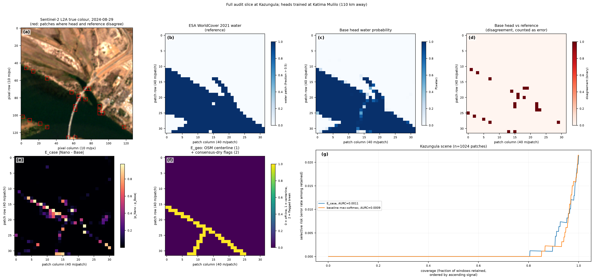
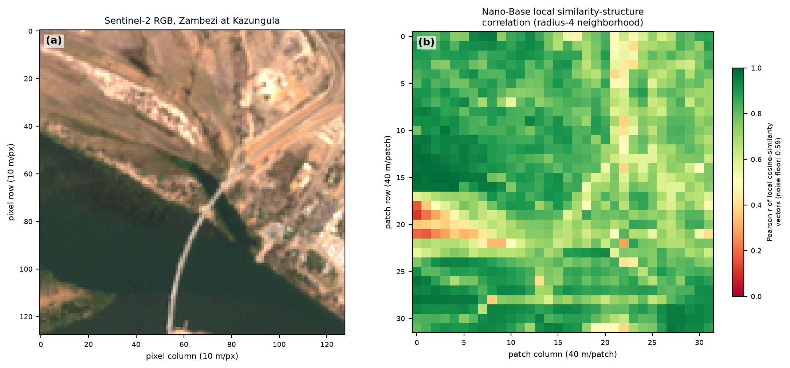
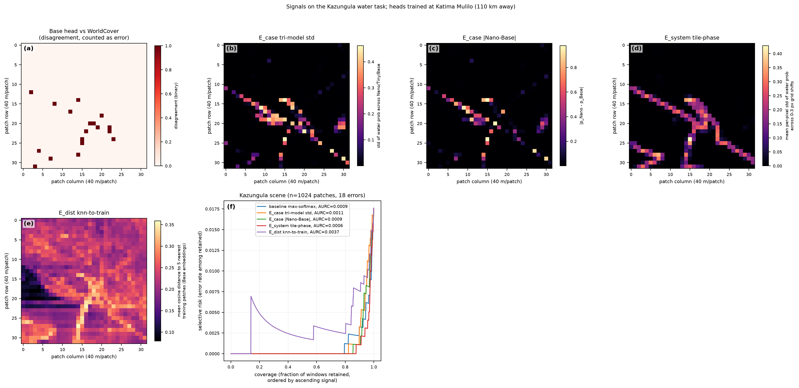

# Per-signal evidence

One section per signal, ordered strongest first. Each gives the definition
as implemented, the evidence, and the verdict. Per-experiment detail is in
[comparisons.md](comparisons.md); scoring rules in
[../method/protocol.md](../method/protocol.md). Index at
[../TECHNIQUES.md](../TECHNIQUES.md). Neighbourhood contradiction (exp39,
exp40) and the periodic-artifact check on the served land-cover-change
rasters (exp22) were archived on 10 October 2026 and are in the
[v1.9.0 copy of this page](https://github.com/2imi9/olmoearth_inferenceX/blob/v1.9.0/docs/results/signals.md).

Notation: "26/27" = better on 26 of the 27 rule-selected scenes.
"163/187" = better on 163 tiles, worse on 187.

---

## Max-softmax confidence — the baseline

**Definition.** Negative absolute logit (top-1 minus top-2 for multiclass),
not `1 - max probability`, so float32 sigmoid saturation does not tie it.

**Against expert labels it wins everywhere tested:** the AWF point task
(exp04, exp16), Sen1Floods11 dense masks with a geographic hold-out (exp18,
lowest pooled E-AURC on both splits), and the fine-tuned AWF model end to
end (exp21, AURC 0.0262).

**Against the WorldCover reference it loses**, best on 0/27 rule-selected
scenes where aligned tile-phase beats it 26/27 (exp13). Why the loss does
not transfer to expert labels is open; three candidate explanations have
been tested and rejected (comparisons.md section 3).

**Verdict: supported.** It is the signal to beat, and nothing has beaten it
on expert-labelled truth.

---

## Perturbation stability (E_system, "tile-phase")

**Definition.** Shift the input window origin by 1-3 pixels (sub-patch
phase), upsample each shifted prediction map to pixels, place it at its true
offset on a common canvas, take the per-pixel standard deviation across
shifts, and pool back to the shift-0 patch grid. Alignment is essential —
see protocol.md.

| Reference | Result |
|---|---|
| WorldCover, 27 scenes (exp13) | Beats confidence **26/27** (p=4e-07), the pixel control 18/27; most frequent best signal |
| Sen1Floods11 hand labels (exp18) | **Does not beat confidence**: Bolivia 163/187 (p=0.22), test 173/305 (p=2e-9, worse) |
| Fine-tuned AWF model (exp21) | **Indistinguishable** from confidence (0.0235 vs 0.0262, CI spans zero); captures more errors at a 20% budget (0.71 vs 0.63) |

**Mechanism (exp14).** A discrete boundary indicator computed from the
shift-0 hard prediction map alone is statistically indistinguishable from
aligned tile-phase across the 27 scenes (boundary better on 12, tile-phase
on 15, p=0.70). **No advantage of the perturbation beyond boundary proximity
is detectable** — which also means the signal is available at zero
additional inference cost.

By construction it is largest where neighbouring patches disagree, so
beating the pixel-edge control is the relevant test, and it does.

**Verdict: mixed.** The strongest constructed signal in the repository, and
the only one that ties confidence on a production model — but it does not
beat confidence on dense hand labels.

---

## Prediction-boundary proximity

**Definition.** Fraction of a patch's 8 neighbours whose hard label differs,
computed from the model's own prediction map. No second inference pass.

**Errors concentrate at boundaries, on both references:** about 75% of error
patches against 20% of correct ones (exp14, exp16, exp18; 75% vs 21% on
Sen1Floods11 Bolivia, 73% vs 18% on test). On the fine-tuned model, boundary
share among errors is 0.63 against 0.34 among correct points (exp21). The
phenomenon replicates label-free on the served product (exp20).

**But it does not order errors better than confidence.** On AWF it loses
(0.0636 vs 0.0363), and exp16 explains why: on a nine-class task the argmax
flips wherever margins are small, so the boundary score is a coarse proxy
for low confidence that the margin already carries at finer resolution
(Spearman 0.60; the margin dominates a logistic model of error, standardized
coefficients 3.53 vs 0.52).

**At a fixed review budget (exp35).** On Sen1Floods11 Bolivia the boundary
indicator captures 0.286 of the errors inside the 5% most suspect windows
against 0.259 for confidence (bootstrap CI [+0.009, +0.046]; by tile
181/147/23, p = 0.068), beating both pixel controls there; by the 20%
budget it is behind (0.667 against 0.749). Secondary, not preregistered.

**Boundary first, then confidence (exp36).** The reviewer's rule that
follows from exp35: order the boundary windows by confidence, then the
interior by confidence, no parameter. Preregistered against confidence at
the 5% and 10% budgets. On Sen1Floods11 Bolivia it captures 0.274 of the
errors at 5% against 0.259 (per tile 85 better, 31 worse, 235 tied,
one-sided p = 2.7e-7; tile-bootstrap CI of the pooled gain [+0.009,
+0.021]) and 0.494 at 10% against 0.465 (112/48/191, p = 2.3e-7; CI
[+0.015, +0.039]); at 20% it is no longer ahead pooled (0.732 against
0.749, CI spanning zero). The ties are the tiles where the least-confident
windows already are boundary windows. On the fine-tuned AWF model (exp21's
344 windows) it captures exactly what confidence captures at 5% on both
crops, because there the 17 least-confident windows are all boundary
windows, and no more at 10 or 20%. On AURC it loses to confidence on
both testbeds (pooled E-AURC 0.0165 against 0.0105 on Bolivia; 0.037
against 0.026 on AWF) and beats it against WorldCover (25/2 scenes, 8/0
rivers), as the boundary indicator does.

**Verdict: supported as a triage cue, not as a ranker.** It says *where*
errors live, and at the tightest budgets the boundary-first order points a
reviewer at 1.5 to 3 points more of the errors than confidence does on hand
labels, and at the same errors on the fine-tuned model. It is also the only label-free cue
available on the served LCC product, which exports no class confidence
(exp20).

---

## Band-set disagreement (internal ensemble)

**Definition.** Heads trained separately on the 10 m, 20 m and 60 m
Sentinel-2 band-set tokens of the same patch; the signal is the standard
deviation of the three water probabilities. One forward pass, one model.

- **WorldCover (exp17):** beats the baseline 21/27 (p=0.006) and the pixel
  control 16/27. Outperforms the two-model E_case (10/27).
- **Hand labels (exp18):** worse than confidence (Bolivia 111/239, p=7e-12;
  test 148/334).

**Why it works better than a second model.** Its errors correlate *more*
with the final head (phi 0.75) than Nano's do (0.61), yet it ranks errors
better. A useful disagreement partner needs a different view of the input,
not decorrelated errors.

**No v1.2 counterpart:** v1.2 tokenizes Sentinel-2 as a single band-set
token per patch (exp19).

**Verdict: mixed.** Real against WorldCover, does not transfer.

---

## Depth-probe disagreement

**Definition.** The water head retrained on each block's tokens; standard
deviation over the last six blocks.

19/27 vs baseline (p=0.052), 13/27 vs control (exp17).

**Verdict: partial.** Marginal, and untested on expert labels.

---

## Embedding dissimilarity (E_dist)

**Definition as implemented.** Mean cosine distance from a window's Base
embedding to its k=5 nearest patches of the head's training window (one
128x128 scene at Katima Mulilo, or the AWF training split in the archived
exp12). **This is distance to the head's training region, not to the
encoder's pretraining distribution** — an AOA-style reference sample over
the pretraining domain has not been built.

- In-domain it does not rank errors (0.00365 vs baseline 0.00089; exp03).
- On the 27 rule-selected scenes: 13/27 vs baseline, sign p=1.00. The
  mean-difference permutation p=0.01 is carried by a few high-error scenes;
  the scale-free sign test shows no advantage (exp13).
- On hand labels it is the worst signal tested (22/329; exp18).
- On AWF: 0.1338 against a 0.0363 baseline (exp12, archived;
  [v1.9.0 copy](https://github.com/2imi9/olmoearth_inferenceX/blob/v1.9.0/docs/results/comparisons.md#awf-expert-label-validation-exp04-exp12)).

**Verdict: not supported as an error ranker.** exp31 separated the
reference set from the density estimator (see "Feature-space typicality"
below) with the same result. Its out-of-distribution-indicator
interpretation remains untested: that needs a shift testbed whose errors
are not spectrally trivial, which does not yet exist.

---

## Geographic grounding (E_geo)

**Definition.** Flag a patch that sits on an OSM `waterway=river` centerline
and that the model predicts dry.

- On a scene where the river is clearly resolved, zero false break alarms
  (52 centerline patches, 0 flagged; exp02).
- Across 27 georeferenced scenes (exp15): flags occur on 17 scenes with
  pooled precision 0.12 over 413 flags, against a base error rate of 0.081
  (1.5x enrichment). **9 scenes carry 1-51 flags at precision exactly
  zero**, where OSM marks a river that both the model and WorldCover call
  dry.
- As a ranker it beats the baseline on 3/27; prepending it to boundary
  proximity gives 5 better, 9 worse, 13 unchanged (p=0.42).

**Verdict: partial.** It mostly detects *disagreement between two reference
maps* on narrow channels, not model error. Its sensitivity cannot be
measured under WorldCover truth; it needs width-filtered GRWL centerlines or
expert labels.

---

## Cross-model disagreement (E_case)

**Definition.** |p_Nano - p_Base| on the same window, or a local
similarity-structure comparison of their embeddings.

**Baseline floor:** mean agreement between Nano and Base on *random* input
is about 0.59, not 0, because the models share patchification and input
normalization. Agreement values must be read against this floor
(`exp/smoke_test.py`).

- Disagreement is spatially structured, concentrating at class boundaries
  and thin structures at both the embedding and prediction levels (exp01,
  exp02).
- WorldCover, 27 scenes: 10/27 vs baseline (p=0.25); intervals favour it on
  3 scenes and against on 9 (exp13).
- Hand labels: 84/265 (p=6e-23) on Bolivia, 141/340 on test (exp18).
- Equal-weight aggregation over three models performs worse than the best
  pairwise signal whenever one member is substantially weaker — three
  independent confirmations (exp03, exp04, exp07).
- **Rater strength does not help** (exp10, archived;
  [v1.9.0 copy](https://github.com/2imi9/olmoearth_inferenceX/blob/v1.9.0/docs/results/comparisons.md#rater-strength-vs-diversity-exp10)):
  v1-Large as Base's partner is worse than Nano (0.0197 vs 0.0129 mean AURC,
  better on 3/7) although Large is more accurate on every scene.

**Verdict: not supported.** Within one family, strong models agree on
errors. The informative property of a partner is a different view of the
input, not accuracy or decorrelation — which is why band-set disagreement
beats it.

**A different backbone, same errors (exp45).** OlmoEarth v1.2 Base changes
the position encoding to rotary and the Sentinel-2 token structure, and it is
a separate pretraining run. On identical Sen1Floods11 windows, through our own
Sentinel-2 pipeline, its probe is wrong on 74.6% (Bolivia) and 71.3% (test
split) of the windows where the v1 probe is wrong, and on 3.1% and 1.3% of the
rest; phi 0.70. That is lower than the 80 to 82% of exp41 and rules out the
possibility that exp41's overlap came from its Sentinel-1 input, while leaving
the shared linear probe and the shared hand labels unaccounted for.

**Two views, two heads (exp41).** The last version of the idea: a probe on
an outside representation of the *same* windows, from Ai2's row-aligned
paper embeddings, so that disagreement is between two encoders rather than
two heads on one. It fails for a reason that closes the family. On
Sen1Floods11 every model, Clay, Galileo, Panopticon and OlmoEarth's own
nano, tiny and large, is wrong on 80 to 82% of the windows where the
OlmoEarth probe is wrong and on 1.6 to 2.1% of the others (phi 0.77 to 0.81);
the partner chosen for the lowest held-out correlation captures 0.242 of
the errors at a 10% budget against 0.454 for confidence, and loses on 1,263
of 1,579 chips. On the AWF points the capture is the same story (0.180
against 0.246), but the error correlation is not: there the outside models
sit at phi 0.32 to 0.48 against OlmoEarth's own family at 0.50 to 0.70, and
exp41's preregistered falsification clause reports the outside partners as
less correlated than the family. The Sen1Floods11 half also lost four of the
seven requested partners, which embed on other token grids, so "every
encoder" means the three that share OlmoEarth's 4-px grid.

**What this does and does not show.** It shows that no frozen encoder read
out by a linear probe on this input escapes these errors, whatever family it
comes from, which is why cross-model disagreement fails as a signal. It does
not show that the errors are a property of the windows. The repository's one
end-to-end fine-tuned model says otherwise: on the 344 AWF points, against
the frozen probe on the same points and labels, fine-tuning corrects 35 of
the probe's 63 errors and the error correlation falls to phi 0.475
(exp/out/exp21_finetuned_awf.csv). Changing the readout moves the error set
about twice as much as changing the frozen encoder. An earlier version of
this section said the errors belong to the windows and not to the model;
that sentence is withdrawn.

---

## Internal-state signals

**Definitions.** Decision settling (the final head applied to every block's
tokens, logit-lens style; std over the last six); representation drift
(cosine change between consecutive late blocks); last-block attention
entropy.

0/27, 3/27 and 3/27 vs baseline on the rule-selected scenes (exp17).

**Verdict: rejected.** INSIDE-style hidden-state probing does not transfer
from language models to this setting.

---

## Masking perturbation

**Definition.** Occlude a random 15% of patch cells with mean-fill, measure
prediction standard deviation over N=32 reruns.

Worst signal on all three scenes tested (0.0027 / 0.0788 / 0.0449 against
tile-phase 0.0008 / 0.0555 / 0.0076; exp08).

**Verdict: rejected**, with a design rule that generalizes: *perturbations
that preserve scene content while changing the tokenization expose model
pathology; perturbations that remove content measure context reliance
instead.*

---

## Dihedral consistency

**Definition.** OlmoEarth v1 was pretrained with flip-and-rotate
augmentation, so predictions on the eight flips and rotations of a window
should agree. Each transformed window is encoded and scored by the same
head, the probability map is mapped back to the window's frame, and the
signal is the standard deviation over the eight maps (exp36, one B200 job,
429 s; the identity transform reproduces the cached probabilities to a
maximum absolute difference of 0.013 on the scenes and 0.007 on Bolivia,
and all eight maps of a window share one forward path).

**Verdict: rejected.** Against confidence it is 17/10 by scene but 4/4 by
river (one-sided p = 0.64), 154/196 by Bolivia tile with a pooled E-AURC of
0.0110 against 0.0105, and below confidence at every review budget (pooled
intervals below zero). It loses to tile-phase 5/22 (0/8 rivers) against
WorldCover. Its Spearman with confidence is 0.67 on the scenes and 0.94 on
Bolivia: a smoothed confidence, not a second view. The preregistered
confidence+dihedral combination is 4/4 rivers; on Bolivia it is 201/148 by
tile with a worse pooled E-AURC (0.0223), a per-tile edge that does not
survive pooling (exp/out/exp36_summary.json).

---

## Decoder self-consistency

**Definition.** The pretraining objective itself, run at inference: hide 25%
of the 4-px patches with all three band-set tokens together (or, in a variant
matching the pretraining masking, 50% of the tokens), decode them, and score
each patch by the cosine distance between the decoded token and the frozen
target projection of the true patch (exp28, one B200 job, 106 s).

**Verdict: rejected** on both testbeds.
On the 27 scenes it loses to confidence 7/20 by scene and 2/6 by river and to
both observed-input controls (S2 patch variance, NDWI level); the
preregistered combination with confidence gains nothing (4/4 rivers,
p = 0.64). On Sen1Floods11 Bolivia its pooled E-AURC is 0.065 against 0.0105
for confidence. The patch-discrimination NLL tracks a target-only crowding
control, so it measures how crowded a target's neighbourhood is rather than
decoding. The cause is the target space: decoded-to-true cosine 0.469
against 0.440 for a shuffled target (medians over the 27 scenes), with the
frozen targets of a scene at pairwise cosine 0.994, the same kind of aliasing
the exp27 oracle gate measured (exp/out/exp28_summary.json; exp27 is
archived, [v1.9.0 copy](https://github.com/2imi9/olmoearth_inferenceX/blob/v1.9.0/exp/out/exp27_oracle_gate.json)).

---

## Last-layer Laplace on the probe head

**Definition.** A Gaussian posterior over the logistic head's weights,
N(theta, (H + lambda I)^-1), from the Hessian of its balanced cross-entropy
at the trained weights, lambda by the marginal likelihood; the score is a
patch's logit variance phi^T Sigma phi (exp30, one B200 job, 192 s). Also
scored: the probit-moderated confidence, predictive entropy and mutual
information under the posterior, and the standard deviation of 16
bootstrap-retrained heads.

**Verdict: rejected** on both testbeds.
On the 27 scenes the variance is the worst signal (median E-AURC 0.071
against 0.0118 for confidence; 3/24 by scene, 0/8 by river) and loses to
the constant score and both observed-input controls; the preregistered
combination with confidence loses 7/20 by scene and 0/8 by river (p = 1.0).
On Sen1Floods11 Bolivia its pooled E-AURC is 0.168 against 0.0105 for
confidence (6/345 tiles), the bootstrap std 0.121, and the moderated
confidence and predictive entropy coincide with confidence (Spearman 1.00).
On the one-scene head the posterior is prior-dominated and the variance is
feature norm (Spearman 0.89), the Bayesian form of E_dist; on the
128k-patch head the weights are well determined and the variance rises with
the size of the logit (Spearman -0.53 with confidence), flagging the patches
the head is surest about (exp/out/exp30_summary.json).

---

## Feature-space typicality

**Definition.** The pooled 768-d feature of a patch scored for atypicality
against a reference set: mean cosine distance to its 5 nearest reference
patches, Mahalanobis distance under a Ledoit-Wolf-shrunk covariance, or
the PCA residual outside the top 192 principal directions; on the head's
training patches also the class-conditional Mahalanobis distance and ViM.
Three references: the head's training patches (R1, where the kNN score is
E_dist), the evaluated scene itself cross-fitted over five folds (R2), and
a cross-testbed pool of about 414k (part A) or 29k (part B) patches (R3)
standing in for a pretraining sample (exp31, one B200 job, 47 s).

**Verdict: rejected** on both testbeds.
On the 27 scenes no score beats confidence: kNN to the training scene is
13/14 (5/3 rivers), the Gaussian scores run from 9/18 (same-scene
Mahalanobis) down to 1/26 (cross-testbed pool), ViM 0/27; the
preregistered combination of confidence with the same-scene kNN score
reaches 14/13 by scene and 6/2 by river (one-sided p = 0.145, below the
7/8 threshold) and loses to tile-phase 2/25. On Sen1Floods11 Bolivia every
score loses to confidence on at least 317 of 351 tiles (best pooled E-AURC
0.0527 against 0.0105) and the combination hurts (0.0326, 60/291). The
kNN scores track the NDWI-gradient control (Spearman up to 0.58) and sit
level with the S2 patch-variance control on Bolivia
(exp/out/exp31_summary.json).

---

## Re-targeted latent-MIM residual

**Definition.** The latent-MIM reading of exp28 with a non-degenerate
target: the frozen encoder's pooled tokens PCA-whitened in their top 64
directions, a small transformer predictor trained label-free to fill 25%
hidden patches from the rest of the unit, and a patch scored by its
whitened residual over eight quarter masks (exp33, one B200 job, 30 s).
Part A cross-fits over river-disjoint folds; part B trains on the 600 valid
tiles.

**Verdict: rejected** on both testbeds, with one constructive fact. The
target swap makes the objective predictable: the predictor explains 57% of
the whitened variance from context on held-out rivers and 70% on Bolivia,
where the shipped decoder's residual was at chance (exp28). But that
residual is input texture, not error: on the 27 scenes it is 13/14 against
confidence by scene and 2/6 by river, loses to tile-phase 4/23, to the
boundary indicator 3/24 and to the S2 patch-variance control 11/16, and
correlates with that control at Spearman 0.56; the preregistered
combination reaches 6/2 rivers (p = 0.145). On Sen1Floods11 Bolivia it
loses to confidence on 339 of 351 tiles (pooled E-AURC 0.066 against
0.0105) and the combination hurts (45/306) (exp/out/exp33_summary.json).

**The other readings (exp34).** A discrete target (k-means, K = 128;
scores: the true-cluster NLL and the predictive entropy), gap masking (3x3
holes, centre scored) and the residual projected onto the head's decision
direction, same folds and tests. All rejected: the preregistered entropy
combination loses 0/8 rivers (p = 1.0) and 60/290 Bolivia tiles; the
entropy is nearly uncorrelated with texture (Spearman 0.05 with S2
variance) and still unrelated to error (5/22, 1/7 rivers; 17/334 tiles);
the gap-masked residual is the one variant at parity with confidence on
WorldCover (13/14, 4/4 rivers) and loses 22/329 on hand labels while
keeping the texture correlation (0.43 and 0.60). With exp28, no reading of
the latent-MIM objective at inference ranks the probe's errors better than
confidence (exp/out/exp34_summary.json).

---

## Label-free reliability estimation (Dawid-Skene)

**Definition.** Dawid-Skene EM over Nano/Tiny/Base votes on AWF, labels
untouched, to estimate each model's accuracy without ground truth.

It **overestimates every model and inverts the ordering**: estimated
0.859 / 0.916 / 0.876 against measured 0.753 / 0.802 / 0.817 (exp07). DS
assumes conditionally independent raters; the family errs together, so
agreement-on-errors is read as competence.

**Verdict: rejected within a single model family.** The
estimate-minus-measured gap (+0.106, +0.114, +0.059) is itself informative:
it directly measures correlated-error mass per model. An out-of-family rater
(Clay or AnySat, both wrapped in
[olmoearth_pretrain/evals](https://github.com/allenai/olmoearth_pretrain/tree/main/olmoearth_pretrain/evals))
was the designed fix; exp83 tested it on 23 September 2026 with six- and
eight-encoder panels from different families and it does not work either: the
estimator infers the panel's plurality, credits an encoder for the errors the
panel shares and debits it for being right alone
([comparisons](comparisons.md#can-raters-from-different-families-estimate-a-maps-accuracy-without-labels-exp83)).
Two notes on the numbers above: they were produced with the EM capped at 50
iterations (the cap the package carried until 23 September 2026; exp83's audit
found the suite's 15- and 19-class panels needing 224 and 261, so the AWF
9-class values may be snapshots too; the votes are not committed, so they
cannot be rerun), and the within-family gap they measure is not what three
probe seeds of one encoder give, which is the unanimous limit (hidden share
0.94–0.995, exp83).

---

## Signals on deployed artifacts

Summarized here; full detail in [comparisons.md](comparisons.md) section 4.

- **Served LCC rasters (exp20).** No class confidence is exported, so the
  baseline cannot run. Boundary fraction is the one available label-free
  cue: it captures a median 0.88 of WorldCover water disagreements at a 5%
  review budget. Change-probability ambiguity concentrates on flagged-region
  edges (2.7% of edge windows against 0.07% interior).
- **Fine-tuned AWF model (exp21).** Confidence remains the best supported
  ranker; tiling instability is indistinguishable from it; boundary, probe
  disagreement and the control are significantly worse. The model is
  overconfident (ECE 0.080), so a stated accuracy needs a coverage: 0.945 at
  80%, 0.919 at 90%.

